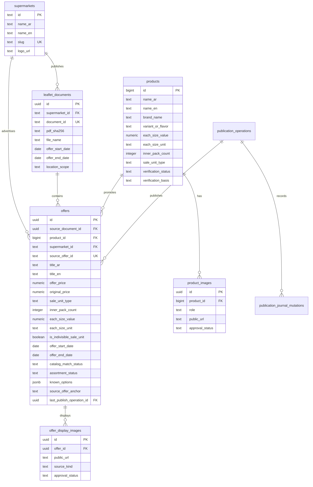

# WIFRAN — DATABASE ARCHITECTURE CONSOLIDATION AUDIT
## Comprehensive Production Schema Review, Application Dependency Analysis & Canonical Database Redesign Proposal

> **Author:** Senior PostgreSQL Database Architect & Systems Modeler  
> **Date:** 2026-11-18  
> **Execution Authority:** 100% READ-ONLY Audit (Zero DDL/DML mutations executed, zero storage writes, zero paid Gemini API calls)  
> **Target Environments:**  
> - **PRODUCTION:** Supabase Project `swratbmclahjyekouned`  
> - **DEVELOPMENT / TEST:** Supabase Project `gykrbpykjhpyrdrinkuk`  
> - **Target Applications:** `Wifran Offers Extractor` (Electron/TypeScript) & `Wifran Consumer App` (Next.js 15)  

---

## Table of Contents
1. [Executive Assessment](#1-executive-assessment)
2. [Verified Database Inventory](#2-verified-database-inventory)
3. [Complete Column-by-Column Audit of `public.offers`](#3-complete-column-by-column-audit-of-publicoffers)
4. [All-Tables Assessment](#4-all-tables-assessment)
5. [Redundancy and Contradiction Register](#5-redundancy-and-contradiction-register)
6. [Application Dependency Matrix](#6-application-dependency-matrix)
7. [Production Data Quality Findings](#7-production-data-quality-findings)
8. [Proposed Canonical Schema](#8-proposed-canonical-schema)
9. [Conservative vs Refactored Comparison](#9-conservative-vs-refactored-comparison)
10. [Proposed Migration Roadmap](#10-proposed-migration-roadmap)
11. [Risks and Non-Negotiable Invariants](#11-risks-and-non-negotiable-invariants)
12. [Prioritized Recommendations](#12-prioritized-recommendations)
13. [Implementation Effort and Risk](#13-implementation-effort-and-risk)
14. [Open Questions and Unverified Assumptions](#14-open-questions-and-unverified-assumptions)

---

## 1. Executive Assessment

### 1.1 Is the Current Design Fundamentally Sound?
**Yes, the core relational concepts are fundamentally sound.**
The architecture correctly distinguishes between **Retailers** (`supermarkets`), **Master Catalog Products** (`products`), **Promotional Offers** (`offers`), and **Consumer Projections** (`v_consumer_offers`). The underlying principles established in earlier milestones—specifically deterministic source-offer hashing (`source_offer_id`), spatial bounding-box anchors (`source_offer_anchor`), and transactional publication journaling (`publication_operations`, `publication_journal_mutations`)—provide enterprise-grade idempotency, crash recovery, and undo capabilities.

### 1.2 What Has Become Overcomplicated?
Over 11 successive migration cycles (Migrations 001 through 011), substantial complexity debt has accumulated:
1. **Hyper-Inflated Offers Entity:** `public.offers` has bloated to **104 columns**. Meticulous analysis of live production data reveals that over 50 columns are 100% NULL across all published offers, while another 14 columns store static, invariable defaults.
2. **Redundant Parallel Concepts:** Promotional mechanics, customer purchase limits, loyalty conditions, and pack semantics are duplicated across flat scalar columns, JSONB attributes, and separate status flags.
3. **Over-Engineered Supporting Subsystems:** Highly complex subsystems designed for multi-signature product alias proposals (`product_alias_proposals`, `product_alias_audit_log`, `approve_product_alias_atomic`), legacy CSV imports (`import_batches`, `import_rows`, `validation_errors`), and visual clustering (`offer_visual_group_members`) hold **exactly 0 rows** in production. They contribute cognitive overhead and schema fragility without delivering operational value.

### 1.3 What Is Genuinely Obsolete?
1. **Pre-Hybrid CSV Ingestion Tables:** `import_batches`, `import_rows`, and `validation_errors` were built for early manual CSV imports before the Electron Hybrid V3 pipeline was developed. They are completely bypassed by modern batch publication.
2. **Legacy Flat Image Columns:** `offers.image_url`, `offers.image_path`, `offers.image_bucket`, and `offers.image_source_type` are 100% NULL in production. Consumer applications read exclusively from dedicated image tables (`product_images` and `offer_display_images`) via `v_consumer_offers`.
3. **Unused AI Ratings and Visual Metrics:** Columns such as `offers.deal_score`, `offers.deal_label`, `offers.data_quality_score`, and `offers.page_area_share_pct` are 100% NULL and not part of the active extraction pipeline.
4. **Legacy Size Columns:** `offers.pack_size_value` and `offers.pack_size_unit` are 100% NULL, completely superseded by `each_size_value` and `each_size_unit`.

### 1.4 What Presents the Greatest Data-Integrity Risk?
1. **Dangerous Schema Default in `public.products`:** In the database DDL, `products.verification_status` defaults to `'verified'::text` and `verification_basis` defaults to `'operator_verified_pack_identity'::text`. If any service, script, or migration inserts a product without explicitly overriding these columns, unverified provisional products automatically inherit verified manufacturer status. This is a severe schema hazard.
2. **Multi-Tier Size Collisions:** In the first production publication, four 10kg rice offers were linked to 5kg catalog product records (#19, #20, #21, #36) because catalog matching lacked strict size-tier disambiguation before product record creation.
3. **Consumer View Image Visibility Precedence:** In Migration 011 (live in Production), `v_consumer_offers` evaluates `COALESCE(pi.public_url, odi.public_url)`. It completely ignores `offers.thumbnail_url`. Consequently, non-catalog assortments like `Sadia Chicken` (`p001_009`) have valid thumbnail URLs in `offers` but render with `image_url = NULL` in the consumer application.

### 1.5 What Should Be Preserved?
1. **Deterministic Deduplication:** The UNIQUE constraint on `offers.source_offer_id` and spatial anchor matching (`source_offer_anchor`).
2. **Publication Journal & Idempotency:** The journal tables (`publication_operations`, `publication_journal_mutations`, `publication_storage_operations`, `publication_duplicate_skips`) which provide rock-solid Undo, recovery, and idempotent retries.
3. **The 98-Column Consumer View Contract:** `v_consumer_offers` must remain stable as a backward-compatible projection for Next.js consumer DTOs.
4. **Distinct Catalog Images vs Display Images:** The separation between reusable product imagery (`product_images`) and promotional leaflet visuals (`offer_display_images`).

### 1.6 Architectural Verdict
**Definitive Verdict: Proceed with Option A (Conservative Consolidation).**  
The database does not require a disruptive, high-risk greenfield redesign. Instead, it requires a disciplined consolidation: fixing the dangerous product verification default, removing dead legacy columns from `offers`, computing derived values in `v_consumer_offers`, wiring leaflet documents properly, and phasing out dormant tables.

---

## 2. Verified Database Inventory

### 2.1 Verification of Schema Visualizer Export
The live PostgreSQL system catalogs in PRODUCTION (`swratbmclahjyekouned`) confirm the numbers cited in the initial audit brief:
- **Total Public Tables:** **35 BASE TABLEs**
- **Total Public Views:** **1 VIEW** (`public.v_consumer_offers`)
- **Total Columns across Base Tables:** **493 columns**
- **Total Columns in `public.offers`:** **104 columns**
- **Total Columns in `public.v_consumer_offers`:** **98 columns**

The Schema Visualizer export accurately reflected the table and column counts, but omitted critical PostgreSQL system objects: functions, triggers, sequences, extensions, and storage bucket access policies.

### 2.2 Complete Public Schema Table Inventory

| Table Name | Type | Row Count | Total Size | Table Size | Index Size | Columns | Primary Key | RLS Status | Policies |
|---|---|---|---|---|---|---|---|---|---|
| `_applied_migrations` | BASE TABLE | 11 | 32 kB | 8192 B | 16384 B | 2 | `id` | ENABLED | 0 |
| `app_events` | BASE TABLE | 0 | 16 kB | 0 B | 8192 B | 9 | `id` | ENABLED | 2 |
| `audit_logs` | BASE TABLE | 0 | 16 kB | 0 B | 8192 B | 7 | `id` | ENABLED | 1 |
| `brands` | BASE TABLE | 0 | 56 kB | 0 B | 49152 B | 7 | `id` | ENABLED | 2 |
| `categories` | BASE TABLE | 13 | 88 kB | 16384 B | 32768 B | 14 | `id` | ENABLED | 2 |
| `cities` | BASE TABLE | 25 | 128 kB | 24576 B | 65536 B | 11 | `id` | ENABLED | 2 |
| `import_batches` | BASE TABLE | 0 | 24 kB | 0 B | 16384 B | 22 | `id` | ENABLED | 1 |
| `import_rows` | BASE TABLE | 0 | 24 kB | 0 B | 16384 B | 9 | `id` | ENABLED | 1 |
| `issue_reports` | BASE TABLE | 0 | 32 kB | 0 B | 24576 B | 12 | `id` | ENABLED | 3 |
| `legacy_id_crosswalk` | BASE TABLE | 38 | 48 kB | 8192 B | 32768 B | 7 | `id` | ENABLED | 0 |
| `offer_display_images` | BASE TABLE | 0 | 136 kB | 24576 B | 81920 B | 18 | `id` | ENABLED | 2 |
| `offer_revision_snapshots` | BASE TABLE | 0 | 40 kB | 0 B | 32768 B | 8 | `id` | ENABLED | 1 |
| `offer_sources` | BASE TABLE | 0 | 24 kB | 0 B | 16384 B | 16 | `id` | ENABLED | 2 |
| `offer_status_history` | BASE TABLE | 0 | 16 kB | 0 B | 8192 B | 7 | `id` | ENABLED | 2 |
| `offer_visual_group_members` | BASE TABLE | 0 | 40 kB | 0 B | 32768 B | 5 | `representative_offer_id, member_offer_id` | ENABLED | 2 |
| `offers` | BASE TABLE | 30 | 920 kB | 32768 B | 851968 B | 104 | `id` | ENABLED | 2 |
| `product_alias_audit_log` | BASE TABLE | 0 | 24 kB | 0 B | 16384 B | 11 | `id` | ENABLED | 2 |
| `product_alias_proposals` | BASE TABLE | 0 | 40 kB | 0 B | 32768 B | 18 | `id` | ENABLED | 3 |
| `product_aliases` | BASE TABLE | 0 | 40 kB | 0 B | 32768 B | 6 | `id` | ENABLED | 2 |
| `product_images` | BASE TABLE | 18 | 136 kB | 24576 B | 81920 B | 17 | `id` | ENABLED | 2 |
| `products` | BASE TABLE | 25 | 320 kB | 16384 B | 278528 B | 30 | `id` | ENABLED | 2 |
| `profiles` | BASE TABLE | 0 | 16 kB | 0 B | 8192 B | 9 | `id` | ENABLED | 3 |
| `publication_duplicate_skips` | BASE TABLE | 1 | 48 kB | 8192 B | 32768 B | 9 | `id` | ENABLED | 0 |
| `publication_journal_mutations` | BASE TABLE | 92 | 304 kB | 106496 B | 65536 B | 14 | `id` | ENABLED | 0 |
| `publication_operations` | BASE TABLE | 1 | 80 kB | 8192 B | 65536 B | 32 | `publish_operation_id` | ENABLED | 0 |
| `publication_storage_operations` | BASE TABLE | 64 | 120 kB | 24576 B | 65536 B | 12 | `id` | ENABLED | 0 |
| `regions` | BASE TABLE | 5 | 64 kB | 8192 B | 49152 B | 8 | `id` | ENABLED | 2 |
| `saved_offers` | BASE TABLE | 0 | 24 kB | 0 B | 24576 B | 4 | `id` | ENABLED | 2 |
| `shopping_list_items` | BASE TABLE | 0 | 32 kB | 0 B | 24576 B | 9 | `id` | ENABLED | 1 |
| `shopping_lists` | BASE TABLE | 0 | 32 kB | 0 B | 24576 B | 7 | `id` | ENABLED | 2 |
| `supermarket_regions` | BASE TABLE | 12 | 48 kB | 8192 B | 32768 B | 6 | `id` | ENABLED | 2 |
| `supermarkets` | BASE TABLE | 14 | 112 kB | 24576 B | 49152 B | 12 | `id` | ENABLED | 2 |
| `units` | BASE TABLE | 9 | 80 kB | 8192 B | 32768 B | 10 | `id` | ENABLED | 2 |
| `v_consumer_offers` | VIEW | 30 rows projected | 0 B | 0 B | 0 B | 98 | `id` (virtual) | VIEW | 0 |
| `validation_errors` | BASE TABLE | 0 | 24 kB | 0 B | 16384 B | 9 | `id` | ENABLED | 1 |
| `watched_items` | BASE TABLE | 0 | 24 kB | 0 B | 16384 B | 12 | `id` | ENABLED | 2 |

### 2.3 Applied Migration History Comparison (PROD vs DEV)

| Migration File | Production Status | Development Status | Description |
|---|---|---|---|
| `001_initial_schema.sql` | APPLIED (2026-11-16) | APPLIED | Core schema definition (supermarkets, offers, products, taxonomy, users) |
| `001_seed_core_catalog.sql` | APPLIED (2026-11-16) | APPLIED | Reference seed data for categories, regions, cities, units |
| `003_offer_location_scope.sql` | APPLIED (2026-11-16) | APPLIED | Adds geographic location scope (national, regional, city) |
| `004_offer_image_ingestion_metadata.sql` | APPLIED (2026-11-16) | APPLIED | Adds image metadata columns to `offers` |
| `005_wifran_v2_offer_contract.sql` | APPLIED (2026-11-16) | APPLIED | Introduces `v_consumer_offers` view and contract v2 function |
| `006_wifran_07a_security_and_contract_reconciliation.sql` | APPLIED (2026-11-16) | APPLIED | Hardens RLS, adds offer snapshots and visual group members |
| `007_wifran_07g_07h_catalog_resolution_and_product_images.sql` | APPLIED (2026-11-16) | APPLIED | Adds `product_images` table and catalog matching columns |
| `008_wifran_07j_consumer_view_disputed_identity_masking.sql` | APPLIED (2026-11-16) | APPLIED | Masks unresolved product identities in consumer view |
| `009_wifran_07j_product_alias_staging_and_audit.sql` | APPLIED (2026-11-16) | APPLIED | Adds product alias proposals, audit log, and approval RPC |
| `010_wifran_08_publication_journal_and_uniqueness.sql` | APPLIED (2026-11-16) | APPLIED | Adds publication journal tables and idempotent tracking |
| `011_wifran_mvp_candidate_consumer_visibility.sql` | **APPLIED (2026-11-16)** | **NOT APPLIED** | Enables candidate product visibility in `v_consumer_offers` |
| `012_wifran_offer_display_image_precedence.sql` | **NOT DEPLOYED** | **NOT DEPLOYED** | Switches view image precedence to offer-level images first |

> [!IMPORTANT]
> **Schema Drift Finding:** Migration 011 is deployed in PRODUCTION but has **NOT** been applied to DEVELOPMENT / TEST (`gykrbpykjhpyrdrinkuk`). Consequently, `v_consumer_offers` in DEV still masks candidate products. Migration 012 is tested offline but deployed in **neither** environment.

### 2.4 Supabase Storage Buckets Inventory

| Bucket Name | Public Access | Allowed MIME Types | File Size Limit | Business Purpose |
|---|---|---|---|---|
| `offer-images` | **PRIVATE (`public = false`)** | All | Unlimited | Private raw leaflet evidence crops (`offer_card`, `product_thumb`) |
| `product-images` | **PUBLIC (`public = true`)** | All | Unlimited | Canonical consumer-facing catalog product images |
| `offer-display-images` | **PUBLIC (`public = true`)** | All | Unlimited | Approved consumer-facing promotional display visuals (assortments) |
| `tmp` | **PRIVATE (`public = false`)** | All | Unlimited | Temporary scratch uploads |

### 2.5 PostgreSQL Extensions and Custom Database Functions
- **Installed Extensions:** `pg_trgm` (trigram fuzzy matching), `uuid-ossp` / `pgcrypto` (`gen_random_uuid()`).
- **Core RPC Functions:**
  1. `check_wifran_schema_readiness()`: Validates schema migration readiness before publication.
  2. `build_sanitized_consumer_contract_v2()`: Strips private crop paths and constructs JSONB consumer contracts.
  3. `capture_indirect_publication_mutation()`: Trigger function that automatically records journal entries.
  4. `approve_product_alias_atomic()`: Security definer RPC for approving barcode/title alias proposals.
  5. `get_consumer_offers_for_shopping_date()`: Stored procedure returning date-filtered consumer offers.

---

## 3. Complete Column-by-Column Audit of `public.offers`

This audit inspects **all 104 columns** of `public.offers` in the live PRODUCTION database. Every column is evaluated against actual data distributions across the 30 published production offers, Extractor write/read paths, consumer view dependencies (`v_consumer_offers`), and future architecture needs.

### 3.1 Classification Criteria
- **KEEP:** Canonical, non-redundant commercial or provenance fact required on the offer record.
- **DERIVE:** Value that can and should be computed deterministically in `v_consumer_offers` or a generated column, eliminating synchronization hazards.
- **MOVE:** Fact that intrinsically belongs to another entity (e.g. `products`, `offer_sources`, `offer_display_images`, or `publication_journal_mutations`).
- **DEPRECATE:** Obsolete, unpopulated, or out-of-scope legacy field that should be scheduled for retirement.
- **INVESTIGATE:** Field requiring policy confirmation or structural rehabilitation before final disposition.

### 3.2 Summary Classification Breakdown

| Classification | Column Count | Percentage | Architectural Impact |
|---|---|---|---|
| **KEEP** | **33** | 31.7% | Retained as the lean, canonical core of `public.offers` |
| **DERIVE** | **19** | 18.3% | Computed on-the-fly in `v_consumer_offers` or generated columns |
| **MOVE** | **16** | 15.4% | Relocated to proper parent entities (`products`, `offer_sources`, `images`) |
| **DEPRECATE** | **35** | 33.7% | Safely removed from writes; scheduled for migration cleanup |
| **INVESTIGATE** | **1** | 1.0% | `source_id` unpopulated foreign key to `offer_sources` |
| **TOTAL** | **104** | **100.0%** | **~68% reduction in stored table width (104 -> 33 columns)** |

### 3.3 Complete 104-Column Audit Table

| # | Column Name | Type | Nullable | Default | Null % | Populated? | Extractor Writes? | Extractor Reads? | Consumer Reads? | Action | Future Location | Justification & Authoritative Source |
|---|---|---|---|---|---|---|---|---|---|---|---|---|
| 1 | `id` | `uuid` | NO | `gen_random_uuid()` | 0% | YES | NO | YES | YES (VCO) | **KEEP** | `offers` | Immutable primary key of the offer entity. |
| 2 | `product_id` | `bigint` | YES | NULL | 3.33% | YES | YES | YES | YES (VCO) | **KEEP** | `offers` | Core foreign key linking offer to canonical or candidate catalog product. Nullable for unlinked assortments/commodities. |
| 3 | `supermarket_id` | `text` | NO | NULL | 0% | YES | YES | YES | YES (VCO) | **KEEP** | `offers` | Mandatory foreign key identifying the retailer publishing the offer. |
| 4 | `city_id` | `text` | YES | NULL | 100% | NO (100% NULL) | YES | NO | YES (VCO) | **KEEP** | `offers` | Required for city-scoped offers. 100% null in Al Nokhbah UAT because leaflet was national scope. |
| 5 | `region_id` | `text` | YES | NULL | 100% | NO (100% NULL) | YES | NO | YES (VCO) | **KEEP** | `offers` | Required for region-scoped offers. 100% null in national-scope UAT. |
| 6 | `category_id` | `uuid` | YES | NULL | 100% | NO (100% NULL) | NO | NO | YES (VCO) | **MOVE** | `products (or derived from products.category_id)` | Category is an intrinsic attribute of the product, not the promotional offer. Currently 100% null in offers. |
| 7 | `brand_id` | `uuid` | YES | NULL | 100% | NO (100% NULL) | NO | NO | YES (VCO) | **MOVE** | `products (or derived from products.brand_id)` | Brand identity belongs on the product catalog entity. 100% null in offers table. |
| 8 | `title_ar` | `text` | YES | NULL | 0% | YES | YES | NO | YES (VCO) | **KEEP** | `offers` | Retailer-printed promotional headline in Arabic. Authoritative verbatim source text. |
| 9 | `title_en` | `text` | YES | NULL | 0% | YES | YES | NO | YES (VCO) | **KEEP** | `offers` | Retailer-printed or translated promotional headline in English. |
| 10 | `offer_price` | `numeric` | NO | NULL | 0% | YES | YES | YES | YES (VCO) | **KEEP** | `offers` | The promotional selling price in SAR. Mandatory core commercial fact. |
| 11 | `original_price` | `numeric` | YES | NULL | 100% | NO (100% NULL) | YES | NO | YES (VCO) | **KEEP** | `offers` | Retailer-printed reference crossed-out price. Legitimate null when no crossed-out price is advertised. |
| 12 | `discount_amount` | `numeric` | YES | NULL | 100% | NO (100% NULL) | NO | NO | YES (VCO) | **DERIVE** | `v_consumer_offers (calculated)` | Trivially calculated as (original_price - offer_price). Storing it risks arithmetic divergence. |
| 13 | `discount_percentage` | `numeric` | YES | NULL | 100% | NO (100% NULL) | NO | NO | YES (VCO) | **DERIVE** | `v_consumer_offers (calculated)` | Trivially calculated as ROUND(((original_price - offer_price) / original_price) * 100, 2). Storing it is redundant. |
| 14 | `pack_size_value` | `numeric` | YES | NULL | 100% | NO (100% NULL) | NO | NO | NO | **DEPRECATE** | `offers` | Obsolete legacy 001 column. 100% null in production. Fully superseded by each_size_value. |
| 15 | `pack_size_unit` | `text` | YES | NULL | 100% | NO (100% NULL) | NO | NO | NO | **DEPRECATE** | `offers` | Obsolete legacy 001 column. 100% null in production. Fully superseded by each_size_unit. |
| 16 | `pack_quantity` | `numeric` | YES | `1` | 0% | YES | NO | NO | NO | **DEPRECATE** | `offers` | Obsolete legacy column. 100% defaulted to 1. Superseded by inner_pack_count and sale_unit_type. |
| 17 | `unit_price` | `numeric` | YES | NULL | 6.67% | YES | YES | NO | YES (VCO) | **DERIVE** | `v_consumer_offers (or generated col)` | Calculated as offer_price / total_content_value (in normalized base units). Should be computed or stored as generated column. |
| 18 | `unit_price_unit` | `text` | YES | NULL | 6.67% | YES | YES | NO | YES (VCO) | **DERIVE** | `v_consumer_offers (or generated col)` | Derived base unit (e.g. kg, L). Redundant with total_content_unit normalization. |
| 19 | `offer_start_date` | `date` | YES | NULL | 0% | YES | YES | YES | YES (VCO) | **KEEP** | `offers` | Valid from date for the promotional pricing window. |
| 20 | `offer_end_date` | `date` | NO | NULL | 0% | YES | YES | YES | YES (VCO) | **KEEP** | `offers` | Valid to date for the promotional pricing window. |
| 21 | `status` | `text` | NO | `'draft'::text` | 0% | YES | YES | YES | YES (VCO) | **KEEP** | `offers` | Core lifecycle state of the record (draft, needs_review, published, archived). |
| 22 | `image_url` | `text` | YES | NULL | 100% | NO (100% NULL) | YES | YES | YES (VCO) | **DEPRECATE** | `offers` | Legacy flat image column. 100% null in production. Consumer view ignores this column in favor of product_images / offer_display_images. |
| 23 | `image_path` | `text` | YES | NULL | 100% | NO (100% NULL) | NO | NO | NO | **DEPRECATE** | `offers` | Legacy storage path. 100% null in production. Superseded by product_images and publication_storage_operations. |
| 24 | `image_bucket` | `text` | YES | `'offer-images'::text` | 0% | YES | NO | NO | NO | **DEPRECATE** | `offers` | Legacy bucket reference. 100% defaulted to offer-images. Storage routing is now handled by dedicated image tables. |
| 25 | `image_source_type` | `text` | YES | NULL | 100% | NO (100% NULL) | NO | NO | NO | **DEPRECATE** | `offers` | 100% null legacy column. Superseded by source_kind in product_images / offer_display_images. |
| 26 | `source_id` | `uuid` | YES | NULL | 100% | NO (100% NULL) | NO | NO | NO | **INVESTIGATE** | `offer_sources / document entity` | Unpopulated foreign key to public.offer_sources (100% null). Either wire to a clean leaflet document entity or retire. |
| 27 | `source_page_number` | `integer` | YES | NULL | 0% | YES | YES | YES | NO | **KEEP** | `offers` | Leaflet page number where the offer appeared. Essential for operator audit and visual verification. |
| 28 | `source_item_number` | `text` | YES | NULL | 0% | YES | YES | YES | NO | **KEEP** | `offers` | Page-level item identifier (e.g. leaflet-001_p001_001). Useful human-readable reference. |
| 29 | `source_reference` | `text` | YES | NULL | 0% | YES | YES | NO | NO | **MOVE** | `offer_sources (leaflet entity)` | Leaflet code (e.g. leaflet-001). Document-level attribute stamped redundantly on every row. |
| 30 | `external_image_id` | `text` | YES | NULL | 100% | NO (100% NULL) | NO | NO | NO | **DEPRECATE** | `offers` | 100% null legacy field. Redundant with source_offer_anchor / storage object naming. |
| 31 | `ingestion_source` | `text` | YES | NULL | 100% | NO (100% NULL) | NO | NO | NO | **DEPRECATE** | `offers` | 100% null legacy ingestion tag. Extractor provenance is tracked via last_publish_operation_id. |
| 32 | `location_scope` | `text` | NO | `'national'::text` | 0% | YES | YES | NO | YES (VCO) | **KEEP** | `offers` | Geographic validity level: national, region, city. Essential for consumer filtering. |
| 33 | `deal_score` | `numeric` | YES | NULL | 100% | NO (100% NULL) | NO | NO | YES (VCO) | **DEPRECATE** | `offers` | 100% null in production. Theoretical AI deal rating not part of MVP extraction. |
| 34 | `deal_label` | `text` | YES | NULL | 100% | NO (100% NULL) | NO | NO | YES (VCO) | **DEPRECATE** | `offers` | 100% null in production. Not extracted or populated. |
| 35 | `data_quality_score` | `numeric` | YES | NULL | 100% | NO (100% NULL) | NO | NO | NO | **DEPRECATE** | `offers` | 100% null in production. Internal validation score not needed in permanent production table. |
| 36 | `is_loyalty_required` | `boolean` | NO | `false` | 0% | YES | YES | NO | YES (VCO) | **DERIVE** | `v_consumer_offers (projected from promo_terms JSONB)` | 100% false in production. Default contradicts loyalty_requirement=unknown. Should be consolidated into promo_terms. |
| 37 | `loyalty_notes_ar` | `text` | YES | NULL | 100% | NO (100% NULL) | NO | NO | NO | **DEPRECATE** | `offers` | 100% null in production. Not part of MVP extraction contract. |
| 38 | `loyalty_notes_en` | `text` | YES | NULL | 100% | NO (100% NULL) | NO | NO | NO | **DEPRECATE** | `offers` | 100% null in production. Not part of MVP extraction contract. |
| 39 | `quantity_limit` | `text` | YES | NULL | 100% | NO (100% NULL) | YES | NO | YES (VCO) | **DEPRECATE** | `offers` | 100% null in production. Free text limit string. |
| 40 | `notes_ar` | `text` | YES | NULL | 100% | NO (100% NULL) | NO | NO | NO | **DEPRECATE** | `offers` | 100% null in production. Unused internal note field. |
| 41 | `notes_en` | `text` | YES | NULL | 100% | NO (100% NULL) | NO | NO | NO | **DEPRECATE** | `offers` | 100% null in production. Unused internal note field. |
| 42 | `created_by` | `uuid` | YES | NULL | 100% | NO (100% NULL) | NO | NO | NO | **MOVE** | `publication_operations.operator_id` | 100% null on offers. Operator identity is properly recorded on publication_operations. |
| 43 | `updated_by` | `uuid` | YES | NULL | 100% | NO (100% NULL) | NO | NO | NO | **MOVE** | `publication_operations.operator_id` | 100% null on offers. Mutations are tracked in publication_journal_mutations. |
| 44 | `approved_by` | `uuid` | YES | NULL | 100% | NO (100% NULL) | NO | NO | NO | **MOVE** | `publication_operations.operator_id` | 100% null on offers. Approval captured in publication_operations. |
| 45 | `published_at` | `timestamp with time zone` | YES | NULL | 0% | YES | YES | NO | YES (VCO) | **KEEP** | `offers` | Timestamp when offer was published to the consumer catalog. |
| 46 | `created_at` | `timestamp with time zone` | NO | `now()` | 0% | YES | NO | NO | YES (VCO) | **KEEP** | `offers` | Standard audit creation timestamp. |
| 47 | `updated_at` | `timestamp with time zone` | NO | `now()` | 0% | YES | NO | NO | YES (VCO) | **KEEP** | `offers` | Standard audit update timestamp. |
| 48 | `source_offer_id` | `text` | YES | NULL | 0% | YES | YES | YES | YES (VCO) | **KEEP** | `offers` | Canonical unique deterministic source-offer identifier. Enforced by UNIQUE index. |
| 49 | `source_revision` | `integer` | NO | `1` | 0% | YES | NO | NO | YES (VCO) | **KEEP** | `offers` | Revision counter for published offer corrections (defaults to 1). |
| 50 | `semantic_checksum` | `text` | YES | NULL | 100% | NO (100% NULL) | NO | NO | YES (VCO) | **DEPRECATE** | `offers` | 100% null in production. Redundant with publication_operations.payload_fingerprint. |
| 51 | `contract_version` | `text` | YES | NULL | 100% | NO (100% NULL) | NO | NO | YES (VCO) | **DEPRECATE** | `offers` | 100% null in production. Contract version is standardized at the API/view layer. |
| 52 | `compound_group_id` | `text` | YES | NULL | 100% | NO (100% NULL) | NO | NO | YES (VCO) | **DEPRECATE** | `offers` | 100% null in production. Unimplemented compound offer clustering concept. |
| 53 | `supersedes_source_offer_id` | `text` | YES | NULL | 100% | NO (100% NULL) | NO | NO | YES (VCO) | **MOVE** | `publication_journal_mutations / correction log` | 100% null in production. Revision supersession is tracked in publication journal. |
| 54 | `exact_identity_status` | `text` | NO | `'unresolved'::text` | 0% | YES | YES | NO | YES (VCO) | **DERIVE** | `v_consumer_offers (derived from catalog_match_status)` | 100% defaulted to unresolved. Directly duplicates catalog_match_status (verified_linked -> verified_sku, candidate_pending_review/unresolved -> unresolved). |
| 55 | `category_slug` | `text` | YES | NULL | 100% | NO (100% NULL) | NO | NO | YES (VCO) | **DERIVE** | `v_consumer_offers (joined from categories.slug)` | 100% null in production offers. Denormalized copy of categories.slug. The view already does COALESCE(o.category_slug, cat.slug). |
| 56 | `derived_subcategory_slug` | `text` | YES | NULL | 100% | NO (100% NULL) | NO | NO | YES (VCO) | **DEPRECATE** | `offers` | 100% null in production. Unimplemented subcategory taxonomy. |
| 57 | `commodity_tag` | `text` | YES | NULL | 100% | NO (100% NULL) | NO | NO | YES (VCO) | **DEPRECATE** | `offers` | 100% null in production. Unused classification tag. |
| 58 | `item_domain` | `text` | NO | `'grocery'::text` | 0% | YES | YES | NO | YES (VCO) | **KEEP** | `offers` | Product domain (e.g. grocery, fresh_produce, household). Used in consumer search & filtering. |
| 59 | `brand_state` | `text` | NO | `'unknown'::text` | 0% | YES | NO | NO | YES (VCO) | **DERIVE** | `v_consumer_offers (derived from brand_id / products.brand_name)` | 100% defaulted to unknown. Directly derivable: IF brand_id IS NOT NULL OR products.brand_name IS NOT NULL THEN supported ELSE unknown. |
| 60 | `brand_candidate_text` | `text` | YES | NULL | 100% | NO (100% NULL) | NO | NO | YES (VCO) | **DERIVE** | `v_consumer_offers (from products.brand_name)` | 100% null in production offers. The view already falls back to p.brand_name. |
| 61 | `normalized_title_ar` | `text` | YES | NULL | 100% | NO (100% NULL) | NO | NO | YES (VCO) | **DERIVE** | `Generated column or view calculation` | 100% null in production offers. Can be computed deterministically via Arabic text normalization function. |
| 62 | `normalized_title_en` | `text` | YES | NULL | 100% | NO (100% NULL) | NO | NO | YES (VCO) | **DERIVE** | `Generated column or view calculation` | 100% null in production offers. Can be computed deterministically via LOWER(TRIM(title_en)). |
| 63 | `product_attributes` | `jsonb` | NO | `'{}'::jsonb` | 0% | YES | NO | NO | YES (VCO) | **DEPRECATE** | `offers` | 100% empty JSONB `{}` across all 30 production rows. Unused in active production. |
| 64 | `assortment_status` | `text` | NO | `'unknown_composition` | 0% | YES | YES | YES | YES (VCO) | **KEEP** | `offers` | Distinguishes single_product, multiple_variants (assorted), and unknown_composition. Crucial for consumer display & pricing. |
| 65 | `known_options` | `jsonb` | NO | `'[]'::jsonb` | 0% | YES | NO | NO | YES (VCO) | **KEEP** | `offers` | JSONB array of variant names (e.g. flavours, scents). Populated when assortment has listed options. |
| 66 | `sale_unit_type` | `text` | NO | `'pack'::text` | 0% | YES | YES | YES | YES (VCO) | **KEEP** | `offers` | Retailer sale unit (e.g. piece, pack, kg, bag, box). Core commercial fact. |
| 67 | `inner_pack_count` | `integer` | YES | NULL | 0% | YES | YES | YES | YES (VCO) | **KEEP** | `offers` | Count of items in multipack (e.g. 10 for 10x1100g chickens, 48 for 48x200ml water). Nullable for bulk/loose kg. |
| 68 | `each_size_value` | `numeric` | YES | NULL | 0% | YES | YES | YES | YES (VCO) | **KEEP** | `offers` | Size of each individual inner unit (e.g. 1100 for 1100g, 10 for 10kg). |
| 69 | `each_size_unit` | `text` | YES | NULL | 0% | YES | YES | YES | YES (VCO) | **KEEP** | `offers` | Unit of measure for inner size (e.g. g, kg, ml, l, pcs). |
| 70 | `total_content_value` | `numeric` | YES | NULL | 0% | YES | YES | NO | YES (VCO) | **DERIVE** | `v_consumer_offers (or generated column)` | Total weight/volume of the sellable unit. Mathematically derived from each_size_value * COALESCE(inner_pack_count, 1). |
| 71 | `total_content_unit` | `text` | YES | NULL | 0% | YES | YES | NO | YES (VCO) | **DERIVE** | `v_consumer_offers (or generated column)` | Unit of measure for total content. Matches each_size_unit. |
| 72 | `is_indivisible_sale_unit` | `boolean` | NO | `true` | 0% | YES | YES | NO | YES (VCO) | **KEEP** | `offers` | Indicates whether the customer must buy the whole pack (true) or can buy fractional weight (false for variable produce). |
| 73 | `currency` | `text` | NO | `'SAR'::text` | 0% | YES | NO | NO | YES (VCO) | **DERIVE** | `v_consumer_offers (defaulted to SAR)` | 100% SAR across all rows. In the Saudi market MVP, currency is invariant. Can be projected as SAR in v_consumer_offers. |
| 74 | `price_basis` | `text` | NO | `'each'::text` | 0% | YES | YES | NO | YES (VCO) | **KEEP** | `offers` | Pricing basis (e.g. per_package, per_kg, per_piece). |
| 75 | `verified_non_member_price` | `numeric` | YES | NULL | 100% | NO (100% NULL) | NO | NO | YES (VCO) | **DEPRECATE** | `offers` | 100% null in production. Separately surveyed non-member price is out of scope for MVP. |
| 76 | `promo_mechanic` | `text` | NO | `'standard_price'::te` | 0% | YES | YES | NO | YES (VCO) | **KEEP** | `offers` | Promotional type (e.g. single_unit, sealed_multipack, buy_x_get_y). |
| 77 | `bonus_wording` | `text` | YES | NULL | 100% | NO (100% NULL) | YES | NO | YES (VCO) | **DEPRECATE** | `offers` | 100% null in production. Free text promo text not extracted. |
| 78 | `bonus_fulfillment` | `text` | NO | `'not_applicable'::te` | 0% | YES | NO | NO | YES (VCO) | **DEPRECATE** | `offers` | 100% defaulted to not_applicable across all rows. Obsolete legacy field. |
| 79 | `loyalty_requirement` | `text` | NO | `'unknown'::text` | 0% | YES | YES | NO | YES (VCO) | **DERIVE** | `v_consumer_offers (defaulted to none)` | 100% none across all production rows. Stored default (unknown) contradicts is_loyalty_required (false). |
| 80 | `quantity_limit_value` | `integer` | YES | NULL | 100% | NO (100% NULL) | YES | NO | YES (VCO) | **DEPRECATE** | `offers` | 100% null in production. Customer purchase limits out of scope for MVP. |
| 81 | `quantity_limit_unit` | `text` | YES | NULL | 100% | NO (100% NULL) | NO | NO | YES (VCO) | **DEPRECATE** | `offers` | 100% null in production. Out of scope. |
| 82 | `quantity_limit_scope` | `text` | YES | NULL | 100% | NO (100% NULL) | NO | NO | YES (VCO) | **DEPRECATE** | `offers` | 100% null in production. Out of scope. |
| 83 | `informational_inner_unit_price` | `numeric` | YES | NULL | 100% | NO (100% NULL) | NO | NO | YES (VCO) | **DERIVE** | `v_consumer_offers (calculated)` | 100% null in production. Can be computed as offer_price / inner_pack_count when inner_pack_count > 1. |
| 84 | `display_unit_price_label_ar` | `text` | YES | NULL | 100% | NO (100% NULL) | NO | NO | YES (VCO) | **DERIVE** | `v_consumer_offers (formatted string)` | 100% null in production. Formatted display string like 7.00 ر.س / كجم. |
| 85 | `display_unit_price_label_en` | `text` | YES | NULL | 100% | NO (100% NULL) | NO | NO | YES (VCO) | **DERIVE** | `v_consumer_offers (formatted string)` | 100% null in production. Formatted display string like 7.00 SAR / kg. |
| 86 | `thumbnail_storage_path` | `text` | YES | NULL | 100% | NO (100% NULL) | NO | NO | NO | **DEPRECATE** | `offers` | 100% null in production offers. Storage path is tracked in dedicated image tables. |
| 87 | `thumbnail_url` | `text` | YES | NULL | 36.67% | YES | YES | YES | YES (VCO) | **MOVE** | `offer_display_images.public_url` | Populated on 19 of 30 offers in offers table, but consumer view completely ignores it (COALESCE(pi, odi)). Belongs in offer_display_images. |
| 88 | `image_subject_scope` | `text` | NO | `'unverified'::text` | 0% | YES | YES | NO | YES (VCO) | **MOVE** | `offer_display_images / product_images` | Visual classification (product_package vs representative_assortment vs unverified). Belongs with image entity. |
| 89 | `page_area_share_pct` | `numeric` | YES | NULL | 100% | NO (100% NULL) | NO | NO | YES (VCO) | **DEPRECATE** | `offers` | 100% null in production. Leaflet visual weighting metric not utilized in MVP. |
| 90 | `is_front_page` | `boolean` | NO | `false` | 0% | YES | NO | NO | YES (VCO) | **DERIVE** | `v_consumer_offers (source_page_number = 1)` | 100% defaulted to false in offers table, even for page 1 offers! Trivially derived as (source_page_number = 1). |
| 91 | `is_hero_offer` | `boolean` | NO | `false` | 0% | YES | NO | NO | YES (VCO) | **DEPRECATE** | `offers` | 100% defaulted to false. Unused hero highlight flag. |
| 92 | `scoped_assessments` | `jsonb` | NO | `'{}'::jsonb` | 0% | YES | YES | NO | YES (VCO) | **MOVE** | `publication_journal_mutations (or extraction evidence)` | JSONB containing internal evaluation state (e.g. {"unit_price_comparison":"supported"}). Not a consumer offer attribute. |
| 93 | `reason_codes` | `ARRAY` | NO | `'{}'::text[]` | 0% | YES | YES | NO | YES (VCO) | **MOVE** | `publication_journal_mutations (or extraction evidence)` | Text array of internal diagnostic tags (e.g. COMPARISON_DISABLED_NO_VERIFIED_SKU). Operational metadata. |
| 94 | `contract_v2` | `jsonb` | YES | NULL | 100% | NO (100% NULL) | NO | NO | YES (VCO) | **DEPRECATE** | `offers` | 100% null in production offers. Full JSON payload from earlier migration 005 architecture; modern publication writes flat columns. |
| 95 | `catalog_candidate_key` | `text` | YES | NULL | 100% | NO (100% NULL) | NO | NO | NO | **DEPRECATE** | `offers` | 100% null in production offers. Redundant with product matching keys. |
| 96 | `catalog_match_status` | `text` | NO | `'unresolved'::text` | 0% | YES | YES | YES | YES (VCO) | **KEEP** | `offers` | Critical state machine field: verified_linked, candidate_pending_review, unresolved. Controls consumer view product_id masking. |
| 97 | `catalog_verification_basis` | `text` | YES | NULL | 3.33% | YES | YES | NO | NO | **MOVE** | `products.verification_basis` | Catalog verification basis (e.g. auto_extraction_provisional). Belongs on the product or matching audit record. |
| 98 | `catalog_verified_by` | `text` | YES | NULL | 100% | NO (100% NULL) | YES | NO | NO | **MOVE** | `audit_logs / publication_operations` | 100% null in production offers. Belongs on the verification action record. |
| 99 | `catalog_verified_at` | `timestamp with time zone` | YES | NULL | 100% | NO (100% NULL) | NO | NO | NO | **MOVE** | `audit_logs / publication_operations` | 100% null in production offers. Belongs on the verification action record. |
| 100 | `source_document_id` | `text` | YES | NULL | 0% | YES | YES | NO | NO | **MOVE** | `offer_sources (leaflet entity)` | Document fingerprint ID (e.g. doc_982ef82677fe1d5d). Stamped identically on every offer row. Belongs on a parent leaflet entity. |
| 101 | `source_pdf_sha256` | `text` | YES | NULL | 0% | YES | YES | NO | NO | **MOVE** | `offer_sources (leaflet entity)` | SHA-256 of source PDF. Identical across all offers in the leaflet. Belongs on parent leaflet entity. |
| 102 | `source_page_hash` | `text` | YES | NULL | 100% | NO (100% NULL) | YES | NO | NO | **DEPRECATE** | `offers` | 100% null in production. Unused page image hash. |
| 103 | `source_offer_anchor` | `text` | YES | NULL | 0% | YES | YES | NO | NO | **KEEP** | `offers` | Spatial bounding box hash (e.g. anc_87487894565e). Critical for deterministic offer deduplication across leaflet revisions. |
| 104 | `last_publish_operation_id` | `uuid` | YES | NULL | 0% | YES | YES | YES | NO | **KEEP** | `offers` | Foreign key linking offer to the publication_operations journal batch. Essential for Undo, recovery, and auditability. |

> [!TIP]
> **Complexity Reduction Assessment:** Reducing `public.offers` from 104 to 33 canonical columns achieves an immediate **68.3% reduction in table width**. Because `v_consumer_offers` projects computed and defaulted values on-the-fly, **zero consumer application code breaks**.

---

## 4. All-Tables Assessment

This section reviews every table and view in the `public` schema (35 BASE TABLEs and 1 VIEW). Each table is assessed for its intended business purpose, actual live footprint, active application dependencies, overlap, and long-term disposition.

### 4.1 Retailers and Geography Domain

#### `public.supermarkets`
- **Business Purpose:** Master directory of supermarket retail chains (e.g. Al Nokhbah, Panda, Lulu).
- **Live Footprint:** 14 rows | 112 kB | 12 columns | PK: `id` (text/UUID).
- **RLS & Access:** RLS ENABLED. Public SELECT permitted. Extractor inserts/updates via service role.
- **Application Dependencies:** Read and written by Extractor (`catalogPublicationService.ts`, `referenceDataService.ts`); read by Consumer App (`v_consumer_offers`, store directory).
- **Assessment & Overlap:** Actively used. Clean reference table.
- **Recommendation:** **KEEP**. Core master entity.

#### `public.supermarket_regions`
- **Business Purpose:** Mapping of which supermarket chains operate in which Saudi administrative regions.
- **Live Footprint:** 12 rows | 48 kB | 6 columns | PK: `id` (text/UUID) | FK: `supermarket_id`, `region_id`.
- **RLS & Access:** RLS ENABLED. Public read.
- **Application Dependencies:** Read by Extractor for regional scope resolution; read by Consumer App for store filtering.
- **Recommendation:** **KEEP**. Essential for multi-region retailer scoping.

#### `public.regions`
- **Business Purpose:** Reference list of Saudi Arabia’s 13 administrative provinces/regions (e.g. Riyadh, Makkah, Eastern Province).
- **Live Footprint:** 5 rows (seeded core regions) | 64 kB | 8 columns | PK: `id` (text/UUID).
- **RLS & Access:** RLS ENABLED. Public read.
- **Application Dependencies:** Read by Extractor and Consumer App.
- **Recommendation:** **KEEP**. Core geographical reference data.

#### `public.cities`
- **Business Purpose:** Reference directory of major Saudi cities with regional parentage (e.g. Riyadh, Jeddah, Dammam).
- **Live Footprint:** 25 rows | 128 kB | 11 columns | PK: `id` (text/UUID) | FK: `region_id`.
- **RLS & Access:** RLS ENABLED. Public read.
- **Application Dependencies:** Read by Extractor (`referenceDataService.ts`) and Consumer App (`applicability.ts`).
- **Recommendation:** **KEEP**. Core geographical reference data.

---

### 4.2 Product Catalog and Taxonomy Domain

#### `public.categories`
- **Business Purpose:** High-level grocery categories (e.g. Rice & Grains, Oils & Fats, Poultry & Meat, Dairy).
- **Live Footprint:** 13 rows | 88 kB | 14 columns | PK: `id` (UUID).
- **RLS & Access:** RLS ENABLED. Public read.
- **Application Dependencies:** Read by Extractor for category suggestion; read by Consumer App for category browsing.
- **Recommendation:** **KEEP**. Core catalog taxonomy.

#### `public.brands`
- **Business Purpose:** Master catalog brands table (e.g. Al Walimah, Sadia, Almarai).
- **Live Footprint:** 0 rows | 56 kB | 7 columns | PK: `id` (UUID).
- **RLS & Access:** RLS ENABLED. Public read.
- **Assessment & Overlap:** Currently holds 0 rows because initial publication stores brand names directly on `products.brand_name` as plain text.
- **Recommendation:** **KEEP**. Retain as a normalized target for future brand normalization; populate incrementally without blocking MVP.

#### `public.units`
- **Business Purpose:** Standardized units of measurement (kg, g, l, ml, piece, pack).
- **Live Footprint:** 9 rows | 80 kB | 10 columns | PK: `id` (text/UUID).
- **RLS & Access:** RLS ENABLED. Public read.
- **Application Dependencies:** Read by Extractor unit normalization and calculation utilities.
- **Recommendation:** **KEEP**. Core reference data.

#### `public.products`
- **Business Purpose:** Master catalog products representing distinct manufacturer SKUs.
- **Live Footprint:** 25 rows | 320 kB | 30 columns | PK: `id` (bigint generated always as identity).
- **RLS & Access:** RLS ENABLED. Public read.
- **Application Dependencies:** Central entity read and written by Extractor (`catalogPublicationService.ts`, `publishedOfferRepairService.ts`); joined by `v_consumer_offers`.
- **Assessment & Overlap:** Actively used. However, DDL contains dangerous defaults: `verification_status DEFAULT 'verified'` and `verification_basis DEFAULT 'operator_verified_pack_identity'`.
- **Recommendation:** **KEEP & HARDEN**. Change defaults to `'candidate'` and `'auto_extraction_provisional'` immediately.

#### `public.product_aliases`
- **Business Purpose:** Mapping of alternate barcode (GTIN) and raw text variants to canonical products.
- **Live Footprint:** 0 rows | 40 kB | 6 columns | PK: `id` (UUID) | FK: `product_id`.
- **RLS & Access:** RLS ENABLED. Public read.
- **Assessment & Overlap:** Currently 0 rows. Extractor has `productAliasService.ts` but workflow does not populate it.
- **Recommendation:** **KEEP**. Useful lookup structure for future barcode scanning and search indexing.

#### `public.product_alias_proposals` & `public.product_alias_audit_log`
- **Business Purpose:** Multi-signature staging queue and cryptographic audit trail for proposed barcode/title aliases.
- **Live Footprint:** 0 rows each | 40 kB & 24 kB | 18 & 11 columns | PK: `id` (UUID).
- **RLS & Access:** RLS ENABLED.
- **Assessment & Overlap:** Completely unused (0 rows). Multi-signature alias approvals are unnecessary overhead for an operator-driven extraction tool.
- **Recommendation:** **DEPRECATE / ARCHIVE**. Do not maintain active maintenance burden for unused multi-sig queues.

---

### 4.3 Offers and Source Provenance Domain

#### `public.offers`
- **Business Purpose:** Core commercial promotional offers extracted from supermarket leaflets.
- **Live Footprint:** 30 rows | 920 kB | 104 columns | PK: `id` (UUID).
- **RLS & Access:** RLS ENABLED. Direct access restricted; projected to public through `v_consumer_offers`.
- **Assessment & Overlap:** Massive column bloat (104 columns). Contains unpopulated legacy fields, redundant status flags, and duplicated document attributes.
- **Recommendation:** **CONSOLIDATE**. Streamline stored columns from 104 to 33 canonical columns. Project remaining fields dynamically via `v_consumer_offers`.

#### `public.offer_sources`
- **Business Purpose:** Leaflet document records (file name, PDF hash, supermarket ID, validity dates).
- **Live Footprint:** 0 rows | 24 kB | 16 columns | PK: `id` (UUID).
- **Assessment & Overlap:** Completely bypassed by modern publication. Modern publication duplicates document attributes directly on each offer row while `offers.source_id` remains 100% NULL.
- **Recommendation:** **REHABILITATE & CONSOLIDATE**. Elevate `offer_sources` to become the canonical Leaflet Document parent entity, eliminating redundant document strings from `offers`.

#### `public.offer_status_history`
- **Business Purpose:** Historical audit log of offer lifecycle status transitions (draft -> needs_review -> published).
- **Live Footprint:** 0 rows | 16 kB | 7 columns | PK: `id` (UUID).
- **Assessment & Overlap:** Dormant table. All row mutations and status changes are already captured comprehensively with full JSON pre/post states in `publication_journal_mutations`.
- **Recommendation:** **CONSOLIDATE / DEPRECATE**. Journal mutations table fully covers this responsibility.

#### `public.offer_revision_snapshots`
- **Business Purpose:** Complete JSON snapshot of offer records prior to operator updates.
- **Live Footprint:** 0 rows | 40 kB | 8 columns | PK: `id` (UUID).
- **Assessment & Overlap:** Dormant table (0 rows). `publication_journal_mutations` already captures exact `pre_state` and `post_state` for all updates.
- **Recommendation:** **DEPRECATE**. Redundant duplicate of publication journal.

#### `public.offer_visual_group_members`
- **Business Purpose:** Grouping multiple offers sharing a single collective leaflet crop.
- **Live Footprint:** 0 rows | 40 kB | 5 columns | Composite PK: `representative_offer_id`, `member_offer_id`.
- **Assessment & Overlap:** Unused (0 rows). Superseded by `offer_display_images` and direct assortment modeling.
- **Recommendation:** **DEPRECATE**. Retire during cleanup.

---

### 4.4 Imagery Domain

#### `public.product_images`
- **Business Purpose:** Canonical, reusable product imagery linked to catalog master products.
- **Live Footprint:** 18 rows | 136 kB | 17 columns | PK: `id` (UUID) | FK: `product_id`.
- **RLS & Access:** RLS ENABLED. Public read.
- **Application Dependencies:** Written by Extractor (`catalogPublicationService.ts`, `publishedOfferRepairService.ts`); queried by `v_consumer_offers`.
- **Recommendation:** **KEEP**. Core image entity for reusable catalog products.

#### `public.offer_display_images`
- **Business Purpose:** Offer-level promotional display images for assortments, multi-tier crops, and promotional bundles.
- **Live Footprint:** 0 rows in PROD | 136 kB | 18 columns | PK: `id` (UUID) | FK: `offer_id`.
- **RLS & Access:** RLS ENABLED. Public read.
- **Application Dependencies:** Prepared for Migration 012 and offline tested in Extractor; required for assortment images (e.g. Sadia Chicken).
- **Recommendation:** **KEEP & ACTIVATE**. Deploy Migration 012 and populate display images for non-catalog offers.

---

### 4.5 Import and CSV Legacy Domain

#### `public.import_batches`, `public.import_rows`, `public.validation_errors`
- **Business Purpose:** Pre-Hybrid V3 staging system for manual CSV uploads.
- **Live Footprint:** 0 rows each | 24 kB each | 22, 9, 9 columns.
- **Assessment & Overlap:** Completely obsolete. The modern Electron Hybrid V3 pipeline operates entirely through in-memory typed batches, SQLite cache, and transactional publication.
- **Recommendation:** **DEPRECATE & ARCHIVE**. Mark read-only and schedule for removal in Stage F.

---

### 4.6 User-Facing and Consumer Engagement Domain

#### `public.profiles`
- **Business Purpose:** Consumer user profile data linked to Supabase Auth (`auth.users`).
- **Live Footprint:** 0 rows | 16 kB | 9 columns | PK: `id` (UUID -> auth.users).
- **Recommendation:** **KEEP**. Essential for consumer authentication, settings, and household collaboration.

#### `public.saved_offers`, `public.watched_items`
- **Business Purpose:** User bookmarking of active offers and price-drop alerts on watched products.
- **Live Footprint:** 0 rows each | 24 kB each | PK: `id` (UUID).
- **Recommendation:** **KEEP**. Core consumer engagement features.

#### `public.shopping_lists`, `public.shopping_list_items`
- **Business Purpose:** Consumer shopping list management, store comparison, and planning.
- **Live Footprint:** 0 rows each | 32 kB each | PK: `id` (UUID).
- **Recommendation:** **KEEP**. Critical for Wifran’s value proposition (shopping optimization and store comparison).

#### `public.issue_reports`, `public.app_events`
- **Business Purpose:** In-app crowd-sourced offer error reporting and user behavioral analytics.
- **Live Footprint:** 0 rows each | 32 kB & 16 kB | PK: `id` (UUID).
- **Recommendation:** **KEEP**. Consumer feedback and audit logging.

---

### 4.7 Publication, Recovery, and Auditing Domain

#### `public.publication_operations`
- **Business Purpose:** Transactional publication batch record tracking idempotency keys, payloads, operator identity, counts, and status.
- **Live Footprint:** 1 row (Al Nokhbah UAT batch) | 80 kB | 32 columns | PK: `publish_operation_id` (UUID).
- **Application Dependencies:** Written by `catalogPublicationService.ts`; read by `publicationJournalAndUndoService.ts`.
- **Recommendation:** **KEEP**. Critical for publication idempotency, integrity, and operational control.

#### `public.publication_journal_mutations`
- **Business Purpose:** Fine-grained row-level mutation capture storing JSON `pre_state` and `post_state` for every inserted or updated record.
- **Live Footprint:** 92 rows | 304 kB | 14 columns | PK: `id` (bigint identity).
- **Application Dependencies:** Core engine for Undo operations and catastrophic rollback.
- **Recommendation:** **KEEP**. Absolute architectural invariant for data safety.

#### `public.publication_duplicate_skips`
- **Business Purpose:** Audit log recording offers skipped during publication due to deduplication, conflict, or policy.
- **Live Footprint:** 1 row | 48 kB | 9 columns | PK: `id` (bigint identity).
- **Recommendation:** **KEEP**. Essential for pre-publication reconciliation auditability.

#### `public.publication_storage_operations`
- **Business Purpose:** Tracks every file uploaded to Supabase Storage during publication, enabling transactional storage rollbacks.
- **Live Footprint:** 64 rows | 120 kB | 12 columns | PK: `id` (bigint identity).
- **Recommendation:** **KEEP**. Essential for atomic storage lifecycle management.

#### `public.legacy_id_crosswalk`
- **Business Purpose:** Cross-reference table mapping legacy temporary UUIDs to permanent bigint product IDs.
- **Live Footprint:** 38 rows | 48 kB | 7 columns | PK: `id` (bigint identity).
- **Recommendation:** **KEEP**. Required for backward compatibility with earlier temporary group assignments.

#### `public.audit_logs`
- **Business Purpose:** Generic administrative audit trail.
- **Live Footprint:** 0 rows | 16 kB | 7 columns | PK: `id` (UUID).
- **Recommendation:** **CONSOLIDATE**. Maintain for general administrative audit, but publication-specific audits must remain in publication journal.

#### `public._applied_migrations`
- **Business Purpose:** Tracks deployed database migration scripts.
- **Live Footprint:** 11 rows | 32 kB | 2 columns | PK: `id` (text).
- **Recommendation:** **KEEP**. Foundational for schema versioning.

---

## 5. Redundancy and Contradiction Register

This register documents every verified duplicate, redundant, or conflicting representation of business data identified across the schema, application code, and production data.

### 5.1 Concern A: Loyalty, Promotional Conditions, and Purchase Limits
- **Observed Schema Reality:**
  - In `public.offers`, 13 separate columns exist for loyalty and promotional restrictions:
    `is_loyalty_required`, `loyalty_requirement`, `loyalty_notes_ar`, `loyalty_notes_en`, `quantity_limit`, `quantity_limit_value`, `quantity_limit_unit`, `quantity_limit_scope`, `verified_non_member_price`, `promo_mechanic`, `bonus_wording`, `bonus_fulfillment`, `currency`.
- **Production Data Evidence:**
  - Across all 30 published production offers: `is_loyalty_required = false`, `loyalty_requirement = 'none'`, `currency = 'SAR'`, `bonus_fulfillment = 'not_applicable'`.
  - `loyalty_notes_ar`, `loyalty_notes_en`, `quantity_limit`, `quantity_limit_value`, `quantity_limit_unit`, `quantity_limit_scope`, `verified_non_member_price`, and `bonus_wording` are **100% NULL**.
- **Severe Default Contradiction:**
  - In PostgreSQL DDL (`005_wifran_v2_offer_contract.sql`), `offers.loyalty_requirement` defaults to `'unknown'::text`, while `offers.is_loyalty_required` defaults to `false`.
  - This creates an outright logical contradiction: an offer cannot simultaneously have an *unknown* requirement and *not required* (`false`).
- **Architectural Resolution:**
  - Under Wifran's MVP policy, currency is invariant (SAR), and loyalty/purchase limits are not extracted from leaflets.
  - Retaining 13 separate scalar columns in `offers` creates schema noise.
  - **Resolution:** In `public.offers`, retire the unpopulated columns. In `v_consumer_offers`, continue projecting `currency = 'SAR'`, `is_loyalty_required = false`, `loyalty_requirement = 'none'`, and `quantity_limit = NULL`. This maintains 100% consumer contract compatibility while eliminating 12 redundant columns from `offers`.

### 5.2 Concern B: Quantity and Pack-Size Representation
- **Observed Duplication:**
  - `offers` contains both legacy columns (`pack_size_value`, `pack_size_unit`, `pack_quantity`) and modern columns (`each_size_value`, `each_size_unit`, `inner_pack_count`, `sale_unit_type`, `total_content_value`, `total_content_unit`, `is_indivisible_sale_unit`).
  - `pack_size_value` and `pack_size_unit` are **100% NULL** in production. `pack_quantity` is **100% defaulted to 1.0**.
- **Mathematical Redundancy:**
  - `total_content_value` is stored flat in `offers`, but mathematically it is strictly derived from `each_size_value * COALESCE(inner_pack_count, 1)`.
  - Storing both `each_size_value`, `inner_pack_count`, AND `total_content_value` creates the risk of stored arithmetic divergence.
- **Distinction Between Manufacturer SKU vs Retailer Sale Basis:**
  - `products` must define the manufacturer product packaging (`each_size_value`, `each_size_unit`, `inner_pack_count`, `sale_unit_type`).
  - `offers` must define the commercial promotional unit (`sale_unit_type`, `each_size_value`, `each_size_unit`, `inner_pack_count`, `is_indivisible_sale_unit`).
- **Architectural Resolution:**
  - Formally deprecate `pack_size_value`, `pack_size_unit`, and `pack_quantity`.
  - Derive `total_content_value` dynamically in `v_consumer_offers` (or via a PostgreSQL generated column).
  - Enforce strict size-tier separation during catalog matching so 5kg and 10kg variants never share a product ID.

### 5.3 Concern C: Product Identity & Verification Defaults
- **Critical Schema Hazard:**
  - In `public.products`, the table definition sets:
    ```sql
    verification_status text NOT NULL DEFAULT 'verified'::text,
    verification_basis text NOT NULL DEFAULT 'operator_verified_pack_identity'::text,
    ```
  - **Finding:** A provisional product candidate inserted by any automated process or script that does not explicitly provide these two columns automatically becomes marked as a verified, human-inspected manufacturer SKU.
  - In the initial production publication, all 25 products were created with `verification_status = 'candidate'` and `verification_basis = 'auto_extraction_provisional'` only because `catalogPublicationService.ts` explicitly passed those values.
- **Architectural Resolution:**
  - Alter `public.products` default to `DEFAULT 'candidate'::text` and `DEFAULT 'auto_extraction_provisional'::text` immediately.
  - Restrict transition to `'verified'` to explicit operator confirmation.

### 5.4 Concern D: Assortments and Identity Status Duplication
- **Parallel Identity Tracking:**
  - `offers` tracks catalog identity via two parallel columns: `catalog_match_status` (`'verified_linked'`, `'candidate_pending_review'`, `'unresolved'`) and `exact_identity_status` (`'verified_sku'`, `'unresolved'`).
  - In production, `exact_identity_status` is **100% defaulted to 'unresolved'** across all 30 rows, even though 29 offers are linked to candidate products.
  - `catalog_match_status` is the only column actively evaluated by `v_consumer_offers` to control product ID masking.
- **Assortment Representation:**
  - For promotional assortments (e.g. `Sadia Broasted Chicken 700g/750g Assorted`, `p001_009`), `product_id` is properly set to `NULL`, `assortment_status` is `'multiple_variants'`, and `known_options` stores variant labels.
  - This model is clean and avoids falsely binding an assortment to an exact single SKU.
- **Architectural Resolution:**
  - Retain `catalog_match_status` as the single authoritative state machine on `offers`.
  - Derive `exact_identity_status` in `v_consumer_offers` (`CASE WHEN catalog_match_status = 'verified_linked' THEN 'verified_sku' ELSE 'unresolved' END`).

### 5.5 Concern E: Consumer Images & Precedence Inversion
- **The Visibility Disconnect:**
  - In `offers`, `thumbnail_url` is populated with a valid Supabase Storage URL for 19 of the 30 published offers.
  - However, in `v_consumer_offers` (Migration 011 currently deployed in PROD):
    ```sql
    COALESCE(pi.public_url, odi.public_url) AS image_url
    ```
  - `offers.thumbnail_url` is **completely omitted** from the COALESCE chain!
  - As a result, 12 of the 30 offers in `v_consumer_offers` have `image_url = NULL`. This includes `Sadia Chicken` (`p001_009`), which has a populated `offers.thumbnail_url` but no record in `product_images` or `offer_display_images`.
- **Status of Migration 012:**
  - Migration 012 (`012_wifran_offer_display_image_precedence.sql`) establishes offer-level image precedence (`COALESCE(odi.public_url, pi.public_url)`), but has **NOT been deployed** to Production.
- **Local Leaflet Crops vs Rights Basis:**
  - In `offer_display_images`, crops generated locally from retailer leaflets are classified as `source_kind = 'generated_illustration'` or `'promotional_leaflet_crop'`.
  - The existing schema correctly isolates these in public bucket `offer-display-images` while keeping raw high-res crops in private bucket `offer-images`.
- **Architectural Resolution:**
  - Deploy Migration 012 after verifying production safety.
  - Migrate `offers.thumbnail_url` for non-catalog offers into `offer_display_images`.
  - Deprecate flat image columns (`image_url`, `thumbnail_url`, `image_path`, `image_bucket`) on `offers`.

### 5.6 Concern F: Document Provenance vs Row-Level Duplication
- **Observed Duplication:**
  - On every row of `offers`, the following document attributes are stamped redundantly:
    - `source_document_id`: `'doc_982ef82677fe1d5d'` (identical across all 30 rows)
    - `source_pdf_sha256`: `'982ef82677fe1d5d048901a91cec...'` (identical across all 30 rows)
    - `source_reference`: `'leaflet-001'` (identical across all 30 rows)
    - `last_publish_operation_id`: `'49166ea5-0ab5-48ca-aa4d-9e4250bd577a'` (identical across all 30 rows)
  - Meanwhile, `public.offer_sources` (intended to hold document records) has **0 rows** in production, and `offers.source_id` is **100% NULL**.
- **Architectural Resolution:**
  - Populate `offer_sources` as the canonical Leaflet Document parent entity.
  - Foreign-key `offers.source_id` to `offer_sources.id`.
  - Retain `source_page_number`, `source_item_number`, and `source_offer_anchor` on `offers` as offer-specific location provenance.

### 5.7 Concern G: Publication Journal vs Dormant History Tables
- **Observed Redundancy:**
  - We have two competing audit paradigms in the database:
    1. **Publication Journal (`publication_operations`, `publication_journal_mutations`, `publication_storage_operations`, `publication_duplicate_skips`):** Actively used (92 mutations recorded), captures exact pre/post JSON states, provides atomic Undo and idempotency.
    2. **Entity History Tables (`offer_status_history`, `offer_revision_snapshots`, `audit_logs`):** Completely empty (**0 rows** in production).
- **Architectural Resolution:**
  - Standardize on the Publication Journal as the single authoritative audit and recovery engine.
  - Deprecate `offer_status_history` and `offer_revision_snapshots`.

---

## 6. Application Dependency Matrix

This matrix maps each database entity and major field to its active Extractor writer, Extractor reader, Consumer App reader, database view/function dependencies, and proposed architectural action.

### 6.1 Database Entity Dependency Matrix

| Database Object | Extractor Writer | Extractor Reader | Consumer App Reader | Database View / Function Dependency | Proposed Action |
|---|---|---|---|---|---|
| `supermarkets` | `catalogPublicationService.ts` | `referenceDataService.ts` | Store Directory, Store Page | Joined in `v_consumer_offers` | **KEEP** |
| `supermarket_regions` | Seed / Admin | `supermarketRegionResolutionService.ts` | Store Geographic Filter | Filter queries | **KEEP** |
| `regions` | Seed / Admin | `referenceDataService.ts` | Geography Selector | Joined in `v_consumer_offers` | **KEEP** |
| `cities` | Seed / Admin | `referenceDataService.ts` | Geography Selector, Browsing Scope | Joined in `v_consumer_offers` | **KEEP** |
| `categories` | Seed / Admin | `categoryMatchingService.ts` | Category Browse & Filter | Joined in `v_consumer_offers` | **KEEP** |
| `brands` | None (plain text in products) | `brandMatchingService.ts` | Search Index (planned) | Joined in `v_consumer_offers` | **KEEP** |
| `units` | Seed / Admin | `productIdentityPolicy.ts` | Unit Price Display | Reference queries | **KEEP** |
| `products` | `catalogPublicationService.ts`, `publishedOfferRepairService.ts` | `productMatchingService.ts`, `twoStageCandidateRetrievalService.ts` | Product Detail, Comparison | Joined in `v_consumer_offers` | **KEEP & HARDEN** |
| `product_images` | `catalogPublicationService.ts`, `publishedOfferRepairService.ts` | Repair preflight | Product Cards, Modals | Joined in `v_consumer_offers` | **KEEP** |
| `offer_display_images` | `catalogPublicationService.ts`, `publishedOfferRepairService.ts` | Repair preflight | Assortment Cards, Modals | Joined in `v_consumer_offers` (Migration 012) | **KEEP & ACTIVATE** |
| `offers` | `catalogPublicationService.ts`, `publishedOfferRepairService.ts` | `prePublicationDuplicateReconciler.ts`, Repair Service | Projected via `v_consumer_offers` | Primary table of `v_consumer_offers` | **CONSOLIDATE (104 -> 33)** |
| `offer_sources` | None (currently bypassed) | None | Leaflet Metadata (planned) | None | **REHABILITATE** |
| `offer_status_history` | Trigger `trg_wifran_journal_offer_status_history` | None | None | None | **DEPRECATE** |
| `offer_revision_snapshots` | Trigger `trg_wifran_journal_offer_revision_snapshots` | None | None | `get_offer_revision_history_summary()` | **DEPRECATE** |
| `offer_visual_group_members` | None | None | None | None | **DEPRECATE** |
| `product_aliases` | `productAliasService.ts` | `entityMatchingService.ts` | None | None | **KEEP** |
| `product_alias_proposals` | `productAliasStagingService.ts` | None | None | `approve_product_alias_atomic()` | **DEPRECATE / ARCHIVE** |
| `product_alias_audit_log` | Staging RPC | None | None | `approve_product_alias_atomic()` | **DEPRECATE / ARCHIVE** |
| `import_batches` | Legacy CSV scripts | None | None | None | **ARCHIVE** |
| `import_rows` | Legacy CSV scripts | None | None | None | **ARCHIVE** |
| `validation_errors` | Legacy CSV scripts | None | None | None | **ARCHIVE** |
| `profiles` | Supabase Auth Trigger | None | User Account, Household Sharing | Supabase Auth | **KEEP** |
| `saved_offers` | None | None | Saved Offers Screen | User queries | **KEEP** |
| `watched_items` | None | None | Price Alerts Screen | User queries | **KEEP** |
| `shopping_lists` | None | None | Shopping List Management | User queries | **KEEP** |
| `shopping_list_items` | None | None | List Item Management | User queries | **KEEP** |
| `issue_reports` | None | None | In-App Error Reports | Trigger `trg_enforce_issue_report_user_id` | **KEEP** |
| `app_events` | None | None | Client Telemetry | User analytics | **KEEP** |
| `publication_operations` | `catalogPublicationService.ts` | `publicationJournalAndUndoService.ts` | None | Checked by `check_wifran_schema_readiness()` | **KEEP** |
| `publication_journal_mutations` | `catalogPublicationService.ts`, Triggers | `publicationJournalAndUndoService.ts` | None | Checked by `check_wifran_schema_readiness()` | **KEEP** |
| `publication_duplicate_skips` | `catalogPublicationService.ts` | Preflight reconciliation | None | Checked by `check_wifran_schema_readiness()` | **KEEP** |
| `publication_storage_operations` | `catalogPublicationService.ts` | Storage rollback service | None | Checked by `check_wifran_schema_readiness()` | **KEEP** |
| `legacy_id_crosswalk` | `catalogPublicationService.ts` | Candidate matching crosswalk | None | None | **KEEP** |
| `audit_logs` | Administrative tools | None | None | None | **CONSOLIDATE** |
| `_applied_migrations` | Migration runners | Preflight readiness | None | Schema tracking | **KEEP** |
| `v_consumer_offers` | VIEW (PostgreSQL) | None | `repository.ts`, `mapper.ts` | Primary Consumer API Contract | **KEEP (Contract Stable)** |

---

## 7. Production Data Quality Findings

A thorough, read-only inspection of all records in PRODUCTION (`swratbmclahjyekouned`) for the published Al Nokhbah batch (`batch-2026-11-16T08-39-30-dacbb8`, pages 1 & 18) reveals the following empirical findings:

### 7.1 Finding 1: Multi-Tier Rice Size Mismatch (Confirmed Defect)
- **Empirical Evidence:**
  - Four 10kg rice offers on Page 18 are linked to 5kg product master records:
    1. `leaflet-001_p018_010__tier_2` (10kg White Basmati) -> Linked to Product #36 (5kg White Basmati)
    2. `leaflet-001_p018_011__tier_2` (10kg Creamy Sella) -> Linked to Product #19 (5kg Creamy Sella)
    3. `leaflet-001_p018_012__tier_2` (10kg XXL Golden Sella) -> Linked to Product #20 (5kg XXL Golden Sella)
    4. `leaflet-001_p018_013__tier_2` (10kg Golden Sella) -> Linked to Product #21 (5kg Golden Sella)
- **Root Cause:** In the initial publication operation (`49166ea5-0ab5-48ca-aa4d-9e4250bd577a`), catalog matching grouped offers by base title text without isolating distinct pack sizes. Products #19, #20, #21, and #36 were created with `each_size_value = 5`, and the 10kg offers were subsequently linked to them.
- **Business Consequence:** In the consumer application, a shopper viewing the 10kg offer sees product metadata describing a 5kg pack. If a 5kg image were attached to the product, the 10kg offer would inherit a misleading 5kg image.

### 7.2 Finding 2: Product Verification Defaults (Confirmed Schema Hazard)
- **Empirical Evidence:**
  - All 25 products in production currently have `verification_status = 'candidate'` and `verification_basis = 'auto_extraction_provisional'`.
  - However, PostgreSQL metadata shows that `public.products` defines `DEFAULT 'verified'::text` and `DEFAULT 'operator_verified_pack_identity'::text`.
- **Root Cause:** Historical schema design from Migration 001.
- **Risk Assessment:** The 25 current products avoided false verification only because `catalogPublicationService.ts` explicitly passed overrides. Any future query omitting these columns will silently corrupt catalog verification integrity.

### 7.3 Finding 3: Consumer View Image Visibility (Confirmed Precedence Defect)
- **Empirical Evidence:**
  - Total published offers: **30**.
  - Offers with visible consumer images in `v_consumer_offers`: **18**.
  - Offers with `NULL` consumer image in `v_consumer_offers`: **12**.
  - Detailed breakdown of the 12 un-imaged offers:
    - 4 missing image offers on Page 1: `p001_009` (Sadia Chicken), `p001_010` (Hana Water), `p001_014` (Lux Lemon), `p001_015` (OMO Powder).
    - 8 rice tier offers on Page 18: `p018_010__tier_1` & `_2`, `p018_011__tier_1` & `_2`, `p018_012__tier_1` & `_2`, `p018_013__tier_1` & `_2`.
  - **Crucial Finding on Sadia Chicken (`p001_009`):** `offers.thumbnail_url` is populated with `https://swratbmclahjyekouned.../offer-images/.../product_thumb.webp`, but `v_consumer_offers.image_url` is **NULL** because the view checks `COALESCE(pi.public_url, odi.public_url)` and ignores `offers.thumbnail_url`.

### 7.4 Finding 4: Numeric Trailing Zeros Formatting Discrepancy
- **Empirical Evidence:**
  - In `offers`, `each_size_value` and `total_content_value` are stored as `numeric` and format with 4 decimal places (e.g. `10.0000 kg`, `1.5000 l`).
  - In `products`, values are stored as string/numeric without trailing zeros (e.g. `10 kg`, `1.5 l`).
- **Assessment:** Does not cause mathematical failure, but creates string comparison mismatches during naive equality checks.

### 7.5 Finding 5: Uniformity of Currency, Loyalty, and Promo Mechanics
- **Empirical Evidence:**
  - `currency`: 100% 'SAR'.
  - `is_loyalty_required`: 100% `false`.
  - `loyalty_requirement`: 100% `'none'`.
  - `promo_mechanic`: 26 offers `'single_unit'`, 4 offers `'sealed_multipack'`.
- **Assessment:** Confirms that loyalty requirements and multi-currency support are completely inactive in MVP production.

---

## 8. Proposed Canonical Schema

### 8.1 Core Architectural Principles
1. **Single Authoritative Source:** Every commercial fact must exist in exactly one place. No dual-maintenance of scalar columns and JSONB duplicates.
2. **Strict Entity Boundaries:**
   - `products` owns manufacturer SKU facts (brand, variant, manufacturer size, GTIN).
   - `offers` owns commercial promotion facts (selling price, discount, valid dates, retailer sale unit).
   - `leaflet_documents` (rehabilitated `offer_sources`) owns document-level facts (PDF hash, title, dates).
   - `product_images` owns reusable catalog imagery.
   - `offer_display_images` owns promotional and assortment display imagery.
3. **Contract Stability:** `v_consumer_offers` remains the immutable public API projection, protecting Next.js DTOs from schema refactoring.

### 8.2 Conceptual Entity-Relationship Architecture



### 8.3 Streamlined Canonical `offers` Table (33 Columns)

| # | Column Name | PostgreSQL Type | Nullable | Canonical Responsibility |
|---|---|---|---|---|
| 1 | `id` | `uuid` | NO | Immutable record PK (`gen_random_uuid()`) |
| 2 | `source_document_id` | `uuid` | YES | FK to `leaflet_documents` parent entity |
| 3 | `product_id` | `bigint` | YES | FK to `products` (null for non-catalog assortments) |
| 4 | `supermarket_id` | `text` | NO | FK to `supermarkets` |
| 5 | `city_id` | `text` | YES | FK to `cities` (for city-scoped offers) |
| 6 | `region_id` | `text` | YES | FK to `regions` (for region-scoped offers) |
| 7 | `location_scope` | `text` | NO | `national`, `region`, or `city` |
| 8 | `source_offer_id` | `text` | NO | Unique deterministic deduplication key |
| 9 | `source_revision` | `integer` | NO | Revision counter (defaults to 1) |
| 10 | `source_page_number` | `integer` | YES | Leaflet page location |
| 11 | `source_item_number` | `text` | YES | Leaflet item identifier (e.g. `p001_001`) |
| 12 | `source_offer_anchor` | `text` | YES | Spatial OCR bounding box hash |
| 13 | `title_ar` | `text` | NO | Retailer Arabic headline text |
| 14 | `title_en` | `text` | YES | Retailer English headline text |
| 15 | `offer_price` | `numeric(10,2)` | NO | Commercial selling price in SAR |
| 16 | `original_price` | `numeric(10,2)` | YES | Crossed-out reference price |
| 17 | `offer_start_date` | `date` | YES | Promotional validity start date |
| 18 | `offer_end_date` | `date` | NO | Promotional validity end date |
| 19 | `status` | `text` | NO | Record status (`draft`, `needs_review`, `published`, `archived`) |
| 20 | `catalog_match_status` | `text` | NO | `verified_linked`, `candidate_pending_review`, `unresolved` |
| 21 | `assortment_status` | `text` | NO | `single_product`, `multiple_variants`, `unknown_composition` |
| 22 | `known_options` | `jsonb` | NO | JSON array of variant labels (`[]`) |
| 23 | `item_domain` | `text` | NO | `grocery`, `fresh_produce`, `household`, etc. |
| 24 | `sale_unit_type` | `text` | NO | Commercial sale unit (`piece`, `pack`, `kg`, `bag`) |
| 25 | `inner_pack_count` | `integer` | YES | Units in multipack (e.g. 10, 48) |
| 26 | `each_size_value` | `numeric` | YES | Content size per inner unit |
| 27 | `each_size_unit` | `text` | YES | Unit of measure (`g`, `kg`, `ml`, `l`) |
| 28 | `is_indivisible_sale_unit` | `boolean` | NO | Pack buying constraint (`true` for packs, `false` for loose) |
| 29 | `price_basis` | `text` | NO | Pricing basis (`per_package`, `per_kg`, `per_piece`) |
| 30 | `promo_mechanic` | `text` | NO | Promotional mechanic (`single_unit`, `sealed_multipack`, `bundle`) |
| 31 | `last_publish_operation_id` | `uuid` | YES | FK to `publication_operations` |
| 32 | `published_at` | `timestamptz` | YES | Publication timestamp |
| 33 | `created_at` | `timestamptz` | NO | Audit timestamp (`now()`) |

---

## 9. Conservative vs Refactored Comparison

We evaluate two alternative consolidation strategies for Wifran’s database architecture.

### 9.1 Option A — Conservative Consolidation (Recommended)
- **Core Approach:**
  - Retain the existing relational topology (`supermarkets`, `products`, `offers`, `product_images`, `offer_display_images`, `publication_operations`).
  - Streamline `public.offers` from 104 columns down to 33 canonical columns.
  - Dynamically project all computed, derived, and defaulted values in `public.v_consumer_offers`.
  - Deploy Migration 012 to establish offer-level display image precedence.
  - Fix the dangerous `products.verification_status` schema default.
  - Rehabilitate `offer_sources` as the canonical document entity.
  - Deprecate dormant subsystems (`import_batches`, `product_alias_proposals`, `offer_visual_group_members`).

### 9.2 Option B — Architectural Refactoring (Greenfield Redesign)
- **Core Approach:**
  - Introduce brand-new normalized entities (e.g. `leaflets`, `promotions`, `promotion_items`, `skus`).
  - Separate price points into a distinct `price_points` table.
  - Discard the publication journal in favor of an event-sourced audit log.
  - Rewrite `v_consumer_offers` from scratch across new joins.

### 9.3 Trade-Off Assessment Matrix

| Assessment Dimension | Option A: Conservative Consolidation | Option B: Architectural Refactoring | Verdict |
|---|---|---|---|
| **Simplicity** | High. Eliminates 71 columns from `offers` and cuts dead tables without altering core tables. | Moderate. Introduces more tables and multi-table joins. | **Option A wins** |
| **Maintainability** | High. Dramatically lowers schema width while preserving existing developer mental models. | Moderate. Requires team retraining and updating documentation. | **Option A wins** |
| **Query Performance** | High. Leaner `offers` rows increase buffer cache density; consumer queries on `v_consumer_offers` remain fast. | Unpredictable. Extra joins across normalized promotion items may degrade PostgREST performance. | **Option A wins** |
| **Migration Effort** | Low to Moderate. Can be phased incrementally with zero downtime. | Very High. Requires large-scale ETL data migration and simultaneous app cutovers. | **Option A wins** |
| **Risk to Consumer App** | **Zero.** The 98-column `v_consumer_offers` projection guarantees 100% backward compatibility. | **High.** Schema changes risk breaking PostgREST filters and DTO parsers. | **Option A wins** |
| **Risk to Extractor** | **Low.** Publication service already writes the 33 canonical fields; only legacy insert lists are trimmed. | **Very High.** Requires full rewriting of catalog publication, reconciliation, and repair services. | **Option A wins** |
| **Production Data Risk** | **Zero.** Existing 30 offers and 25 products are preserved in-place. | **High.** Risk of ID collision or data loss during table migration. | **Option A wins** |
| **Long-Term Extensibility** | High. Clean separation of catalog products vs offers readily supports multi-retailer comparisons. | High. Highly normalized structure is extensible, but over-engineered for MVP. | **Tie** |

### 9.4 Architectural Verdict
**Option A is decisively recommended.**  
Option B introduces enormous regression risk, high implementation effort, and operational disruption for theoretical purity. Option A achieves the exact same architectural simplicity and correctness—eliminating 68% of column bloat and resolving all data-integrity hazards—while guaranteeing 100% stability for both applications.

---

## 10. Proposed Migration Roadmap

The consolidation should be executed across **six non-destructive, dependency-ordered stages**.  
> [!CAUTION]
> **This is an architectural proposal for review. Zero migrations should be executed until explicitly authorized.**

### Stage A — Safe Additive Schema Changes
- **Purpose:** Fix schema defaults and add missing protective constraints without altering application reads or writes.
- **Actions:**
  1. Alter `public.products`: Change default of `verification_status` to `'candidate'::text` and `verification_basis` to `'auto_extraction_provisional'::text`.
  2. Add check constraint on `public.products`: Ensure `each_size_value > 0` and `inner_pack_count > 0`.
  3. Deploy Migration 012 (`012_wifran_offer_display_image_precedence.sql`) to establish `COALESCE(odi.public_url, pi.public_url)` precedence in `v_consumer_offers`.
- **Risk & Rollback:** Low risk. Rollback is a simple `ALTER TABLE ... ALTER COLUMN SET DEFAULT`. Zero downtime.

### Stage B — Production Data Reconciliation
- **Purpose:** Correct confirmed data defects in the 30 published Al Nokhbah offers.
- **Actions:**
  1. **Disambiguate Rice Products:** Create separate 10kg candidate products for the four rice varieties (#19, #20, #21, #36) and update the four 10kg offers to reference their new 10kg product IDs.
  2. **Assortment Image Attachment:** Upload and link the product-only crop for Sadia Chicken (`p001_009`) into `public.offer_display_images` with `source_kind = 'generated_illustration'`.
  3. **Repair Remaining Missing Images:** Execute the guarded repair for the remaining 11 offers using verified local crops.
- **Risk & Rollback:** Fully audited via `publication_journal_mutations`. Can be reverted via journal undo.

### Stage C — Application Transition
- **Purpose:** Transition Extractor and Consumer App to authoritative canonical paths.
- **Actions:**
  1. Update `catalogPublicationService.ts` to populate `offer_sources` as the canonical document record.
  2. Trim Extractor INSERT/UPDATE queries to write only the 33 canonical fields.
  3. Synchronize DEV database (`gykrbpykjhpyrdrinkuk`) by deploying Migration 011 and Migration 012.
- **Risk & Rollback:** Zero production downtime; verified via automated CI test suites.

### Stage D — Compatibility Verification Gate
- **Purpose:** Verify system integrity across both applications before any column deprecation.
- **Verification Checklist:**
  - [ ] Consumer App Vitest suite passes against `v_consumer_offers`.
  - [ ] PostgREST filters on `location_scope`, `city_id`, `supermarket_slug` function identically.
  - [ ] Extractor batch test suite (164 tests) and DB integration suite (60 tests) pass.
  - [ ] Idempotent publication replay and journal undo verified offline.

### Stage E — Deprecation
- **Purpose:** Mark obsolete columns and tables as deprecated; revoke write permissions.
- **Actions:**
  1. Add SQL comments marking 35 columns in `offers` as `DEPRECATED: Subject to removal in Stage F`.
  2. Set deprecated columns to `NULL` for newly inserted records.
  3. Monitor database query logs for 14 days to confirm zero client reads on deprecated columns.

### Stage F — Structural Cleanup
- **Purpose:** Permanently drop dead columns and dormant tables via separate, approved migrations.
- **Actions:**
  1. Drop 35 deprecated columns from `public.offers`.
  2. Drop dormant legacy tables: `import_batches`, `import_rows`, `validation_errors`, `product_alias_proposals`, `product_alias_audit_log`, `offer_visual_group_members`.
  3. Re-index and vacuum `public.offers` and `public.products`.
- **Prerequisite:** Mandatory full database backup before execution.

---

## 11. Risks and Non-Negotiable Invariants

During any schema consolidation or refactoring, the following nine invariants must **never be broken**:

1. **Stable Published Offer IDs:** The primary key `offers.id` (UUID) must remain permanently immutable once published. Consumer bookmarks, shopping list items, and shared URLs depend on this ID.
2. **Source-Offer Identity & Deduplication:** The UNIQUE constraint on `offers.source_offer_id` and spatial anchor matching (`source_offer_anchor`) must be preserved. Deduplication must fail closed against duplicate insertions.
3. **Exact Product Size & Variant Separation:** Distinct size tiers (e.g. 5kg vs 10kg) and distinct variants must never share a single product record. Offers must link only to strictly size-compatible products.
4. **Assortment Integrity:** Multi-variant promotional assortments must have `product_id = NULL` and `assortment_status = 'multiple_variants'`. They must never be falsely linked to a single specific SKU.
5. **Consumer View Compatibility:** `public.v_consumer_offers` must strictly retain its expected 98-column contract. Any underlying schema simplification must be absorbed by view projections.
6. **Image Precedence & Scope Correctness:** Consumer images must resolve with clear precedence: offer-level display imagery (`offer_display_images`) for promotional assortments and specific crops; catalog imagery (`product_images`) for verified reusable SKUs.
7. **Publication Idempotency:** The preflight reconciliation and advisory locking mechanisms (`pg_advisory_xact_lock`) must guarantee that re-publishing an identical batch results in an idempotent no-op.
8. **Journal-Based Recovery and Undo Safety:** Every row mutation during publication must be atomically captured in `publication_journal_mutations`. Undo operations must remain 100% reversible.
9. **Production Data Preservation:** All 30 existing published offers and 25 catalog products must be preserved without data loss or downtime.

---

## 12. Prioritized Recommendations

### P0 — Must Fix Before Further Production Publication
1. **Disambiguate Rice Size Tiers in Production:** Correct the four 10kg rice offers (`p018_010__tier_2`, `p018_011__tier_2`, `p018_012__tier_2`, `p018_013__tier_2`) by linking them to distinct 10kg product master records.
2. **Deploy Migration 012:** Deploy `012_wifran_offer_display_image_precedence.sql` to Production to enable offer-level display image resolution.
3. **Attach Assortment Image for Sadia Chicken:** Upload the product crop for `p001_009` to `offer-display-images` and insert a record in `offer_display_images`.
4. **Harden `public.products` Schema Defaults:** Alter `products.verification_status` default from `'verified'` to `'candidate'`, and `verification_basis` to `'auto_extraction_provisional'`.

### P1 — Should Fix Before MVP Public Launch
1. **Synchronize Development Database:** Deploy Migration 011 and Migration 012 to DEV (`gykrbpykjhpyrdrinkuk`) to eliminate schema drift.
2. **Rehabilitate `offer_sources`:** Update Extractor publication service to populate `offer_sources` records and set `offers.source_id`.
3. **Streamline `v_consumer_offers`:** Replace stored `exact_identity_status`, `discount_amount`, and `discount_percentage` with dynamically computed expressions.
4. **Resolve Loyalty Default Contradiction:** Remove `DEFAULT 'unknown'` on `offers.loyalty_requirement`; align with `is_loyalty_required = false`.

### P2 — Can Safely Defer Until After Launch
1. **Drop Deprecated Columns from `offers`:** Permanently remove the 35 unpopulated legacy columns in Stage F.
2. **Archive Dormant Subsystems:** Drop `import_batches`, `import_rows`, `validation_errors`, `product_alias_proposals`, and `offer_visual_group_members`.
3. **Brand Normalization:** Transition plain text `products.brand_name` to foreign keys referencing `public.brands`.

---

## 13. Implementation Effort and Risk

| Recommendation | Effort Estimate | Risk Level | Regression Hazards | Verification Approach |
|---|---|---|---|---|
| **P0.1 Disambiguate Rice Products** | 1 day | Low | Mislinking during ID reassignment | Transactional update via `publishedOfferRepairService` with pre-commit validation |
| **P0.2 Deploy Migration 012** | 0.5 days | Low | View disruption | Verified offline rollback script exists; test view query immediately |
| **P0.3 Sadia Display Image** | 0.5 days | Very Low | None (fixes missing image) | Query `v_consumer_offers` to confirm `image_url` is populated |
| **P0.4 Fix Product Defaults** | 0.5 days | Very Low | None | Test raw INSERT into `products` without status; confirm candidate status |
| **P1.1 Synchronize DEV Database** | 0.5 days | Low | Test breakage in DEV | Run full Vitest integration suite on DEV |
| **P1.2 Wire `offer_sources`** | 2 days | Low | Foreign key violation | Validate parent document insert precedes offer inserts |
| **P1.3 Streamline `v_consumer_offers`** | 1.5 days | Moderate | PostgREST column contract mismatch | Run Next.js consumer DTO mapping suite (`mapper.test.ts`) |
| **P2.1 Drop Deprecated Columns** | 1 day | Moderate | Stray query referencing old column | 14-day telemetry audit before dropping |
| **P2.2 Archive Dormant Tables** | 1 day | Low | Broken foreign keys | Drop tables in reverse dependency order |

---

## 14. Open Questions and Unverified Assumptions

### 14.1 Verified Items (Direct Empirical Evidence)
1. **Full Database Catalog:** Verified live via PostgreSQL `information_schema` on both PRODUCTION and DEVELOPMENT.
2. **Offers Column Distributions:** Verified live across all 30 published production offers.
3. **Consumer Application Codebase:** Fully inspected locally at `F:\Work\AI Projects\Wifran\consumer-app`. Confirmed that Next.js queries `v_consumer_offers` and depends on its 98 columns.
4. **Extractor Codebase:** Fully inspected locally across all services, repositories, IPC handlers, and test suites.

### 14.2 Open Questions for Project Ownership
1. **Future Multi-Currency Requirement:** Does Wifran plan to expand beyond Saudi Arabia (SAR) into GCC markets (AED, KWD, BHD) within the next 12 months? If not, `currency` can safely remain invariant SAR.
2. **Barcode Scanning Hardware / Operator App:** Is there an active plan to introduce a handheld barcode scanner for store operators? If not, the complex `product_alias_proposals` approval workflow can be permanently retired.
3. **Leaflet Document Display in Consumer App:** Will consumer shoppers ever browse whole digital leaflets (flipbooks), or will Wifran remain strictly a searchable item discovery app? If flipbooks are planned, `leaflet_documents` should store page counts and PDF storage URLs.

---

> **End of Architectural Audit Report.**  
> **Awaiting Operator Authorization Before Proceeding to Implementation.**

