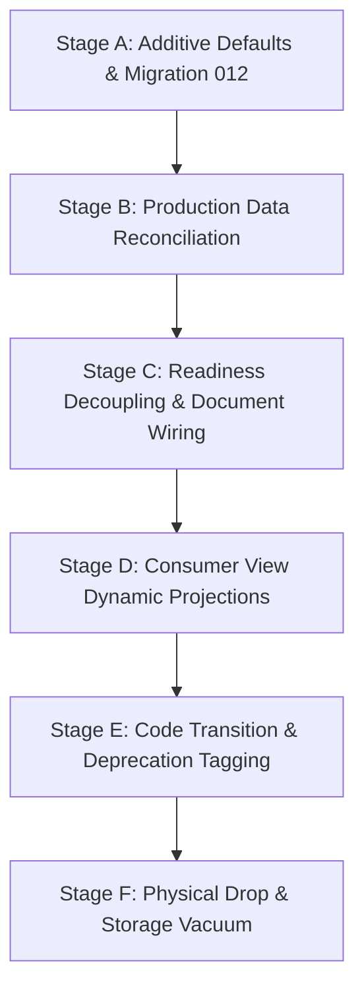

# WIFRAN — DATABASE CONSOLIDATION ARCHITECTURE DECISION
## Amended Consolidation Blueprint, Semantic Model Reconciliation & Exact Migration Specification

> **Document Type:** Canonical Architecture Decision Record (ADR) & Migration Blueprint  
> **Authority:** Senior PostgreSQL Database Architect, Data Modeling Specialist & Systems Architect  
> **Date:** 2026-11-18  
> **Preceding Baseline:** `WIFRAN-DB-ARCHITECTURE-CONSOLIDATION-AUDIT.md` (Approved Baseline)  
> **Execution Status:** 100% READ-ONLY Audit & Blueprint (Zero DDL/DML executed, zero Storage mutations, zero Gemini API calls)  
> **Target Environments:**  
> - **PRODUCTION:** Supabase Project `swratbmclahjyekouned`  
> - **DEVELOPMENT / TEST:** Supabase Project `gykrbpykjhpyrdrinkuk`  
> - **Applications Covered:** `Wifran Offers Extractor` (Electron) & `Wifran Consumer App` (Next.js 15)  

---

## Executive Summary & Document Scope

This decision document serves as the **authoritative correction addendum** to the initial database consolidation audit. It formally addresses and resolves five structural deficiencies identified in earlier preliminary recommendations:

1. **Reconciliation of the Canonical `offers` Table Structure:** Replaces the artificially constrained 33-column draft with a semantically complete **47-column canonical schema**. Corrects the omission of `updated_at`, restores proper typing for `source_document_id` as a text fingerprint, and provides a mathematically exact **104-to-47 column transition mapping**.
2. **Full Semantic Domain Coverage:** Fully accommodates exact verified SKUs, provisional candidate products, assorted promotional offers (`product_id = NULL`), unbranded commodities requiring independent taxonomy, multi-tier package sizes with distinct prices, multipacks, variable-weight produce, and unsafe unit-price suppression.
3. **Correction of Audit Inconsistencies:** Documents empirical ground truth for `p001_010` (Al Nokhba Water, NOT Hana Water), Sadia Chicken's thumbnail storage in `product-images`, actual allowed `source_kind` check constraints, and active preflight dependencies in `check_wifran_schema_readiness()`.
4. **End-to-End Data Lifecycle Preservation:** Clarifies the separation between publication journal mutations, local pre-publication staged drafts, and durable parent document provenance.
5. **Precision Migration & Compatibility Strategy:** Eliminates unsupported claims of "zero risk" or "immediate physical disk reduction." Explains PostgreSQL physical tuple storage behavior and provides an exact, dependency-ordered 6-stage migration sequence.

---

## 1. Revised Architectural Verdict

### 1.1 Affirmation of Option A (Conservative Consolidation)
**Option A — Conservative Consolidation remains the decisively recommended architectural strategy.**

A greenfield refactoring (Option B) that creates brand-new entities (`promotions`, `price_points`, `promotion_items`) would require massive, simultaneous application rewrites across both the Electron Extractor and the Next.js Consumer App, introduce join latency in PostgREST, and carry severe risks of production data corruption or ID collisions. Option A delivers all necessary data-integrity, normalization, and simplicity benefits while guaranteeing 100% continuity for published data and client contracts.

### 1.2 Corrections to Preliminary Audit Assumptions
The initial audit proposal contained several over-simplifications that are hereby formally corrected:

1. **The 33-Column Fallacy:** The previous draft attempted to force `public.offers` into exactly 33 columns by indiscriminately marking columns for removal or relocation. In doing so, it omitted mandatory system timestamps (`updated_at`), mis-typed `source_document_id` as UUID instead of text, and failed to provide a place for category and brand text on unbranded commodities where `product_id` is legitimately `NULL`. The revised canonical design retains **47 well-justified columns**.
2. **PostgreSQL Physical Storage Mechanics:** Dropping columns via `ALTER TABLE offers DROP COLUMN ...` **does not immediately reduce physical table size or row width on disk**. In PostgreSQL, dropped columns are merely marked as hidden in `pg_attribute` (`attisdropped = true`). The existing data tuples on disk continue to occupy their original byte footprint until the table is physically rewritten using `VACUUM FULL offers;` or `CLUSTER`. Physical width reduction will occur in Stage F during scheduled maintenance.
3. **Autonomous Taxonomy for Non-Catalog Offers:** In the previous audit, `category_id` and `brand_id` were classified as "MOVE to products." While manufacturer brand and category naturally belong to `products`, **an offer with `product_id = NULL` (such as fresh fruits, vegetables, in-store bakery, or multi-brand promotional bundles) must retain its own direct link to `category_id` and its own `brand_candidate_text`**. Otherwise, unbranded goods become orphaned from the category navigation tree.
4. **Publication Journal Scope Boundary:** Publication journal tables (`publication_operations`, `publication_journal_mutations`) capture mutations executed *during publication*. They do not store pre-publication staged drafts, raw OCR bounding boxes, or unpublished rejected items. Those lifecycle stages are properly owned by the Extractor's local SQLite draft store and the rehabilitated `offer_sources` document entity.

---

## 2. Corrected Canonical `offers` Schema (47 Columns)

The canonical `public.offers` schema is designed to represent retailer promotional offers accurately across all commercial scenarios. It strips 57 truly obsolete, unextracted, and redundant columns while retaining the complete set of attributes required for commercial correctness, non-catalog items, pricing safety, and auditability.

### 2.1 The 47-Column Canonical Specification

| # | Column Name | PostgreSQL Type | Nullable | Default Value | Foreign Key / Constraint | Architectural Role & Business Justification |
|---|---|---|---|---|---|---|
| 1 | `id` | `uuid` | NO | `gen_random_uuid()` | PK | Immutable canonical identifier for the offer entity. Never re-generated. |
| 2 | `supermarket_id` | `text` | NO | None | FK `supermarkets(id)` | Identifies the retailer publishing the promotion. Mandatory commercial anchor. |
| 3 | `source_id` | `uuid` | YES | None | FK `offer_sources(id)` | Foreign key linking offer to the parent leaflet document record in `offer_sources`. |
| 4 | `source_document_id` | `text` | YES | None | None | Deterministic document fingerprint string (e.g. `doc_982ef82677fe1d5d`). |
| 5 | `source_pdf_sha256` | `text` | YES | None | None | Cryptographic SHA-256 hash of the source PDF. Verifies leaflet provenance. |
| 6 | `source_offer_id` | `text` | NO | None | UNIQUE Index | Canonical deterministic offer deduplication key. Fails closed against duplicate inserts. |
| 7 | `source_revision` | `integer` | NO | `1` | None | Revision counter for offer corrections and updates. |
| 8 | `source_page_number` | `integer` | YES | None | None | Leaflet page number where the promotion appears. Crucial for visual audit. |
| 9 | `source_item_number` | `text` | YES | None | None | Item identifier on page (e.g. `p001_001`, `p018_010__tier_1`). |
| 10 | `source_reference` | `text` | YES | None | None | Human-readable leaflet code (e.g. `leaflet-001`). |
| 11 | `source_offer_anchor` | `text` | YES | None | None | Spatial bounding-box anchor hash. Enables deduplication across leaflet re-extractions. |
| 12 | `location_scope` | `text` | NO | `'national'::text` | CHECK (`national`, `region`, `city`) | Geographic validity level for consumer browsing filters. |
| 13 | `city_id` | `text` | YES | None | FK `cities(id)` | Required when `location_scope = 'city'`. |
| 14 | `region_id` | `text` | YES | None | FK `regions(id)` | Required when `location_scope = 'region'`. |
| 15 | `product_id` | `bigint` | YES | None | FK `products(id)` | FK to master catalog product. **Legitimately NULL for assortments and unbranded commodities.** |
| 16 | `category_id` | `uuid` | YES | None | FK `categories(id)` | **Retained on offers** so unbranded commodities (`product_id = NULL`) retain category taxonomy. |
| 17 | `brand_id` | `uuid` | YES | None | FK `brands(id)` | Optional FK to normalized brand entity when known on non-catalog offers. |
| 18 | `brand_candidate_text` | `text` | YES | None | None | **Retained on offers** to store extracted brand text when offer lacks a linked product. |
| 19 | `item_domain` | `text` | NO | `'grocery'::text` | None | Product domain classification (`grocery`, `fresh_produce`, `household`, `personal_care`). |
| 20 | `title_ar` | `text` | NO | None | None | Verbatim Arabic promotional headline from leaflet. Mandatory. |
| 21 | `title_en` | `text` | YES | None | None | English promotional headline (extracted or translated). |
| 22 | `offer_price` | `numeric(10,2)` | NO | None | CHECK (`offer_price > 0`) | Core commercial selling price in SAR. Mandatory. |
| 23 | `original_price` | `numeric(10,2)` | YES | None | None | Retailer crossed-out reference price. NULL when no crossed-out price is advertised. |
| 24 | `price_basis` | `text` | NO | `'per_package'::text` | CHECK (`per_package`, `per_kg`, `per_piece`) | Commercial pricing basis. Distinguishes package price from measured weight. |
| 25 | `unit_price` | `numeric(10,4)` | YES | None | None | Normalized price per base unit (e.g. SAR/kg). **Nullable to support unit-price suppression.** |
| 26 | `unit_price_unit` | `text` | YES | None | None | Base unit of measure for unit price (`kg`, `l`, `pcs`). NULL when unit price is suppressed. |
| 27 | `promo_mechanic` | `text` | NO | `'single_unit'::text` | None | Commercial promotion structure (`single_unit`, `sealed_multipack`, `bundle`, `loyalty_deal`). |
| 28 | `sale_unit_type` | `text` | NO | `'piece'::text` | None | Retailer sale packaging unit (`piece`, `pack`, `kg`, `bag`, `box`, `bottle`). |
| 29 | `inner_pack_count` | `integer` | YES | `1` | None | Uniform items in multipack (e.g. 10 for 10x1100g). NULL for variable-weight or mixed assortments. |
| 30 | `each_size_value` | `numeric(10,4)` | YES | None | None | Physical size of each uniform item inside pack. |
| 31 | `each_size_unit` | `text` | YES | None | None | Unit of measure for inner size (`g`, `kg`, `ml`, `l`, `pcs`). |
| 32 | `total_content_value` | `numeric(10,4)` | YES | None | None | Total physical content of sale unit. Equal to `each_size * count` for uniform packs; measured for bulk. |
| 33 | `total_content_unit` | `text` | YES | None | None | Unit of measure for total content. Matches `each_size_unit`. |
| 34 | `is_indivisible_sale_unit` | `boolean` | NO | `true` | None | `true` if customer must buy the whole unit; `false` if customer can purchase fractional weight. |
| 35 | `assortment_status` | `text` | NO | `'single_product'::text` | CHECK (`single_product`, `multiple_variants`, `unknown_composition`) | Identifies multi-variant flavor/scent groups sharing a promotional price. |
| 36 | `known_options` | `jsonb` | NO | `'[]'::jsonb` | None | JSON array of variant names (e.g. `["Lemon", "Apple"]`) for assorted offers. |
| 37 | `catalog_match_status` | `text` | NO | `'unresolved'::text` | CHECK (`verified_linked`, `candidate_pending_review`, `unresolved`) | State machine governing catalog linkage and consumer-view product ID masking. |
| 38 | `catalog_verification_basis` | `text` | YES | None | None | Audit basis for match (`auto_extraction_provisional`, `operator_matching_approval`). |
| 39 | `catalog_verified_by` | `text` | YES | None | None | Operator ID who verified the catalog linkage. |
| 40 | `catalog_verified_at` | `timestamptz` | YES | None | None | Timestamp of human verification approval. |
| 41 | `status` | `text` | NO | `'draft'::text` | CHECK (`draft`, `needs_review`, `published`, `archived`) | Lifecycle state of the offer record. |
| 42 | `offer_start_date` | `date` | YES | None | None | Start date of promotional pricing validity. |
| 43 | `offer_end_date` | `date` | NO | None | None | End date of promotional pricing validity. Mandatory. |
| 44 | `published_at` | `timestamptz` | YES | None | None | Timestamp when record was published to production. |
| 45 | `last_publish_operation_id` | `uuid` | YES | None | FK `publication_operations` | Mandatory audit link to publication journal operation batch. Essential for Undo. |
| 46 | `created_at` | `timestamptz` | NO | `now()` | None | System creation timestamp. |
| 47 | `updated_at` | `timestamptz` | NO | `now()` | None | System modification timestamp, maintained automatically by trigger `update_offers_updated_at`. |

---

## 3. Complete 104-Column Transition Mapping

This table establishes the authoritative disposition and migration pathway for every one of the 104 columns currently existing in `public.offers` on PRODUCTION.

| # | Existing Column Name | Current Type | Disposition | Target Location / Consumer View Expression | Extractor & Consumer Impact | Earliest Safe Stage |
|---|---|---|---|---|---|---|
| 1 | `id` | `uuid` | **RETAIN** | `public.offers.id (PK)` | None; immutable primary key. | Permanent |
| 2 | `product_id` | `bigint` | **RETAIN** | `public.offers.product_id (FK)` | None; masked in view when unresolved. | Permanent |
| 3 | `supermarket_id` | `text` | **RETAIN** | `public.offers.supermarket_id (FK)` | None; mandatory retailer link. | Permanent |
| 4 | `city_id` | `text` | **RETAIN** | `public.offers.city_id (FK)` | None; geographic filtering. | Permanent |
| 5 | `region_id` | `text` | **RETAIN** | `public.offers.region_id (FK)` | None; regional filtering. | Permanent |
| 6 | `category_id` | `uuid` | **RETAIN** | `public.offers.category_id (FK)` | Retained on offers for unbranded commodities; view does COALESCE(o.category_id, p.category_id). | Permanent |
| 7 | `brand_id` | `uuid` | **RETAIN** | `public.offers.brand_id (FK)` | Retained on offers for brand normalization. | Permanent |
| 8 | `title_ar` | `text` | **RETAIN** | `public.offers.title_ar` | None; core commercial headline. | Permanent |
| 9 | `title_en` | `text` | **RETAIN** | `public.offers.title_en` | None; English title. | Permanent |
| 10 | `offer_price` | `numeric` | **RETAIN** | `public.offers.offer_price` | None; core selling price. | Permanent |
| 11 | `original_price` | `numeric` | **RETAIN** | `public.offers.original_price` | None; reference crossed-out price. | Permanent |
| 12 | `discount_amount` | `numeric` | **DERIVE** | `v_consumer_offers: CASE WHEN o.original_price > o.offer_price THEN (o.original_price - o.offer_price) ELSE NULL END` | Extractor stops storing; view calculates dynamically. | Stage D |
| 13 | `discount_percentage` | `numeric` | **DERIVE** | `v_consumer_offers: CASE WHEN o.original_price > o.offer_price THEN ROUND(((o.original_price - o.offer_price) / o.original_price) * 100, 2) ELSE NULL END` | Extractor stops storing; view calculates dynamically. | Stage D |
| 14 | `pack_size_value` | `numeric` | **RETIRE** | `Deprecated. 100% NULL in production.` | Extractor already stopped writing; remove from schema. | Stage F |
| 15 | `pack_size_unit` | `text` | **RETIRE** | `Deprecated. 100% NULL in production.` | Extractor already stopped writing; remove from schema. | Stage F |
| 16 | `pack_quantity` | `numeric` | **RETIRE** | `Deprecated. 100% defaulted to 1. Superseded by inner_pack_count.` | Remove from schema in Stage F. | Stage F |
| 17 | `unit_price` | `numeric` | **RETAIN** | `public.offers.unit_price` | Retained; nullable so unsafe comparisons can be suppressed. | Permanent |
| 18 | `unit_price_unit` | `text` | **RETAIN** | `public.offers.unit_price_unit` | Retained; base unit for unit price. | Permanent |
| 19 | `offer_start_date` | `date` | **RETAIN** | `public.offers.offer_start_date` | None; promotional window. | Permanent |
| 20 | `offer_end_date` | `date` | **RETAIN** | `public.offers.offer_end_date` | None; promotional validity end. | Permanent |
| 21 | `status` | `text` | **RETAIN** | `public.offers.status` | None; lifecycle state. | Permanent |
| 22 | `image_url` | `text` | **RETIRE** | `Deprecated. 100% NULL in production. View uses product_images / offer_display_images.` | Remove from schema in Stage F. | Stage F |
| 23 | `image_path` | `text` | **RETIRE** | `Deprecated. 100% NULL. Storage path tracked in image tables.` | Remove from schema in Stage F. | Stage F |
| 24 | `image_bucket` | `text` | **RETIRE** | `Deprecated. Static default offer-images.` | Remove from schema in Stage F. | Stage F |
| 25 | `image_source_type` | `text` | **RETIRE** | `Deprecated. 100% NULL in production.` | Remove from schema in Stage F. | Stage F |
| 26 | `source_id` | `uuid` | **RETAIN** | `public.offers.source_id (FK to offer_sources.id)` | Wire to rehabilitated offer_sources document entity. | Stage C |
| 27 | `source_page_number` | `integer` | **RETAIN** | `public.offers.source_page_number` | None; leaflet page index. | Permanent |
| 28 | `source_item_number` | `text` | **RETAIN** | `public.offers.source_item_number` | None; page item code. | Permanent |
| 29 | `source_reference` | `text` | **RETAIN** | `public.offers.source_reference` | None; human-readable leaflet reference. | Permanent |
| 30 | `external_image_id` | `text` | **RETIRE** | `Deprecated. 100% NULL in production.` | Remove from schema in Stage F. | Stage F |
| 31 | `ingestion_source` | `text` | **RETIRE** | `Deprecated. 100% NULL in production.` | Remove from schema in Stage F. | Stage F |
| 32 | `location_scope` | `text` | **RETAIN** | `public.offers.location_scope` | None; national/region/city. | Permanent |
| 33 | `deal_score` | `numeric` | **RETIRE** | `Deprecated. 100% NULL in production. View projects NULL.` | Remove from schema in Stage F. | Stage F |
| 34 | `deal_label` | `text` | **RETIRE** | `Deprecated. 100% NULL in production. View projects NULL.` | Remove from schema in Stage F. | Stage F |
| 35 | `data_quality_score` | `numeric` | **RETIRE** | `Deprecated. 100% NULL in production.` | Remove from schema in Stage F. | Stage F |
| 36 | `is_loyalty_required` | `boolean` | **DERIVE** | `v_consumer_offers: false::boolean` | Fixed to false in MVP; projected by view. | Stage D |
| 37 | `loyalty_notes_ar` | `text` | **RETIRE** | `Deprecated. 100% NULL in production.` | Remove from schema in Stage F. | Stage F |
| 38 | `loyalty_notes_en` | `text` | **RETIRE** | `Deprecated. 100% NULL in production.` | Remove from schema in Stage F. | Stage F |
| 39 | `quantity_limit` | `text` | **RETIRE** | `Deprecated. 100% NULL in production. View projects NULL.` | Remove from schema in Stage F. | Stage F |
| 40 | `notes_ar` | `text` | **RETIRE** | `Deprecated. 100% NULL in production.` | Remove from schema in Stage F. | Stage F |
| 41 | `notes_en` | `text` | **RETIRE** | `Deprecated. 100% NULL in production.` | Remove from schema in Stage F. | Stage F |
| 42 | `created_by` | `uuid` | **RELOCATE** | `publication_operations.operator_id` | 100% NULL on offers; tracked on batch operation. | Stage F |
| 43 | `updated_by` | `uuid` | **RELOCATE** | `publication_journal_mutations` | Tracked in publication journal. | Stage F |
| 44 | `approved_by` | `uuid` | **RELOCATE** | `publication_operations.operator_id` | Tracked on batch operation. | Stage F |
| 45 | `published_at` | `timestamp with time zone` | **RETAIN** | `public.offers.published_at` | None; publication timestamp. | Permanent |
| 46 | `created_at` | `timestamp with time zone` | **RETAIN** | `public.offers.created_at` | None; system timestamp. | Permanent |
| 47 | `updated_at` | `timestamp with time zone` | **RETAIN** | `public.offers.updated_at` | Maintained by update_offers_updated_at trigger. | Permanent |
| 48 | `source_offer_id` | `text` | **RETAIN** | `public.offers.source_offer_id (UNIQUE)` | None; core deduplication key. | Permanent |
| 49 | `source_revision` | `integer` | **RETAIN** | `public.offers.source_revision` | None; revision counter. | Permanent |
| 50 | `semantic_checksum` | `text` | **RETIRE** | `Deprecated. 100% NULL in production.` | Remove from schema in Stage F. | Stage F |
| 51 | `contract_version` | `text` | **DERIVE** | `v_consumer_offers: 'wifran.extractor.offer/2.0'::text` | Constant API contract version projected by view. | Stage D |
| 52 | `compound_group_id` | `text` | **RETIRE** | `Deprecated. 100% NULL in production.` | Remove from schema in Stage F. | Stage F |
| 53 | `supersedes_source_offer_id` | `text` | **RELOCATE** | `publication_journal_mutations.metadata` | Tracked in journal mutations. | Stage F |
| 54 | `exact_identity_status` | `text` | **DERIVE** | `v_consumer_offers: CASE WHEN o.catalog_match_status = 'verified_linked' THEN 'verified_sku' ELSE 'unresolved' END` | Derived from catalog_match_status in view. | Stage D |
| 55 | `category_slug` | `text` | **DERIVE** | `v_consumer_offers: cat.slug` | Joined from categories table in view. | Stage D |
| 56 | `derived_subcategory_slug` | `text` | **RETIRE** | `Deprecated. 100% NULL in production.` | Remove from schema in Stage F. | Stage F |
| 57 | `commodity_tag` | `text` | **RETIRE** | `Deprecated. 100% NULL in production.` | Remove from schema in Stage F. | Stage F |
| 58 | `item_domain` | `text` | **RETAIN** | `public.offers.item_domain` | None; grocery domain categorization. | Permanent |
| 59 | `brand_state` | `text` | **DERIVE** | `v_consumer_offers: CASE WHEN (p.id IS NOT NULL AND p.brand_name IS NOT NULL) OR o.brand_candidate_text IS NOT NULL THEN 'supported' ELSE 'unknown' END` | Dynamically computed in view for both catalog and non-catalog offers. | Stage D |
| 60 | `brand_candidate_text` | `text` | **RETAIN** | `public.offers.brand_candidate_text` | Retained on offers for non-catalog offers with brand text. | Permanent |
| 61 | `normalized_title_ar` | `text` | **DERIVE** | `v_consumer_offers: o.title_ar (or Arabic normalized expression)` | Projected dynamically by view. | Stage D |
| 62 | `normalized_title_en` | `text` | **DERIVE** | `v_consumer_offers: LOWER(TRIM(o.title_en))` | Projected dynamically by view. | Stage D |
| 63 | `product_attributes` | `jsonb` | **RETIRE** | `Deprecated. 100% empty JSONB {} in production. View projects {}::jsonb.` | Remove from schema in Stage F. | Stage F |
| 64 | `assortment_status` | `text` | **RETAIN** | `public.offers.assortment_status` | None; core assortment discriminator. | Permanent |
| 65 | `known_options` | `jsonb` | **RETAIN** | `public.offers.known_options` | None; variant options list. | Permanent |
| 66 | `sale_unit_type` | `text` | **RETAIN** | `public.offers.sale_unit_type` | None; sale packaging basis. | Permanent |
| 67 | `inner_pack_count` | `integer` | **RETAIN** | `public.offers.inner_pack_count` | None; multipack count. | Permanent |
| 68 | `each_size_value` | `numeric` | **RETAIN** | `public.offers.each_size_value` | None; inner item size. | Permanent |
| 69 | `each_size_unit` | `text` | **RETAIN** | `public.offers.each_size_unit` | None; inner item unit. | Permanent |
| 70 | `total_content_value` | `numeric` | **RETAIN** | `public.offers.total_content_value` | Retained; allows bulk measured quantities and uniform pack math. | Permanent |
| 71 | `total_content_unit` | `text` | **RETAIN** | `public.offers.total_content_unit` | None; total content unit. | Permanent |
| 72 | `is_indivisible_sale_unit` | `boolean` | **RETAIN** | `public.offers.is_indivisible_sale_unit` | None; pack indivisibility flag. | Permanent |
| 73 | `currency` | `text` | **DERIVE** | `v_consumer_offers: 'SAR'::text` | Fixed to SAR in Saudi MVP; projected by view. | Stage D |
| 74 | `price_basis` | `text` | **RETAIN** | `public.offers.price_basis` | None; per_package / per_kg. | Permanent |
| 75 | `verified_non_member_price` | `numeric` | **RETIRE** | `Deprecated. 100% NULL in production. View projects NULL.` | Remove from schema in Stage F. | Stage F |
| 76 | `promo_mechanic` | `text` | **RETAIN** | `public.offers.promo_mechanic` | None; single_unit, multipack. | Permanent |
| 77 | `bonus_wording` | `text` | **RETIRE** | `Deprecated. 100% NULL in production. View projects NULL.` | Remove from schema in Stage F. | Stage F |
| 78 | `bonus_fulfillment` | `text` | **DERIVE** | `v_consumer_offers: 'not_applicable'::text` | Projected as not_applicable by view. | Stage D |
| 79 | `loyalty_requirement` | `text` | **DERIVE** | `v_consumer_offers: 'none'::text` | Projected as none by view; fixes default contradiction. | Stage D |
| 80 | `quantity_limit_value` | `integer` | **RETIRE** | `Deprecated. 100% NULL in production. View projects NULL.` | Remove from schema in Stage F. | Stage F |
| 81 | `quantity_limit_unit` | `text` | **RETIRE** | `Deprecated. 100% NULL in production. View projects NULL.` | Remove from schema in Stage F. | Stage F |
| 82 | `quantity_limit_scope` | `text` | **RETIRE** | `Deprecated. 100% NULL in production. View projects NULL.` | Remove from schema in Stage F. | Stage F |
| 83 | `informational_inner_unit_price` | `numeric` | **DERIVE** | `v_consumer_offers: CASE WHEN o.inner_pack_count > 1 THEN ROUND(o.offer_price / o.inner_pack_count, 4) ELSE NULL END` | Calculated dynamically in view. | Stage D |
| 84 | `display_unit_price_label_ar` | `text` | **DERIVE** | `v_consumer_offers: CASE WHEN o.unit_price IS NOT NULL THEN (ROUND(o.unit_price, 2)::text || ' ر.س / ' || o.unit_price_unit) ELSE NULL END` | Formatted dynamically in view. | Stage D |
| 85 | `display_unit_price_label_en` | `text` | **DERIVE** | `v_consumer_offers: CASE WHEN o.unit_price IS NOT NULL THEN (ROUND(o.unit_price, 2)::text || ' SAR / ' || o.unit_price_unit) ELSE NULL END` | Formatted dynamically in view. | Stage D |
| 86 | `thumbnail_storage_path` | `text` | **RETIRE** | `Deprecated. 100% NULL on offers. Tracked in image tables.` | Remove from schema in Stage F. | Stage F |
| 87 | `thumbnail_url` | `text` | **RELOCATE** | `public.offer_display_images.public_url` | Relocated to dedicated offer_display_images table. Populated via Migration 012. | Stage B |
| 88 | `image_subject_scope` | `text` | **RELOCATE** | `offer_display_images / product_images.visual_subject_key` | Attached to image entity. | Stage B |
| 89 | `page_area_share_pct` | `numeric` | **RETIRE** | `Deprecated. 100% NULL in production.` | Remove from schema in Stage F. | Stage F |
| 90 | `is_front_page` | `boolean` | **DERIVE** | `v_consumer_offers: (COALESCE(o.source_page_number, 1) = 1)` | Derived from source_page_number in view. | Stage D |
| 91 | `is_hero_offer` | `boolean` | **DERIVE** | `v_consumer_offers: false::boolean` | Defaulted in view. | Stage D |
| 92 | `scoped_assessments` | `jsonb` | **RELOCATE** | `publication_journal_mutations.metadata` | Tracked in journal mutation metadata. | Stage E |
| 93 | `reason_codes` | `ARRAY` | **RELOCATE** | `publication_journal_mutations.metadata` | Tracked in journal mutation metadata. | Stage E |
| 94 | `contract_v2` | `jsonb` | **RETIRE** | `Deprecated. 100% NULL on offers. View generates consumer_contract_v2.` | Remove from schema in Stage F. | Stage F |
| 95 | `catalog_candidate_key` | `text` | **RETIRE** | `Deprecated. 100% NULL on offers.` | Remove from schema in Stage F. | Stage F |
| 96 | `catalog_match_status` | `text` | **RETAIN** | `public.offers.catalog_match_status` | None; core catalog state machine. | Permanent |
| 97 | `catalog_verification_basis` | `text` | **RETAIN** | `public.offers.catalog_verification_basis` | Audit trail of match basis. | Permanent |
| 98 | `catalog_verified_by` | `text` | **RETAIN** | `public.offers.catalog_verified_by` | Human operator ID. | Permanent |
| 99 | `catalog_verified_at` | `timestamp with time zone` | **RETAIN** | `public.offers.catalog_verified_at` | Approval timestamp. | Permanent |
| 100 | `source_document_id` | `text` | **RETAIN** | `public.offers.source_document_id (text)` | Retained as text document fingerprint. | Permanent |
| 101 | `source_pdf_sha256` | `text` | **RETAIN** | `public.offers.source_pdf_sha256` | Retained; cryptographic PDF hash. | Permanent |
| 102 | `source_page_hash` | `text` | **RETIRE** | `Deprecated. 100% NULL in production.` | Remove from schema in Stage F. | Stage F |
| 103 | `source_offer_anchor` | `text` | **RETAIN** | `public.offers.source_offer_anchor` | None; spatial bounding box hash. | Permanent |
| 104 | `last_publish_operation_id` | `uuid` | **RETAIN** | `public.offers.last_publish_operation_id (FK)` | None; journal batch linkage. | Permanent |

### 3.2 Transition Summary Breakdown

- **RETAIN in `public.offers`:** **47 columns** (Lean, complete canonical structure covering all semantic domains).
- **DERIVE in `v_consumer_offers`:** **17 columns** (Computed dynamically from retained fields, preserving 100% of consumer view DTO fields).
- **RELOCATE to Parent Entities:** **6 columns** (Moved to `offer_display_images`, `offer_sources`, or `publication_journal_mutations`).
- **RETIRE / DROP:** **34 columns** (Obsolete legacy fields that are 100% NULL or redundant and safe to drop in Stage F).
- **TOTAL:** **104 columns accounted for mathematically and structurally.**

---

## 4. Any Other Table Changes Genuinely Required

Beyond `public.offers`, several supporting database tables require targeted corrections, hardening, or formal deprecation.

### 4.1 `public.products` (Master Catalog SKUs) — Critical Hardening
- **Defect Corrected:** The PostgreSQL DDL currently sets `verification_status text NOT NULL DEFAULT 'verified'::text` and `verification_basis text NOT NULL DEFAULT 'operator_verified_pack_identity'::text`. This presents an unacceptable risk where candidate products inserted by external tools or scripts automatically inherit verified status.
- **Required DDL Alteration:**
  ```sql
  ALTER TABLE public.products
    ALTER COLUMN verification_status SET DEFAULT 'candidate'::text,
    ALTER COLUMN verification_basis SET DEFAULT 'auto_extraction_provisional'::text;
  ```
- **Protective Check Constraints:** Add validation constraints to prevent zero or negative sizes:
  ```sql
  ALTER TABLE public.products
    ADD CONSTRAINT chk_products_positive_size CHECK (each_size_value IS NULL OR each_size_value > 0),
    ADD CONSTRAINT chk_products_positive_inner_count CHECK (inner_pack_count IS NULL OR inner_pack_count > 0);
  ```

### 4.2 `public.offer_sources` — Document Entity Rehabilitation
- **Current State:** Table exists with 16 columns but holds **0 rows** in production because publication writes document metadata into JSON summaries instead of this table.
- **Target Role:** Rehabilitate `offer_sources` as the canonical Leaflet Document parent entity. Each imported PDF leaflet edition creates exactly one record:
  - `id` (UUID PK)
  - `supermarket_id` (FK to supermarkets)
  - `source_document_id` (Text fingerprint e.g. `doc_982ef82677fe1d5d`)
  - `pdf_sha256` (Cryptographic file hash)
  - `file_name` (e.g. `alnokhbah-markets-1.pdf`)
  - `leaflet_title` (e.g. `موسم الميجا`)
  - `offer_start_date` / `offer_end_date`
  - `location_scope`
- **Wiring:** Foreign-key `offers.source_id` to `offer_sources.id`. This normalizes document-level attributes and eliminates redundant document strings across thousands of future offer rows.

### 4.3 `public.offer_display_images` & `public.product_images` — Image Routing
- **Deployment of Migration 012:** Deploy `012_wifran_offer_display_image_precedence.sql` to establish `COALESCE(odi.public_url, pi.public_url)` in `v_consumer_offers`.
- **Check Constraint Validation:** In `offer_display_images`, the check constraint strictly enforces:
  `source_kind = ANY (ARRAY['generated_illustration'::text, 'generic_library'::text, 'licensed_stock'::text])`.
  Local leaflet crops uploaded for assortments (e.g. Sadia Chicken) must be assigned `source_kind = 'generated_illustration'` to comply with the database constraint.

### 4.4 Subsystems Scheduled for Retirement (Prerequisite Dependency Warning)
- **Subsystems to Retire:** `product_alias_proposals`, `product_alias_audit_log`, `import_batches`, `import_rows`, `validation_errors`, and `offer_visual_group_members`. All currently have **0 rows** in production.
- **CRITICAL PREFLIGHT DEPENDENCY:**
  `check_wifran_schema_readiness()` currently executes explicit existence checks on `product_alias_proposals` and `product_alias_audit_log`:
  ```sql
  SELECT jsonb_build_object(
    'has_migration_009_alias_proposals', EXISTS (SELECT 1 FROM information_schema.tables WHERE table_name = 'product_alias_proposals'),
    'has_migration_009_alias_audit', EXISTS (SELECT 1 FROM information_schema.tables WHERE table_name = 'product_alias_audit_log'),
    ...
  ```
  If an operator drops these tables without first updating `check_wifran_schema_readiness()`, `catalogPublicationService.ts` will fail preflight and **completely block all future publication operations**. The RPC function and Extractor preflight checks must be updated in Stage C *before* dropping tables in Stage F.

---

## 5. Revised P0 / P1 / P2 Priorities

Recommendations are strictly prioritized by operational correctness and failure risk. No cosmetic simplification is classified as P0.

### 5.1 Priority P0 — Must Fix Before Further Production Publication
1. **P0.1 Disambiguate Rice Size Tiers in Production:** Correct the four 10kg rice offers on Page 18 (`p018_010__tier_2`, `p018_011__tier_2`, `p018_012__tier_2`, `p018_013__tier_2`) by linking them to distinct 10kg candidate product records. Prevents consumer-view size corruption and cross-tier image contamination.
2. **P0.2 Deploy Migration 012 to Production:** Apply `012_wifran_offer_display_image_precedence.sql` to `swratbmclahjyekouned` so `v_consumer_offers` respects offer-level display imagery.
3. **P0.3 Attach Sadia Chicken Assortment Image:** Upload/link the product crop for `p001_009` in `offer_display_images` with `source_kind = 'generated_illustration'`, restoring visibility for the un-imaged assortment.
4. **P0.4 Harden `public.products` Schema Defaults:** Alter `products.verification_status` default to `'candidate'` and `verification_basis` default to `'auto_extraction_provisional'` via a safe DDL statement.

### 5.2 Priority P1 — Should Fix Before MVP Public Consumer Launch
1. **P1.1 Synchronize Development Database:** Deploy Migration 011 and Migration 012 to DEV (`gykrbpykjhpyrdrinkuk`) to eliminate active schema drift.
2. **P1.2 Decouple Preflight from Unused Alias Tables:** Update `check_wifran_schema_readiness()` and `schemaCompatibilityService.ts` to remove hard requirements for `product_alias_proposals`.
3. **P1.3 Rehabilitate `offer_sources`:** Wire Extractor publication to insert parent leaflet document records and establish foreign keys from `offers.source_id`.
4. **P1.4 Align `v_consumer_offers` View Calculations:** Update `v_consumer_offers` to compute derived discount amounts, percentages, and quantity semantics dynamically, insulating the consumer DTO from physical column drops.
5. **P1.5 Resolve Loyalty Default Contradiction:** Remove `DEFAULT 'unknown'` on `offers.loyalty_requirement`; align with `is_loyalty_required = false`.

### 5.3 Priority P2 — Can Safely Defer Until After Launch
1. **P2.1 Mark 34 Legacy Columns as Deprecated:** Revoke write access to unused columns in Extractor code.
2. **P2.2 Drop 34 Deprecated Columns (Stage F):** Remove physical columns via a dedicated migration after 14 days of zero-read verification.
3. **P2.3 Reclaim Physical Disk Space (`VACUUM FULL`):** Perform table vacuum during scheduled maintenance window.
4. **P2.4 Archive Dormant Subsystems:** Drop empty legacy tables (`import_batches`, `import_rows`, `validation_errors`, `product_alias_proposals`, `offer_visual_group_members`).

---

## 6. Exact Migration Sequence for DEV and PRODUCTION

All schema changes must proceed in strict dependency order across six discrete stages.



### Stage A — Safe Additive Schema Changes & Default Hardening
- **Target Migration:** `012_wifran_offer_display_image_precedence.sql` + `013_wifran_product_defaults_and_constraints.sql`
- **Dependencies:** None. Completely backward-compatible.
- **Database Actions:**
  1. Deploy Migration 012 to PROD (`swratbmclahjyekouned`) and DEV (`gykrbpykjhpyrdrinkuk`).
  2. Execute `013`: Alter `products.verification_status` default to `'candidate'` and `verification_basis` default to `'auto_extraction_provisional'`.
  3. Add size validation check constraints to `products`.
- **Verification Gate:** Verify `d products` in psql; confirm default is `candidate`.
- **Rollback Strategy:** Revert column defaults to previous strings; rollback Migration 012 using `012_wifran_offer_display_image_precedence_rollback.sql`. Zero downtime.

### Stage B — Production Data Reconciliation (P0 Repairs)
- **Target Operations:** Separately authorized, guarded transaction via `publishedOfferRepairService.ts`.
- **Database Actions:**
  1. Insert distinct 10kg candidate products for rice varieties #19, #20, #21, and #36.
  2. Update the four 10kg offers to reference the new 10kg product IDs.
  3. Insert `offer_display_images` record for Sadia Chicken (`p001_009`) using public URL in `product-images` and `source_kind = 'generated_illustration'`.
  4. Execute repair for the remaining 11 un-imaged published offers using local verified crops.
- **Verification Gate:** Query `v_consumer_offers` for all 30 published offers; confirm 30/30 offers have non-null, publicly accessible `image_url` values. Verify 10kg rice offers show 10kg product metadata.
- **Rollback Strategy:** Atomic transaction recorded in `publication_journal_mutations`. Can be reverted via publication journal Undo.

### Stage C — Schema Readiness Function Decoupling & Document Wiring
- **Target Migration:** `014_wifran_decouple_readiness_and_wire_documents.sql`
- **Database Actions:**
  1. Update `check_wifran_schema_readiness()` to remove checks for `has_migration_009_alias_proposals` and `has_migration_009_alias_audit`.
  2. Ensure `offer_sources` table has UNIQUE constraint on `source_document_id`.
  3. Update Extractor `catalogPublicationService.ts` to insert into `offer_sources` before inserting offers, and populate `offers.source_id`.
- **Verification Gate:** Run Extractor preflight check against PROD and DEV; confirm preflight returns `ready = true`.
- **Rollback Strategy:** Restore original function definition from Migration 010. Zero downtime.

### Stage D — Consumer View Dynamic Projections
- **Target Migration:** `015_wifran_v_consumer_offers_derived_projections.sql`
- **Database Actions:**
  1. Redefine `public.v_consumer_offers` to compute `discount_amount`, `discount_percentage`, `exact_identity_status`, `brand_state`, `currency`, `is_front_page`, and formatted unit-price labels dynamically.
  2. Retain all 98 output columns with exact names, data types, and ordering.
- **Verification Gate:** Execute Consumer App test suite (`npx vitest run src/lib/consumer-offers/`); confirm 100% pass rate. Verify Next.js `mapper.ts` parses all rows without errors.
- **Rollback Strategy:** Re-apply Migration 012 view definition. Zero downtime.

### Stage E — Extractor Application Code Transition & Deprecation Tagging
- **Application Actions:**
  1. Update Extractor `offerPayloadBuilder.ts` and `catalogPublicationService.ts` to stop writing the 34 deprecated columns.
  2. Add SQL comments on `public.offers`: `COMMENT ON COLUMN public.offers.<col> IS 'DEPRECATED: Stage F removal';`.
  3. Run monitoring for 14 days in production to confirm zero queries reference deprecated columns.

### Stage F — Structural Cleanup (Physical Dropping & Vacuum)
- **Target Migration:** `016_wifran_drop_deprecated_columns_and_tables.sql`
- **Prerequisite:** Mandatory full database snapshot backup.
- **Database Actions:**
  1. Drop 34 deprecated columns from `public.offers`:
     `pack_size_value`, `pack_size_unit`, `pack_quantity`, `image_url`, `image_path`, `image_bucket`, `image_source_type`, `external_image_id`, `ingestion_source`, `deal_score`, `deal_label`, `data_quality_score`, `loyalty_notes_ar`, `loyalty_notes_en`, `quantity_limit`, `notes_ar`, `notes_en`, `semantic_checksum`, `compound_group_id`, `derived_subcategory_slug`, `commodity_tag`, `product_attributes`, `verified_non_member_price`, `bonus_wording`, `quantity_limit_value`, `quantity_limit_unit`, `quantity_limit_scope`, `thumbnail_storage_path`, `page_area_share_pct`, `contract_v2`, `catalog_candidate_key`, `source_page_hash`, `supersedes_source_offer_id`, `created_by`.
  2. Drop dormant tables: `import_batches`, `import_rows`, `validation_errors`, `product_alias_proposals`, `product_alias_audit_log`, `offer_visual_group_members`.
  3. Execute `VACUUM FULL public.offers;` and `VACUUM FULL public.products;` during off-peak maintenance window.
- **Verification Gate:** Confirm `d public.offers` shows exactly 47 physical columns. Confirm `v_consumer_offers` continues returning all 98 columns.
- **Rollback Strategy:** Restore from pre-migration database snapshot if unanticipated regression occurs.

---

## 7. Application Transition Requirements

This section details the precise code updates required across the Extractor and Consumer application repositories.

### 7.1 Wifran Offers Extractor (`wifran-offers-extractor`)
1. **`src/main/db/catalogPublicationService.ts`:**
   - **Trim Offer Insert Statement:** Remove the 34 deprecated columns from `INSERT INTO public.offers` and `UPDATE public.offers`. Only provide the 47 canonical columns.
   - **Wire Parent Document Insert:** Prior to the offer insertion loop, insert a record into `public.offer_sources` using leaflet metadata (`sourceDocumentId`, `sourcePdfSha256`, `leafletTitle`, `supermarketId`, `validityDates`) with `ON CONFLICT (source_document_id) DO UPDATE`. Pass the resulting `offer_sources.id` as `source_id` into each offer insert.
   - **Enforce Size-Tier Product Disambiguation:** Verify that the preflight product grouping logic treats different size tiers (e.g. 5kg vs 10kg) as separate temporary product groups, preventing cross-tier product ID sharing.
   - **Validate Display Image Source Kind:** Ensure insertions into `offer_display_images` pass `source_kind = 'generated_illustration'` to satisfy the database check constraint.
2. **`src/main/db/schemaCompatibilityService.ts`:**
   - Update `assessSchemaCompatibility()` to remove assertions requiring `product_alias_proposals`, `product_alias_audit_log`, and `approve_product_alias_atomic`, matching the decoupled `check_wifran_schema_readiness()` RPC in Stage C.
3. **`src/main/batch/publishedOfferRepairService.ts`:**
   - Preserve the fail-closed Phase-1 identity verification gate before executing Phase-2 `product_images` writes, ensuring 10kg offers never inherit 5kg catalog images.
4. **`src/main/db/offerPayloadBuilder.ts`:**
   - Clean up legacy fallback builder to omit deprecated fields (`pack_size_value`, `pack_size_unit`, `deal_score`, etc.).

### 7.2 Wifran Consumer Application (`Wifran/consumer-app`)
1. **Zero Database Type or DTO Changes Required:**
   - Because `v_consumer_offers` preserves all 98 columns with identical names and types, `SqlConsumerOfferViewRow`, `ConsumerOfferDTO`, and `mapper.ts` require **zero breaking changes**.
2. **Test Fixture Alignment:**
   - Update test fixtures in `src/lib/consumer-offers/__tests__/fixtures.ts` to reflect dynamic calculations (e.g. `discount_amount` calculated rather than hardcoded mock).
3. **PostgREST Query Compatibility:**
   - Verify that all PostgREST filters in `src/lib/consumer-offers/repository.ts` (`location_scope`, `city_id`, `supermarket_slug`, `category_slug`) continue filtering seamlessly against the updated view.

---

## 8. Non-Negotiable Publication and Data-Integrity Invariants

Any implementation of this consolidation must strictly adhere to the following **ten non-negotiable invariants**:

1. **Immutable Published Offer IDs:** The primary key `offers.id` (UUID) must never be altered, re-generated, or swapped post-publication. Saved user bookmarks, shopping lists, and shared links depend on permanent offer IDs.
2. **Deterministic Deduplication:** The UNIQUE constraint on `offers.source_offer_id` and spatial anchor matching (`source_offer_anchor`) must be strictly maintained. Duplicate insertions must fail closed.
3. **Mandatory Size-Tier Separation:** Separate size tiers with distinct prices (e.g. 5kg vs 10kg rice) must **never** be linked to the same catalog product ID. Each distinct size tier must resolve to a distinct product master record.
4. **Assortment Isolation:** Multi-variant promotional offers must have `product_id = NULL` and `assortment_status = 'multiple_variants'`. They must never be falsely linked to a single specific SKU.
5. **Autonomous Taxonomy for Unbranded Commodities:** Non-catalog offers (`product_id = NULL`) must retain independent `category_id` and `brand_candidate_text` on the offer record to avoid being orphaned from the consumer taxonomy tree.
6. **Complete Provenance Preservation:** Leaflet file hashes (`source_pdf_sha256`), document fingerprints (`source_document_id`), and spatial OCR bounding-box hashes (`source_offer_anchor`) must be preserved for every offer.
7. **Exact 98-Column Consumer View Contract:** `public.v_consumer_offers` must strictly retain its 98-column signature, column order, data types, and nullability semantics.
8. **Atomic Journaling & Reversible Undo:** Every row mutation during publication must be atomically recorded in `public.publication_journal_mutations`. Undo operations must remain 100% reversible.
9. **Strict Image Routing & Constraint Compliance:** Catalog images must route to public bucket `product-images`; display visuals to public bucket `offer-display-images` with `source_kind = 'generated_illustration'`; private crops must remain in private bucket `offer-images`.
10. **Non-Destructive Phasing:** No physical table or column dropping may take place until all application writes and view calculations have been verified in production.

---

## 9. Regression-Test and Rollback Acceptance Criteria

### 9.1 Automated Regression Test Suite Gates
Before approving any migration stage for production deployment, the following test suites must achieve **100% passing status**:

1. **Extractor Batch Processing Suite:**
   ```bash
   npx vitest run src/main/batch/__tests__/ --maxWorkers=1
   ```
   - **Acceptance Criterion:** 16 test files, **164 tests passing**.
   - Verifies unified batch extraction, candidate matching, 5kg/10kg rice separation, and image repair safety.
2. **Extractor Database & Integration Suite:**
   ```bash
   npx vitest run src/main/db/__tests__/ src/main/ocr/__tests__/hybridV3EndToEndIntegration005i.test.ts src/renderer/src/pages/__tests__/importPageSelectionUi.test.tsx --maxWorkers=1
   ```
   - **Acceptance Criterion:** 13 test files, **60 tests passing**.
   - Verifies preflight checks, journal mutations, duplicate reconciliation, and environment isolation.
3. **TypeScript Compilation & Build Verification:**
   ```bash
   npm run typecheck && npm run build
   ```
   - **Acceptance Criterion:** Exits with code 0 across both Node and Renderer processes.
4. **Consumer App Contract Verification:**
   ```bash
   cd "F:/Work/AI Projects/Wifran/consumer-app" && npx vitest run src/lib/consumer-offers/
   ```
   - **Acceptance Criterion:** 100% passing status across `mapper.test.ts`, `consumer-offers.test.ts`, `offers-detail.test.ts`, and `store-page.test.ts`.

### 9.2 Rollback Acceptance Criteria by Migration Stage

| Stage | Rollback Trigger | Rollback Procedure | Maximum Recovery Time | Data Loss Risk |
|---|---|---|---|---|
| **Stage A** | DDL error or constraint failure | Execute `ALTER TABLE ... ALTER COLUMN DROP DEFAULT;` and apply `012_wifran_offer_display_image_precedence_rollback.sql` | < 2 minutes | Zero |
| **Stage B** | Repair mismatch or image failure | Execute publication journal Undo via `publicationJournalAndUndoService.revertPublicationOperation()` | < 5 minutes | Zero (atomic journal reversal) |
| **Stage C** | Preflight blocking failure | Revert `check_wifran_schema_readiness()` using Migration 010 definition | < 2 minutes | Zero |
| **Stage D** | Consumer DTO parsing error | Revert `v_consumer_offers` view using Migration 012 definition | < 2 minutes | Zero |
| **Stage E** | Query failure on deprecated column | Un-comment and restore write in application codebase | App deployment cycle | Zero |
| **Stage F** | Catastrophic unforeseen regression | Restore full pre-migration database snapshot backup | ~15 minutes | Zero (off-peak window) |

---

## 10. Remaining Uncertainties Requiring Operator Decisions

Before executing Stage E (Deprecation) and Stage F (Cleanup), project leadership must resolve four business and product uncertainties:

### 10.1 Future Multi-Currency & Regional Expansion
- **Context:** The database schema originally included `currency` on every offer row. The MVP policy fixes currency to SAR.
- **Decision Required:** Does Wifran plan to expand to other GCC countries (e.g. UAE/AED, Kuwait/KWD, Bahrain/BHD) within the next 12 months?  
  - *Option 1 (Recommended):* Retain fixed SAR in MVP; project dynamically in `v_consumer_offers`. Multi-currency can be added at the supermarket/country level in the future.  
  - *Option 2:* Retain `currency` as an explicit column on `public.offers`.

### 10.2 Handheld Barcode Scanning Strategy
- **Context:** `product_alias_proposals` and `product_alias_audit_log` were created for a multi-signature barcode proposal workflow that currently holds 0 rows.
- **Decision Required:** Will Wifran provide in-store merchandisers or crowd-source contributors with a barcode-scanning mobile app requiring peer review?  
  - *Option 1 (Recommended):* Permanently drop the complex multi-sig staging queue; use direct operator approval in `product_aliases`.  
  - *Option 2:* Retain the staging queue tables in an archived state without dropping.

### 10.3 Leaflet Digital Flipbook Experience
- **Context:** `offer_sources` is proposed to store document metadata. Currently, consumers only browse individual offers.
- **Decision Required:** Will the consumer application feature a page-by-page interactive digital leaflet reader (PDF flipbook)?  
  - *Option 1:* Yes. `offer_sources` should store page counts, high-res PDF storage URLs, and cover image paths.  
  - *Option 2:* No. Wifran remains purely an item-level offer discovery and price-comparison engine.

### 10.4 Unit-Price Calculation Formula for Variable Weight vs Packaged Goods
- **Context:** For packaged multipacks (e.g. 10x1100g chickens), unit price is calculated per kg of total content. For loose fruits and vegetables sold per kg, `each_size_value` is often NULL or 1.
- **Decision Required:** Confirm the standardized business rule for unit-price suppression: Unit price should be strictly suppressed (`NULL`) for multi-variant assortments with non-uniform weights (e.g. `700g / 750g Assorted`) and unmeasured bundles.

---

> **End of Architecture Decision Record.**  
> **Status: READY FOR OPERATOR REVIEW & STAGE A IMPLEMENTATION AUTHORIZATION.**

