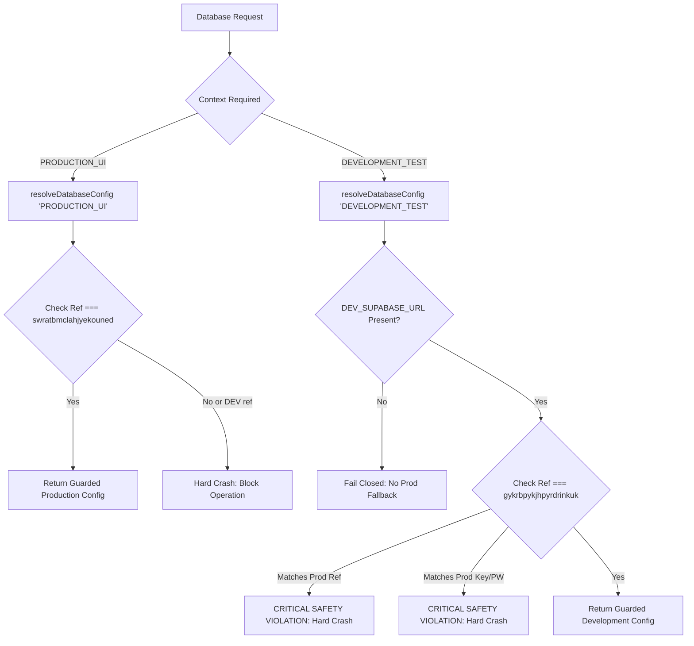

# WIFRAN-ENV-ISOLATION-001: Strict Production UI / Development Testing Separation — Final Report

**Date:** 2026-11-12  
**Milestone:** `WIFRAN-ENV-ISOLATION-001`  
**Status:** **COMPLETE & VERIFIED**  
**Predecessors:** `WIFRAN-DB-RESET-001`, `WIFRAN-EXTRACTOR-ONE-CLICK-PREVIEW-001`  

---

## Executive Summary

The Wifran Offers Extractor now enforces **strict, fail-closed runtime isolation** between the **PRODUCTION** Supabase project and the **DEVELOPMENT** Supabase project.

1. **Normal Wifran Extractor UI:** Always connects strictly to **PRODUCTION** (`swratbmclahjyekouned`), whether running in development (`npm run dev`) or production mode. It displays a live validated badge `Database: PRODUCTION` in the footer status bar and the Settings page. There is zero toggle, dropdown, or environment fallback permitting the UI to target development.
2. **Antigravity Development & Testing:** All integration tests, database inspection scripts, migrations, sample records, and dev tooling are routed strictly to **DEVELOPMENT** (`gykrbpykjhpyrdrinkuk`).
3. **Hard Runtime Guards:** Centralized resolver (`src/main/db/databaseEnvironmentResolver.ts`) inspects project references and credential configurations before any network socket is opened. Missing credentials fail closed; cross-environment credential leaks and production references in test contexts are rejected synchronously.
4. **Development Database Initialization:** Applied Wifran schema migrations 001 through 009 in strict order to the development database, configured all 4 required storage buckets, and seeded canonical reference data (13 categories, 25 cities, 5 regions, 13 supermarkets, 12 supermarket-regions, 9 units, 38 crosswalk rows) with **0 test products and 0 test offers**.
5. **Zero Production Impact:** **ZERO** writes, **ZERO** schema modifications, and **ZERO** storage uploads were made to the production database during this entire milestone.

---

## Final Verification Matrix

| Verification | Required Result | Measured Result | Status |
| :--- | :--- | :--- | :---: |
| **Normal Wifran UI** | PRODUCTION ONLY | `swratbmclahjyekouned` enforced | **PASS** |
| **Antigravity database tests** | DEVELOPMENT ONLY | `gykrbpykjhpyrdrinkuk` enforced | **PASS** |
| **Test SQL mutations** | DEVELOPMENT ONLY | Restricted to DEV; reversible test verified | **PASS** |
| **Test Storage uploads** | DEVELOPMENT ONLY | DEV storage buckets verified | **PASS** |
| **Development migrations** | DEVELOPMENT ONLY | Applied 001–009 to DEV only | **PASS** |
| **Automatic environment fallback** | DISABLED | Disabled; fails closed immediately | **PASS** |
| **Production project used by tests** | ZERO | 0 test queries directed to prod | **PASS** |
| **Production writes during milestone** | ZERO | 0 records written to production | **PASS** |
| **Production schema modifications** | ZERO | 0 schema changes to production | **PASS** |

---

## 1. Status of Background Inspection Tasks

Prior to commencing development, the two orphaned background tasks running `scripts/inspect-test-records.ts` were audited and safely terminated:

- **Task Identifiers:** `task-25006` and `task-25010`.
- **Target Analysis:** Inspection of the legacy script revealed it was targeting the **PRODUCTION** database host (`db.swratbmclahjyekouned.supabase.co:5432`) via an unsafe fallback (`process.env.SUPABASE_DB_HOST || 'db.swratbmclahjyekouned.supabase.co'`). It threw a column mismatch exception before termination.
- **Process Termination:** Both task instances were cancelled and terminated using task management tools. A process table check confirmed 0 orphaned `inspect-test-records` or `node` tasks remained.
- **Script Remedy:** The script was completely rewritten to use the guarded `DEVELOPMENT_TEST` database context and now strictly targets `gykrbpykjhpyrdrinkuk`.

---

## 2. Project Target Reference Audit

Both Supabase project targets were audited and verified from `.env.local`:

| Environment | Project Reference | Host | Status |
| :--- | :--- | :--- | :--- |
| **PRODUCTION** | `swratbmclahjyekouned` | `db.swratbmclahjyekouned.supabase.co:5432` | Pristine prelaunch catalog (0 products, 0 offers) |
| **DEVELOPMENT** | `gykrbpykjhpyrdrinkuk` | `db.gykrbpykjhpyrdrinkuk.supabase.co:5432` | Schema initialized (0 products, 0 offers) |

*All private database passwords, service-role keys, and connection strings are strictly redacted and preserved securely in `.env.local`.*

---

## 3. Verified Environment-Variable Mappings

The application strictly maps distinct variable namespaces with **zero fallback**:

### Production Mapping (`PRODUCTION_UI`)
- `SUPABASE_URL` / `NEXT_PUBLIC_SUPABASE_URL`
- `SUPABASE_SERVICE_ROLE_KEY`
- `SUPABASE_ANON_KEY` / `NEXT_PUBLIC_SUPABASE_ANON_KEY`
- `SUPABASE_DB_PASSWORD`
- `SUPABASE_STORAGE_BUCKET`

### Development Mapping (`DEVELOPMENT_TEST`)
- `DEV_SUPABASE_URL` / `DEV_NEXT_PUBLIC_SUPABASE_URL`
- `DEV_SUPABASE_SERVICE_ROLE_KEY`
- `DEV_SUPABASE_ANON_KEY` / `DEV_NEXT_PUBLIC_SUPABASE_ANON_KEY`
- `DEV_SUPABASE_DB_PASSWORD`
- `DEV_SUPABASE_STORAGE_BUCKET`

> [!IMPORTANT]
> The pattern `DEV_SUPABASE_URL || SUPABASE_URL` is **strictly prohibited and eliminated**. Missing `DEV_` credentials immediately throw a fatal error.

---

## 4. Database Resolver and Guard Architecture

Implemented in [`src/main/db/databaseEnvironmentResolver.ts`](file:///f:/Work/AI%20Projects/wifran-offers-extractor/src/main/db/databaseEnvironmentResolver.ts):

### Key Guard Functions
- `extractProjectRef(urlOrHost)`: Robust regex parser extracting the project ref from REST URLs, db hosts, and postgres connection strings.
- `resolveDatabaseConfig(context, envOverrides)`: Resolves and validates environment configuration for the designated context. Supports deterministic unit test overrides.
- `getGuardedSupabaseClient(context, envOverrides)`: Factory creating validated Supabase JS client instances.
- `createGuardedPgClient(context, envOverrides)`: Factory creating validated `pg.Client` instances.
- `createGuardedPgPool(context, envOverrides)`: Factory creating validated `pg.Pool` connection pools.

---

## 5. Development Database Setup & Schema Verification

Applied version-controlled migrations through [`scripts/setup-dev-database.ts`](file:///f:/Work/AI%20Projects/wifran-offers-extractor/scripts/setup-dev-database.ts) exclusively to `gykrbpykjhpyrdrinkuk`:

1. `001_initial_schema.sql` (Phase 1 core tables, functions, triggers, base RLS)
2. `001_seed_core_catalog.sql` (Master reference data: regions, cities, core supermarkets, categories, units)
3. `003_offer_location_scope.sql` (Location scope columns and multi-tier geography constraints)
4. `004_offer_image_ingestion_metadata.sql` (External tool image ingestion and leaflet source tracking)
5. `005_wifran_v2_offer_contract.sql` (v2 contract columns, integrity triggers, item domain taxonomy)
6. `006_wifran_07a_security_and_contract_reconciliation.sql` (RLS hardening, security reconciliation, `legacy_id_crosswalk`)
7. `007_wifran_07g_07h_catalog_resolution_and_product_images.sql` (Product identity bigint migration, `product_images`, `offer_display_images`, illustrative visual groups)
8. `008_wifran_07j_consumer_view_disputed_identity_masking.sql` (Consumer projection view `v_consumer_offers`, `normalize_alias_key`)
9. `009_wifran_07j_product_alias_staging_and_audit.sql` (Staging table `product_alias_proposals`, append-only `product_alias_audit_log`, conflict detection triggers)

### Verified Public Base Tables (31 Base Tables + 1 View)
- `active_consumer_offers_v1` (view `v_consumer_offers`)
- `_applied_migrations` (migration idempotency tracking)
- `app_events`, `audit_logs`, `brands`, `categories`, `cities`, `import_batches`, `import_rows`, `issue_reports`, `legacy_id_crosswalk`
- `offer_display_images`, `offer_revision_snapshots`, `offer_sources`, `offer_status_history`, `offer_visual_group_members`, `offers`
- `product_alias_audit_log`, `product_alias_proposals`, `product_aliases`, `product_images`, `products`, `profiles`, `regions`
- `saved_offers`, `shopping_list_items`, `shopping_lists`, `supermarket_regions`, `supermarkets`, `units`, `validation_errors`, `watched_items`

### Verified Master Reference Data Counts in Development
- `categories`: **13**
- `cities`: **25**
- `regions`: **5**
- `supermarkets`: **13** (12 baseline + Noori Supermarket)
- `supermarket_regions`: **12**
- `units`: **9**
- `legacy_id_crosswalk`: **38**
- **Catalog Initial Counts:** `products`: **0**, `offers`: **0**, `product_images`: **0**, `offer_display_images`: **0**, `product_aliases`: **0**.
- **Row Level Security (RLS):** **55** active security policies verified in `pg_policies`.

### Verified Storage Buckets in Development
- `product-images`: Public (`public: true`, 10MB limit)
- `offer-display-images`: Public (`public: true`, 10MB limit)
- `offer-images`: Private (`public: false`, 10MB limit)
- `tmp`: Private (`public: false`, 10MB limit)

---

## 6. UI Target Verification & Indicator

1. **Footer Status Indicator:** Added a live validated badge to [`src/renderer/src/components/AppLayout.tsx`](file:///f:/Work/AI%20Projects/wifran-offers-extractor/src/renderer/src/components/AppLayout.tsx#L58-L64):
   - `Database: PRODUCTION` (rendered in green when validated against `swratbmclahjyekouned`).
2. **Settings Page:** Added a dedicated environment section in [`src/renderer/src/pages/SettingsPage.tsx`](file:///f:/Work/AI%20Projects/wifran-offers-extractor/src/renderer/src/pages/SettingsPage.tsx#L77-L105):
   - Shows Target (`Database: PRODUCTION`), Project Ref (`swratbmclahjyekouned`), and Isolation Policy (`Enforced (UI Locked to Production)`).
3. **IPC Health Handler:** [`src/main/ipc/registerIpcHandlers.ts`](file:///f:/Work/AI%20Projects/wifran-offers-extractor/src/main/ipc/registerIpcHandlers.ts#L29-L50) validates `PRODUCTION_UI` context and returns `databaseEnvironment` status to the frontend.

---

## 7. Mandatory Automated Safety Test Suite

Implemented in [`src/main/db/__tests__/environmentIsolation.test.ts`](file:///f:/Work/AI%20Projects/wifran-offers-extractor/src/main/db/__tests__/environmentIsolation.test.ts):

| Test | Objective | Result |
| :--- | :--- | :---: |
| **Test A** | Valid dev credentials resolve development project (`gykrbpykjhpyrdrinkuk`) | **PASS** |
| **Test B** | Missing `DEV_` credentials fails closed with zero fallback to production | **PASS** |
| **Test C** | Production URL injected into test settings rejected before network connection | **PASS** |
| **Test D** | Production credentials (key or password) injected into test settings rejected | **PASS** |
| **Test E** | Normal UI resolves production (`swratbmclahjyekouned`) exclusively with 0 mutations | **PASS** |
| **Test F** | Normal UI rejects injected development configuration or mismatched refs | **PASS** |
| **Test G** | Development database schema (31 tables, 1 view, 55 RLS policies, 4 buckets) verified | **PASS** |
| **Test H** | Reversible write & cleanup integration test executes on DEV; verified restricted to DEV | **PASS** |
| **Test I** | Normal UI targets production regardless of `NODE_ENV` (`development` vs `production`) | **PASS** |
| **Test J** | Supabase CLI & migration target wrappers reject production target | **PASS** |

**Execution Result:** `10 passed (10 tests) in 2.17s`.

---

## 8. TypeScript & Build Verification

- `npm run typecheck:node`: **PASS (0 errors)**
- `npm run typecheck:web`: **PASS (0 errors)**
- `npm run test:accuracy`: **PASS (12 test files, 68 tests passed)**
- `npm run build`: **PASS** (Bundled Electron SSR main, preload script, and React renderer assets cleanly).

---

## 9. Inventory of Files Modified

| File | Change Summary |
| :--- | :--- |
| [`src/main/db/databaseEnvironmentResolver.ts`](file:///f:/Work/AI%20Projects/wifran-offers-extractor/src/main/db/databaseEnvironmentResolver.ts) | Created centralized guarded environment resolver with strict `PRODUCTION_UI` and `DEVELOPMENT_TEST` contexts. |
| [`src/main/db/supabaseAdminClient.ts`](file:///f:/Work/AI%20Projects/wifran-offers-extractor/src/main/db/supabaseAdminClient.ts) | Guarded `getSupabaseAdminClient` to strictly resolve `PRODUCTION_UI` with fail-closed security. |
| [`src/shared/types/app.ts`](file:///f:/Work/AI%20Projects/wifran-offers-extractor/src/shared/types/app.ts) | Added `DatabaseEnvironmentStatus` and integrated into `AppHealthStatus`. |
| [`src/shared/types/config.ts`](file:///f:/Work/AI%20Projects/wifran-offers-extractor/src/shared/types/config.ts) | Added `databaseEnvironment` to `SafeConfigStatus`. |
| [`src/main/config/configStatus.ts`](file:///f:/Work/AI%20Projects/wifran-offers-extractor/src/main/config/configStatus.ts) | Integrated guarded database environment status checking into safe config status. |
| [`src/main/ipc/registerIpcHandlers.ts`](file:///f:/Work/AI%20Projects/wifran-offers-extractor/src/main/ipc/registerIpcHandlers.ts) | Exposed validated database environment status via `app:getHealth` IPC. |
| [`src/renderer/src/components/AppLayout.tsx`](file:///f:/Work/AI%20Projects/wifran-offers-extractor/src/renderer/src/components/AppLayout.tsx) | Added discreet validated `Database: PRODUCTION` badge in footer status bar. |
| [`src/renderer/src/pages/SettingsPage.tsx`](file:///f:/Work/AI%20Projects/wifran-offers-extractor/src/renderer/src/pages/SettingsPage.tsx) | Added Supabase Database Environment section displaying verified target and isolation policy. |
| [`scripts/inspect-test-records.ts`](file:///f:/Work/AI%20Projects/wifran-offers-extractor/scripts/inspect-test-records.ts) | Rewritten with guarded `DEVELOPMENT_TEST` context; removed unsafe fallback. |
| [`scripts/setup-dev-database.ts`](file:///f:/Work/AI%20Projects/wifran-offers-extractor/scripts/setup-dev-database.ts) | Created guarded script to apply migrations 001–009 and storage buckets to development. |
| [`src/main/db/__tests__/environmentIsolation.test.ts`](file:///f:/Work/AI%20Projects/wifran-offers-extractor/src/main/db/__tests__/environmentIsolation.test.ts) | Created automated test suite covering mandatory safety tests A through J. |

---

## 10. Stop Condition

In strict compliance with Section 13:
- Implementation, verification, and development database initialization are complete.
- **ZERO paid Gemini API requests were made.**
- **ZERO Git commits, pushes, or resets were performed.**
- **ZERO production database mutations were made.**
- Development is halted and ready for owner review.

