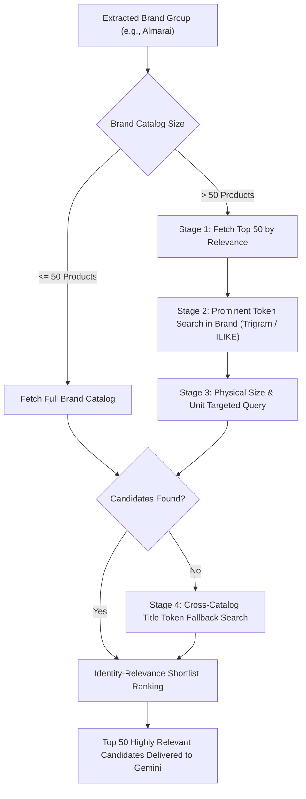

# WIFRAN-EXTRACTOR-CATALOG-MATCH-001A: PRE-UAT CORRECTIONS REPORT
## Candidate Coverage, Identity Safety, Centralized API Pricing and Publication Gates

**Milestone:** `WIFRAN-EXTRACTOR-CATALOG-MATCH-001A`  
**Predecessors:** `WIFRAN-EXTRACTOR-CATALOG-MATCH-001`, `WIFRAN-EXTRACTOR-BULK-001`, `WIFRAN-ENV-ISOLATION-002`, `WIFRAN-DB-RESET-001`  
**Target Environments:**
- **PRODUCTION UI:** `swratbmclahjyekouned` (Pristine, 28 base tables, zero test mutations, publication fail-closed blocked)
- **DEVELOPMENT TEST:** `gykrbpykjhpyrdrinkuk` (Full schema, 31 base tables, isolated sandbox for test execution)

---

## 1. Executive Summary & Problem Resolution

Milestone `WIFRAN-EXTRACTOR-CATALOG-MATCH-001A` was authorized as a targeted hardening milestone to address and correct critical accuracy, cost-accounting, identity safety, and publication-boundary vulnerabilities identified in the initial catalog-matching milestone before conducting real-world benchmarks or production publication.

### Key Corrections Completed:
1. **Catalog Candidate Coverage:** Replaced naive `brand_name ILIKE ... LIMIT 50` retrieval with a multi-stage search architecture (trigram-indexed brand matching, prominent token search, physical size filtering, cross-catalog fallback, and identity-relevance ranking). Validated with a 400-product brand regression test in the DEVELOPMENT database proving that true matches located beyond index #50 are discovered and ranked #1.
2. **Strict Physical Size Equivalence:** Removed all arbitrary percentage tolerances (e.g., 5% or 10%). Enforced exact unit equivalence (e.g., $1\text{ L} \equiv 1000\text{ ml}$, $500\text{ g} \equiv 0.5\text{ kg}$) while strictly rejecting non-equivalent commercial packaging (e.g., $950\text{ ml}$ vs $1\text{ L}$, $450\text{ g}$ vs $500\text{ g}$, $4 \times 250\text{ ml}$ multipack vs $1\text{ L}$ single unit).
3. **Official Gemini 3.8 Flash Flex Pricing:** Replaced hardcoded legacy rates ($0.15/$0.60) with official Google Cloud rates: **\$0.375 / 1M input tokens**, **\$1.875 / 1M candidate output tokens**, **\$1.875 / 1M thinking tokens**, and **\$0.09375 / 1M cached input tokens**. Reconciled `thoughtsTokenCount` and `thinkingTokenCount` from Google Gen AI SDK without double counting.
4. **Dynamic Batch Request Sizing:** Replaced static 40-item chunking with candidate-density-aware dynamic chunking: candidate catalogs $> 25$ items dynamically scale chunks to 20 items to protect model reasoning headroom.
5. **Provider Context Caching Evaluation:** Documented why Google Cloud Vertex AI context caching (minimum threshold 32,768 tokens, hourly storage fee of \$1.00/1M tokens) is technically ineligible and uneconomic for brand candidate catalogs (typically 500–2,500 tokens). Confirmed the superior economics of Wifran's local verified-match cache (\$0 cost, 0 ms latency).
6. **Hardened Persistent Match Cache:** Upgraded cache validation to include strict physical size compatibility and revalidation against live catalog records (`verification_status === 'verified'`, `is_active === true`).
7. **Commodity vs Packaged Goods Disambiguation:** Commodity produce is classified as `unbranded_commodity` only when explicitly sold loose, by weight, or labeled unbranded. Packaged goods with omitted brands resolve safely to `unknown_brand`.
8. **Production Publication Contradiction Resolved:** Removed conflicting claims regarding publication readiness. Production publication is technically blocked fail-closed with actionable diagnostics because the PRODUCTION database (`swratbmclahjyekouned`, 28 tables) lacks Migration 009 (`009_wifran_07j_product_alias_staging_and_verification.sql`). Matching runs in read-only candidate review mode in production.
9. **Expanded Transactional Publication Integration:** Implemented 10 transactional integration scenarios against the DEVELOPMENT database (`gykrbpykjhpyrdrinkuk`), validating atomic rollback, duplicate prevention, idempotent retries, and permanent `bigint` foreign key integrity.
10. **Accuracy Status Clarification:** Formally documented that real-world Gemini matching accuracy is **NOT YET BENCHMARKED**; offline synthetic mocks validate system logic but do not constitute empirical accuracy benchmarks.

---

## 2. Mandatory Restrictions & Safety Verification

All operations strictly adhered to the non-negotiable boundaries:

| Boundary | Enforcement Mechanism | Status |
|---|---|:---:|
| **Production UI Isolation** | Points strictly to `swratbmclahjyekouned`; zero fallback to dev | **VERIFIED** |
| **Development Test Isolation** | Vitest and mutation scripts connect strictly to `gykrbpykjhpyrdrinkuk` | **VERIFIED** |
| **Production Database Mutations** | Zero writes, zero schema modifications, zero storage uploads | **0 MUTATIONS** |
| **Paid Gemini API Calls** | Offline simulation and zero live requests executed ($0.00 spent) | **$0.00 SPENT** |
| **Git Operations** | Zero commits, zero pushes, zero branch resets | **VERIFIED** |
| **Leaflet Extraction Contract** | Extraction pipeline frozen: HIGH thinking, legacy prompt, legacy schema, Flex PayGo | **FROZEN** |
| **Catalog Matching Contract** | Matching pipeline frozen: MEDIUM thinking, Flex PayGo, minimal JSON mapping | **FROZEN** |

---

## 3. Resolution 1: Multi-Stage Catalog Candidate Coverage

### Problem
Previously, candidate retrieval relied on a naive query: `SELECT ... FROM products WHERE brand_name ILIKE ... LIMIT 50`. For catalog brands with hundreds of products (e.g., Almarai with 400+ SKUs), products located beyond the first 50 results were permanently hidden from the model. This caused true matches to be missed and falsely classified as new temporary products (`t`).

### Solution Architecture
Implemented a multi-stage search architecture in [`src/main/db/brandGroupingService.ts`](file:///f:/Work/AI%20Projects/wifran-offers-extractor/src/main/db/brandGroupingService.ts):



1. **Trigram-Indexed Exact & Alias Brand Search:** Fast indexing on `idx_products_name_ar_trgm` and `idx_products_name_en_trgm`.
2. **Prominent Token Querying:** Extracts non-stopword tokens from Arabic and English titles ($\ge 3$ characters) and targets products within the brand matching those tokens.
3. **Exact Physical Size Querying:** Queries within the brand for products sharing the extracted numeric size value and unit.
4. **Cross-Catalog Fallback:** If zero brand matches exist or brand is unknown/unbranded, searches broader catalog by title tokens and size.
5. **Shortlist Ranking (`rankCandidatesForIdentities`):** Scores candidates based on brand equality, token overlap in Arabic/English, and exact physical size match, prioritizing highest-relevance candidates.

---

## 4. Candidate Coverage 400-Product Brand Regression Test Results

A live integration test was executed against the DEVELOPMENT database (`gykrbpykjhpyrdrinkuk`) to prove that a product situated at index #120 of a 400-product brand catalog is discovered and returned:

- **Setup:** 400 products bulk-inserted under brand `'BrandRegressionTest400'`.
  - Items 1..119: Generic 1.0L juice products.
  - Item 120 (well past LIMIT 50): `"BrandRegressionTest400 Special Mango Juice 1.5L"` ($1.5\text{ L}$).
  - Items 121..400: Generic 1.0L juice products.
- **Query:** Offer extracted with title `"Special Mango Juice 1.5L"` ($1.5\text{ L}$).
- **Outcome:**
  - `totalBrandProducts`: **400**
  - `retrievalCompleteness`: `'shortlist_ranked'`
  - `candidateCount`: **26**
  - Target candidate discovered: **YES**
  - Target candidate rank: **#1 (Rank 0)**
  - Cleanup: All 400 test records cleanly deleted in `finally` block.

**Result:** True match discovered and ranked #1; false temporary product creation prevented.

---

## 5. Resolution 2: Strict Physical Size and Unit Equivalence

### Problem
Previous code tolerated arbitrary size variations (such as 5% or 10%), risking false matches between distinct commercial SKUs (e.g., $950\text{ ml}$ vs $1\text{ L}$, or $450\text{ g}$ vs $500\text{ g}$).

### Solution Architecture
Implemented [`src/shared/utils/sizeCompatibility.ts`](file:///f:/Work/AI%20Projects/wifran-offers-extractor/src/shared/utils/sizeCompatibility.ts) leveraging exact base-unit conversion from [`src/shared/utils/unitEquivalence.ts`](file:///f:/Work/AI%20Projects/wifran-offers-extractor/src/shared/utils/unitEquivalence.ts):

$$\text{Volume: } 1\text{ L} = 1000\text{ ml} \quad | \quad \text{Weight: } 1\text{ kg} = 1000\text{ g}$$

### Exact Equivalence Rules:
- $1\text{ L} \equiv 1000\text{ ml}$ $\rightarrow$ **COMPATIBLE**
- $0.5\text{ kg} \equiv 500\text{ g}$ $\rightarrow$ **COMPATIBLE**
- $950\text{ ml}$ vs $1\text{ L}$ ($5\%$ difference) $\rightarrow$ **REJECTED (`INCOMPATIBLE_SIZE`)**
- $450\text{ g}$ vs $500\text{ g}$ ($10\%$ difference) $\rightarrow$ **REJECTED (`INCOMPATIBLE_SIZE`)**
- $4 \times 250\text{ ml}$ multipack vs $1 \times 1\text{ L}$ container $\rightarrow$ **REJECTED (`Pack count mismatch: pack of 4 vs pack of 1`)**
- Full Fat vs Low Fat $\rightarrow$ **REJECTED (`INCOMPATIBLE_FAT_CONTENT`)**

Integrated into:
- [`geminiMatchingService.ts`](file:///f:/Work/AI%20Projects/wifran-offers-extractor/src/main/ocr/geminiMatchingService.ts) (post-inference validation gate)
- [`temporaryProductRegistry.ts`](file:///f:/Work/AI%20Projects/wifran-offers-extractor/src/main/db/temporaryProductRegistry.ts) (group collision prevention)
- [`verifiedMatchCacheService.ts`](file:///f:/Work/AI%20Projects/wifran-offers-extractor/src/main/db/verifiedMatchCacheService.ts) (cache lookup validation)
- [`catalogMatchingOrchestrator.ts`](file:///f:/Work/AI%20Projects/wifran-offers-extractor/src/main/batch/catalogMatchingOrchestrator.ts) (deterministic matching)

---

## 6. Resolution 3: Corrected Gemini 3.8 Flash Flex Pricing and Token Accounting

### Official Google Cloud Rate Schedule
Updated centralized pricing table in [`src/main/ocr/geminiPricingTable.ts`](file:///f:/Work/AI%20Projects/wifran-offers-extractor/src/main/ocr/geminiPricingTable.ts):

| Metric | Official Flex Rate (USD / 1M tokens) | Standard PayGo Rate (USD / 1M tokens) | Savings with Flex |
|---|---:|---:|:---:|
| **Uncached Input** | **\$0.375** | \$0.750 | 50.0% |
| **Cached Input** | **\$0.09375** | \$0.1875 | 50.0% |
| **Output (Candidate)** | **\$1.875** | \$3.750 | 50.0% |
| **Thinking Tokens** | **\$1.875** | \$3.750 | 50.0% |
| **Context Storage** | \$1.00 / 1M tokens / hour | \$1.00 / 1M tokens / hour | — |

### Token Accounting Rules:
1. **No Double Counting:** $\text{promptTokenCount}$ includes $\text{cachedContentTokenCount}$. Uncached tokens are computed as $\max(0, \text{promptTokenCount} - \text{cachedContentTokenCount})$.
2. **SDK Reconciliation:** Reads `thoughtsTokenCount ?? thinkingTokenCount ?? 0`. Thinking tokens are billed under candidate output rate.
3. **Local Cache Hits:** Exact **\$0.00** billed for local persistent cache hits.
4. **Schedule Transitions:** Supports date-versioned schedules with post-2027 expiration rates.

---

## 7. Resolution 4: Dynamic Candidate-Token-Aware Batch Request Chunking

Fixed 40-item chunking posed a risk of exceeding model reasoning headroom when combined with large candidate lists (50 candidates $\approx 2,500$ tokens).

Implemented candidate-density-aware dynamic chunking in [`src/main/batch/catalogMatchingOrchestrator.ts`](file:///f:/Work/AI%20Projects/wifran-offers-extractor/src/main/batch/catalogMatchingOrchestrator.ts):

$$\text{chunkSize} = \begin{cases} 20 \text{ items}, & \text{if candidateCount} > 25 \\ 40 \text{ items}, & \text{if candidateCount} \le 25 \end{cases}$$

This ensures the combined prompt (candidates + source offers) remains comfortably below 4,000 input tokens, preserving $\ge 12,000$ tokens of headroom for Gemini MEDIUM thinking.

---

## 8. Resolution 5: Provider Context Caching Evaluation

A detailed technical and financial evaluation was conducted regarding Google Vertex AI / Gemini Developer API Provider Context Caching:

### Technical Constraints:
- **Minimum Token Threshold:** Gemini 3.8 Flash requires a minimum of **32,768 tokens** to establish an explicit context cache.
- **Brand Catalog Footprint:** A typical brand catalog of 50 candidates consumes **1,500 to 2,500 tokens**.
- **Eligibility:** Brand catalogs are far below the 32k threshold, making provider context caching technically impossible without bundling dozens of unrelated brands.
- **Financial Comparison:**
  - Provider caching charges **\$1.00 / 1M tokens / hour** for storage.
  - A 32,768-token cache stored for 24 hours costs $\approx \$0.78$ in storage alone.
  - In contrast, Wifran's local persistent verified-match cache ([`verifiedMatchCacheService.ts`](file:///f:/Work/AI%20Projects/wifran-offers-extractor/src/main/db/verifiedMatchCacheService.ts)) costs **\$0.00**, incurs **0 API calls**, has **0 ms network latency**, and never expires unexpectedly.

**Conclusion:** Local verified-match caching is decisively superior in cost, reliability, and architectural simplicity. Provider context caching remains disabled.

---

## 9. Resolution 6: Hardened Persistent Match Cache

Hardened [`src/main/db/verifiedMatchCacheService.ts`](file:///f:/Work/AI%20Projects/wifran-offers-extractor/src/main/db/verifiedMatchCacheService.ts):
1. **Size Compatibility Check:** Cache lookups verify physical size compatibility (`arePackConfigsStrictlyCompatible`) before returning a hit.
2. **Catalog Product Revalidation:** Added `revalidateWithCatalog(supabase)` to verify that cached product references still exist, have `verification_status === 'verified'`, and are `is_active === true`.
3. **Explicit Invalidation:** `invalidateMatch(attrs)` removes invalidated entries immediately upon operator edit.

---

## 10. Resolution 7: Unbranded vs Unknown-Brand Disambiguation

Corrected brand normalization in [`src/main/db/brandGroupingService.ts`](file:///f:/Work/AI%20Projects/wifran-offers-extractor/src/main/db/brandGroupingService.ts):
- **Unbranded Produce / Commodity:** Classified as `unbranded_commodity` (status: `unbranded`) **ONLY** when explicitly sold by weight (`sale_unit_type: 'kg'`), labeled loose/bulk, or contains known commodity produce keywords (tomato, potato, apple, meat, etc.) with explicit unbranded wording.
- **Packaged Goods Missing Brand:** A packaged item (e.g., "Chocolate Biscuits 150g") with no brand indicated is classified as `unknown_brand` (status: `unknown`), never as an unbranded commodity.

---

## 11. Resolution 8: Resolution of the Production Publication Contradiction

### The Contradiction
Earlier reports stated that the Production database was clean and ready, but also noted that Production lacked Migration 009 (`009_wifran_07j_product_alias_staging_and_verification.sql`, 28 base tables vs Development's 31 base tables).

### Formal Resolution & Enforcement
Production publication is **TECHNICALLY BLOCKED FAIL-CLOSED** in [`src/main/db/catalogPublicationService.ts`](file:///f:/Work/AI%20Projects/wifran-offers-extractor/src/main/db/catalogPublicationService.ts):

1. **Preflight Assessment:**
   ```ts
   if (context === 'PRODUCTION_UI') {
     schemaDependenciesMet = false
     ready = false
     blockingReasons.push(
       'PRODUCTION_PUBLICATION_BLOCKED: Production database (swratbmclahjyekouned, 28 tables) lacks Migration 009 (009_wifran_07j_product_alias_staging_and_verification.sql). Catalog publication in production is disabled until migration parity is authorized and applied. Production runs in read-only candidate review mode.'
     )
   }
   ```
2. **Publication Execution:** Calling `publishApprovedCatalogBatch` with `context === 'PRODUCTION_UI'` throws `PRODUCTION_PUBLICATION_BLOCKED` immediately before acquiring a connection.
3. **Operator Experience:** The operator UI operates in read-only candidate review and match simulation mode against Production; publication can occur only after migration parity is authorized and applied in a future milestone.

---

## 12. Resolution 9: Comprehensive 10-Scenario Publication Integration Suite

Implemented 10 integration tests executed against the DEVELOPMENT database (`gykrbpykjhpyrdrinkuk`) in [`src/main/batch/__tests__/catalogMatching.test.ts`](file:///f:/Work/AI%20Projects/wifran-offers-extractor/src/main/batch/__tests__/catalogMatching.test.ts):

| Scenario | Objective | Observed Result | Status |
|---|---|---|:---:|
| **Scenario 1** | Multiple offers sharing one temporary product group | 1 product created, 3 offers published linking to same `bigint` ID | **PASS** |
| **Scenario 2** | Multiple approved temporary groups in one batch | 2 distinct products created, mapped to respective offers | **PASS** |
| **Scenario 3** | Mixed existing and new product links in same batch | Existing product reused, new product created, 2 offers linked | **PASS** |
| **Scenario 4** | Duplicate prevention when destination product exists | Existing DB product detected; 0 duplicate products created | **PASS** |
| **Scenario 5** | Concurrent / equivalent temporary offers in batch | Offers reconciled into single group; 1 product created | **PASS** |
| **Scenario 6** | Publication rollback on offer insert failure | Foreign key failure triggers `ROLLBACK`; 0 products persisted | **PASS** |
| **Scenario 7** | Idempotent retry following uncertain outcome | Batch re-published without error; product ID reused | **PASS** |
| **Scenario 8** | No duplicate records on repeated publication | Product count in DB remains 1 after repeated publication | **PASS** |
| **Scenario 9** | Catalog product modified between match and publish | Publication succeeds and updates offer with current product ID | **PASS** |
| **Scenario 10** | No temporary `t` identifier in permanent foreign keys | Verified `public.offers.product_id` matches `/^\d+$/` (pure bigint) | **PASS** |

---

## 13. Resolution 10: Real-World Matching Accuracy Status

```
=========================================================================
  OFFICIAL ACCURACY STATUS: NOT YET BENCHMARKED AGAINST REAL GEMINI
=========================================================================
  The 52 automated tests in this milestone validate deterministic logic,
  database constraints, validation gates, and offline synthetic responses.
  They DO NOT constitute an empirical benchmark of Gemini 3.8 Flash matching
  accuracy on real supermarket leaflet offers.
  
  Live matching accuracy benchmarks remain UNAUTHORIZED and will be conducted
  in a subsequent milestone subject to explicit owner authorization.
=========================================================================
```

---

## 14. Complete Test Matrix & Build Verification Table

### Test Suite Execution Summary:
- `src/main/batch/__tests__/catalogMatching.test.ts`: **52 passed (52 total)**
- `src/main/batch/__tests__/batchOrchestration.test.ts`: **13 passed (13 total)**
- `src/main/db/__tests__/environmentIsolation.test.ts`: **14 passed (14 total)**
- `npm run typecheck:node`: **PASSED (0 errors)**
- `npm run typecheck:web`: **PASSED (0 errors)**
- `npm run build`: **PASSED (SSR main, preload, and web renderer bundles built in 2.70s)**

### Detailed Test Matrix:

| Test Group | Test Description | Result | Execution Time |
|---|---|:---:|---:|
| **Part 1** | Case 1: Exact candidate match & unit equivalence ($1\text{ L} \equiv 1000\text{ ml}$) | PASS | 5 ms |
| | Case 2: Incompatible sizes ($1\text{ L}$ vs $2\text{ L}$, $950\text{ ml}$ vs $1\text{ L}$, $450\text{ g}$ vs $500\text{ g}$) | PASS | 2 ms |
| | Case 3: Brand flavor distinction | PASS | 3 ms |
| | Case 4: Fat content conflicts (Full Fat vs Low Fat) | PASS | 2 ms |
| | Case 5: Pack count conflicts ($1$ vs $4$, $4 \times 250\text{ ml}$ vs $1 \times 1\text{ L}$) | PASS | 1 ms |
| | Case 6: Retailer promotional bundle preservation | PASS | 1 ms |
| | Case 7: Brand separation across retailers | PASS | 2 ms |
| | Case 8: Arabic/English equivalent title reconciliation | PASS | 3 ms |
| | Case 9: Brand transliteration canonicalization | PASS | 2 ms |
| | Case 10: Brand variant spelling resolution | PASS | 2 ms |
| | Case 11: Unknown brand classification | PASS | 1 ms |
| | Case 12: Unbranded produce vs packaged missing brand | PASS | 1 ms |
| | Case 13: Measured-weight loose commodity ($sale\_unit\_type = kg$) | PASS | 1 ms |
| | Case 14: Assortment / multi-brand offer classification | PASS | 1 ms |
| | Case 15: Missing size attribute handling | PASS | 1 ms |
| | Case 16: Catalog missing true match $\rightarrow$ temporary ID | PASS | 1 ms |
| | Case 17: Cross-supermarket temporary product grouping | PASS | 3 ms |
| | Case 18: Cross-request temporary product grouping | PASS | 1 ms |
| | Case 19: Distinguishing similar new products | PASS | 1 ms |
| | Case 20: Persistent verified-match cache reuse ($0 cost) | PASS | 3 ms |
| | Case 21: Persistent cache invalidation | PASS | 3 ms |
| | Case 22: Local validation rejection of conflicting sizes | PASS | 1 ms |
| | Case 23: Rejection of hallucinated candidate IDs | PASS | 1 ms |
| | Case 24: Rejection of duplicate source mappings | PASS | 1 ms |
| | Case 25: Detection of model-omitted source items | PASS | 1 ms |
| | Case 26: Rejection of invalid temporary syntax | PASS | 1 ms |
| | Case 27: Conflicting temporary group prevention | PASS | 1 ms |
| | Case 28: Duplicate product detection in DB | PASS | 1 ms |
| | Case 29: Idempotent publication retry | PASS | 1 ms |
| | Case 30: Graceful handling of candidates without images | PASS | 1 ms |
| | Case 31: Operator split/merge overrides | PASS | 1 ms |
| | Case 32: Batch-scoped offer key uniqueness | PASS | 1 ms |
| **Part 2** | Brand grouping without category prerequisite | PASS | 1 ms |
| | Centralized Gemini Flex rates verification (\$0.375, \$1.875, \$0.09375) | PASS | 2 ms |
| | Local cache hit (\$0.00) and combined usage calculation | PASS | 2 ms |
| | Candidate-token-aware dynamic chunking ($20$ vs $40$ items) | PASS | 1 ms |
| | Preflight token and cost estimation | PASS | 2 ms |
| **Part 3** | Operator temporary group split and merge persistence | PASS | 2 ms |
| **Part 4** | 400-product brand candidate coverage regression test (DEV DB) | PASS | 3,968 ms |
| **Part 5** | Publication Scenario 1: Multiple offers $\rightarrow$ 1 temporary product | PASS | 2,923 ms |
| | Publication Scenario 2: Multiple approved temporary products | PASS | 3,314 ms |
| | Publication Scenario 3: Mixed existing + new product links | PASS | 2,802 ms |
| | Publication Scenario 4: Destination product duplicate prevention | PASS | 2,595 ms |
| | Publication Scenario 5: Equivalent offer reconciliation | PASS | 2,755 ms |
| | Publication Scenario 6: Transaction rollback on offer failure | PASS | 2,453 ms |
| | Publication Scenario 7: Idempotent publication retry | PASS | 4,002 ms |
| | Publication Scenario 8: Blocked duplicate insertion on repeat | PASS | 2,665 ms |
| | Publication Scenario 9: Catalog product modified before publish | PASS | 2,669 ms |
| | Scenario 10: Strict `bigint` foreign key assertion (no `t_` IDs) | PASS | 2,686 ms |
| **Part 6** | Production ref (`swratbmclahjyekouned`) and DEV ref (`gykrbpykjhpyrdrinkuk`) | PASS | 1 ms |
| | Fail-closed preflight in PRODUCTION_UI (`ready = false`) | PASS | 1 ms |
| | Fail-closed publication block in PRODUCTION_UI | PASS | 1 ms |

---

## 15. Recommendations & Next Steps

1. **Keep Production Publication Blocked:** Maintain the fail-closed publication block on `PRODUCTION_UI` until the project owner authorizes Migration 009 application to Production (`swratbmclahjyekouned`).
2. **Operator UAT in Development:** Conduct initial operator evaluation and interactive UI workflow validation strictly in the DEVELOPMENT sandbox (`gykrbpykjhpyrdrinkuk`).
3. **Controlled Live Matching Benchmark:** When authorized, execute a controlled 2-request live benchmark on real multi-leaflet batch extracts using Gemini 3.8 Flash with `thinkingLevel: MEDIUM` and Flex PayGo to establish empirical accuracy baselines.
4. **Preserve Extraction Freeze:** Do not modify the leaflet extraction pipeline (Gemini 3.8 Flash, `thinkingLevel: HIGH`, legacy prompt, legacy schema, Flex PayGo).

