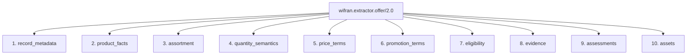
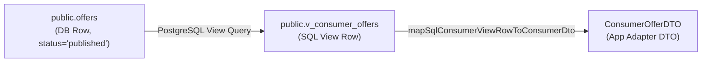

# Extractor to Wifran App Integration Handoff Guide
**Data Contract Version**: `wifran.extractor.offer/2.0` (`contract_v2`)  
**Database Schema**: Additive Migrations `001` through `006` (`006_wifran_07a_security_and_contract_reconciliation.sql`)  
**Public Consumer View**: `public.v_consumer_offers` (Hardened with `WHERE o.status = 'published'`)  
**RPC Shopping Date Access**: `public.get_consumer_offers_for_shopping_date()`  
**Document Status**: Official Release Candidate (Reconciled with WIFRAN-07A / INT-F01..INT-F12)  

---

## 1. Executive Summary & Purpose

This document serves as the authoritative handoff and integration reference for the **Wifran Mobile & Web Engineering Teams**. It details how extracted supermarket promotional offers are represented, persisted, and consumed under the `WIFRAN-04` and `WIFRAN-07A` (`wifran.extractor.offer/2.0`) contract.

The extractor operates with **100% catalog self-sufficiency**, automatically seeding all Saudi supermarkets, regions, cities, and categories, and exports offers through two complementary interfaces:
1. **JSON Data Contract (`contract_v2`)**: A rich, self-contained 10-domain contract attached to every canonical offer export.
2. **PostgreSQL Relational Schema & View (`v_consumer_offers`)**: Hardened by migration `006_wifran_07a_security_and_contract_reconciliation.sql` providing indexed columns on `public.offers`, strict RLS, immutable revision snapshots (`offer_revision_snapshots`), recursive workstation path sanitization (`build_sanitized_consumer_contract_v2`), and publication filtering (`WHERE o.status = 'published'`).

---

## 2. Saudi Supermarket & Geography Master Registry

All master data entities use deterministic, environment-independent UUIDs and 4-letter codes. Consumer applications can rely on these keys across staging and production without re-mapping.

### 2.1 Supermarket Chains (12 Major Saudi Chains)
| Supermarket ID | Slug | Code | Arabic Name | English Name |
| :--- | :--- | :--- | :--- | :--- |
| `c2cc16c2-0001-4444-b000-c00000000001` | `panda` | `PAND` | هايبر بنده / بنده | Panda / HyperPanda |
| `c2cc16c2-0002-4444-b000-c00000000002` | `othaim` | `OTHM` | أسواق عبد الله العثيم | Abdullah AlOthaim Markets |
| `c2cc16c2-0003-4444-b000-c00000000003` | `lulu` | `LULU` | لولو هايبرماركت | LuLu Hypermarket |
| `c2cc16c2-0004-4444-b000-c00000000004` | `danube` | `DANB` | الدانوب | Danube |
| `c2cc16c2-0005-4444-b000-c00000000005` | `tamimi` | `TAMM` | أسواق التميمي | Tamimi Markets |
| `c2cc16c2-0006-4444-b000-c00000000006` | `carrefour` | `CARF` | كارفور | Carrefour |
| `c2cc16c2-0007-4444-b000-c00000000007` | `bin-dawood` | `BNDW` | بن داود | BinDawood |
| `c2cc16c2-0008-4444-b000-c00000000008` | `alwafa` | `ALWF` | هايبر الوفاء | Hyper Alwafa |
| `c2cc16c2-0009-4444-b000-c00000000009` | `nesto` | `NEST` | نستو هايبرماركت | Nesto Hypermarket |
| `c2cc16c2-0010-4444-b000-c00000000010` | `farm` | `FARM` | أسواق المزرعة | Farm Superstores |
| `c2cc16c2-0011-4444-b000-c00000000011` | `manuel` | `MANU` | مانويل | Manuel Market |
| `c2cc16c2-0012-4444-b000-c00000000012` | `raya` | `RAYA` | أسواق الراية | Al Raya Markets |

### 2.2 Geography Registry (5 Commercial Leaflet Regions & 25 Authoritative Cities)
Promotional leaflets in Saudi retail are distributed according to **5 Commercial Regions** rather than 13 administrative provinces (`INT-F04`). Every city explicitly references its parent commercial `region_id`:

- **5 Commercial Regions**:
  * `b144b6c8-1111-4444-b000-000000000001`: Central Region (`central` / `CENT` / المنطقة الوسطى)
  * `b144b6c8-2222-4444-b000-000000000002`: Western Region (`western` / `WEST` / المنطقة الغربية)
  * `b144b6c8-3333-4444-b000-000000000003`: Eastern Region (`eastern` / `EAST` / المنطقة الشرقية)
  * `b144b6c8-4444-4444-b000-000000000004`: Southern Region (`southern` / `SOUT` / المنطقة الجنوبية)
  * `b144b6c8-5555-4444-b000-000000000005`: Northern Region (`northern` / `NORT` / المنطقة الشمالية)

- **25 Authoritative Cities**:
  | Canonical City ID | Slug | Code | Parent Commercial Region ID | English Name | Arabic Name |
  | :--- | :--- | :--- | :--- | :--- | :--- |
  | `a6f7b140-0001-4444-a000-000000000001` | `riyadh` | `RIYC` | `b144b6c8-1111-4444-b000-000000000001` (Central) | Riyadh | الرياض |
  | `a6f7b140-0002-4444-a000-000000000002` | `jeddah` | `JEDC` | `b144b6c8-2222-4444-b000-000000000002` (Western) | Jeddah | جدة |
  | `a6f7b140-0003-4444-a000-000000000003` | `makkah` | `MAKC` | `b144b6c8-2222-4444-b000-000000000002` (Western) | Makkah | مكة المكرمة |
  | `a6f7b140-0004-4444-a000-000000000004` | `madinah` | `MEDC` | `b144b6c8-2222-4444-b000-000000000002` (Western) | Madinah | المدينة المنورة |
  | `a6f7b140-0005-4444-a000-000000000005` | `dammam` | `DAMC` | `b144b6c8-3333-4444-b000-000000000003` (Eastern) | Dammam | الدمام |
  | `a6f7b140-0006-4444-a000-000000000006` | `khobar` | `KHBC` | `b144b6c8-3333-4444-b000-000000000003` (Eastern) | Khobar | الخبر |
  | `a6f7b140-0007-4444-a000-000000000007` | `dhahran` | `DHAC` | `b144b6c8-3333-4444-b000-000000000003` (Eastern) | Dhahran | الظهران |
  | `a6f7b140-0008-4444-a000-000000000008` | `taif` | `TAIC` | `b144b6c8-2222-4444-b000-000000000002` (Western) | Taif | الطائف |
  | `a6f7b140-0009-4444-a000-000000000009` | `tabuk` | `TABC` | `b144b6c8-5555-4444-b000-000000000005` (Northern) | Tabuk | تبوك |
  | `a6f7b140-0010-4444-a000-000000000010` | `buraydah` | `BURC` | `b144b6c8-1111-4444-b000-000000000001` (Central) | Buraydah | بريدة |
  | `a6f7b140-0011-4444-a000-000000000011` | `khamis-mushait`| `KHMC` | `b144b6c8-4444-4444-b000-000000000004` (Southern) | Khamis Mushait | خميس مشيط |
  | `a6f7b140-0012-4444-a000-000000000012` | `abha` | `ABHC` | `b144b6c8-4444-4444-b000-000000000004` (Southern) | Abha | أبها |
  | `a6f7b140-0013-4444-a000-000000000013` | `hail` | `HAIC` | `b144b6c8-1111-4444-b000-000000000001` (Central) | Hail | حائل |
  | `a6f7b140-0014-4444-a000-000000000014` | `jazan` | `JAZC` | `b144b6c8-4444-4444-b000-000000000004` (Southern) | Jazan | جازان |
  | `a6f7b140-0015-4444-a000-000000000015` | `najran` | `NAJC` | `b144b6c8-4444-4444-b000-000000000004` (Southern) | Najran | نجران |
  | `a6f7b140-0016-4444-a000-000000000016` | `al-bahah` | `BAHC` | `b144b6c8-4444-4444-b000-000000000004` (Southern) | Al Bahah | الباحة |
  | `a6f7b140-0017-4444-a000-000000000017` | `sakaka` | `SKKC` | `b144b6c8-5555-4444-b000-000000000005` (Northern) | Sakaka | سكاكا |
  | `a6f7b140-0018-4444-a000-000000000018` | `arar` | `ARAC` | `b144b6c8-5555-4444-b000-000000000005` (Northern) | Arar | عرعر |
  | `a6f7b140-0019-4444-a000-000000000019` | `al-ahsa` | `AHSC` | `b144b6c8-3333-4444-b000-000000000003` (Eastern) | Al Ahsa | الأحساء |
  | `a6f7b140-0020-4444-a000-000000000020` | `jubail` | `JUBC` | `b144b6c8-3333-4444-b000-000000000003` (Eastern) | Jubail | الجبيل |
  | `a6f7b140-0021-4444-a000-000000000021` | `yanbu` | `YANC` | `b144b6c8-2222-4444-b000-000000000002` (Western) | Yanbu | ينبع |
  | `a6f7b140-0022-4444-a000-000000000022` | `qatif` | `QATC` | `b144b6c8-3333-4444-b000-000000000003` (Eastern) | Qatif | القطيف |
  | `a6f7b140-0023-4444-a000-000000000023` | `unaizah` | `UNZC` | `b144b6c8-1111-4444-b000-000000000001` (Central) | Unaizah | عنيزة |
  | `a6f7b140-0024-4444-a000-000000000024` | `al-kharj` | `KHRC` | `b144b6c8-1111-4444-b000-000000000001` (Central) | Al Kharj | الخرج |
  | `a6f7b140-0025-4444-a000-000000000025` | `hafar-al-batin`| `HAFC` | `b144b6c8-3333-4444-b000-000000000003` (Eastern) | Hafar Al Batin | حفر الباطن |

### 2.3 Legacy ID Crosswalk (`legacy_id_crosswalk`)
Migration `006` populates table `public.legacy_id_crosswalk` so existing databases safely resolve legacy IDs without destructive truncations:
- Legacy Jeddah (`a6f7b140-0002-4c28-98e3-c28dd6fb4fb4`) -> Canonical Jeddah (`a6f7b140-0002-4444-a000-000000000002`).
- 13 Administrative Regions (e.g., Makkah Region `b144b6c8-2222-477c-a496-d3c52e46b3f2`) -> Commercial Western Region (`b144b6c8-2222-4444-b000-000000000002`).
- In TypeScript, `resolveCanonicalId(id)` is exported by `src/main/db/referenceDataService.ts`.

---

## 3. Data Contract Specification: `wifran.extractor.offer/2.0`

Every extracted offer contains a top-level `contract_v2` object partitioned into 10 explicit domains:



### 3.1 Logical Section Definitions

#### 1. `record_metadata`
- `source_offer_id`: Deterministic page-scoped ID `${leaflet_id}:p${pad3(page)}:i${pad3(item)}:s${pad2(subOfferIndex)}` (dynamic sub-offer index `:s01`, `:s02` ensures compound offers never collide — `INT-31`).
- `source_revision`: Monotonically increasing revision integer (default `1`). Replaying identical semantic checksum is a strict no-op (`INT-28`).
- `semantic_checksum`: SHA-256 hash over canonical semantic fields (excludes volatile timestamps and local workstation paths — `EX-05`, `EX-06`).
- `supersedes_source_offer_id`: Tracks remapped historical identifiers (e.g., remapping Alwafa test from Tamimi — `INT-30`).
- `compound_group_id`: Identifies compound offers sharing a visual block (`null` for standalone offers).

#### 2. `product_facts`
- `exact_identity_status`: `'verified_exact' | 'product_family_only' | 'unresolved' | 'conflicting'`
- `verified_product_id`: Always `null` from the extractor unless verified against a canonical SKU master.
- `brand_assertion`: `{ value: string | null, state: 'supported' | 'unknown' | 'conflicting', candidate_unverified: string | null, provenance: string | null }`.
- `derived_subcategory_slug`: Normalizes product classification (e.g., `'mini_fan'`, `'bath_soap'`, `'fresh_mutton'`, `'fresh_produce'`).
- `commodity_tag`: Specific commodity taxonomy (e.g. `'fresh_mutton'`, `'fresh_beef'`, `'fresh_produce'`).
- `attributes`: Domain-aware attribute dictionary:
  * On electronics/appliances (`J2` Mini Fan): `model`, `power_watts`, and `dimensions` are `{ value: null, state: 'unknown', provenance: null }` when absent from source text (NEVER `'not_applicable'`). Dairy/food attributes are marked `'not_applicable'`.
  * On fresh meat (`J3` Ethiopian Fresh Mutton Cuts): Extracts `meat_species: 'mutton'`, `freshness: 'fresh'`, `origin: 'ethiopian'`, `cut_type: 'cuts'`, `bone_status: 'unknown'`.

#### 3. `assortment`
- `status`: `'single_product' | 'assortment_indicated' | 'choice_among_options' | 'mixed_bundle' | 'unknown_composition' | 'indicated_with_conflict'`
- `composition_type`: `'single' | 'alternatives' | 'bundle' | 'unknown'`
- `known_options`: Array of option objects (empty `[]` when unenumerated — `EX-10`).

#### 4. `quantity_semantics`
- `sale_unit`: `'pack' | 'each' | 'kg' | 'qualifying_group' | 'unknown'`
- `inner_count`: Integer count of discrete items inside the sale unit, OR `null` for measured-weight items (e.g., `6` for Dove 5+1 pack, `null` for Ethiopian Mutton sold by the kg — `INT-11`).
- `is_indivisible_sale_unit`: `boolean` (`true` for multi-packs that cannot be broken at the cash register, `false` for measured weight by kg).

#### 5. `price_terms`
- `currency`: `"SAR"`
- `source_reported_offer_price`: Decimal string (e.g., `"25.00"`).
- `source_reported_price_basis`: `'per_pack' | 'each' | 'per_kg' | 'qualifying_group' | 'unknown'`.
- `source_reported_original_price`: Decimal string or `null` (e.g., `"42.99"`).
- `verified_current_non_member_price`: `null` (NEVER copy `original_price` into non-member price — `EX-25`).

#### 6. `promotion_terms`
- `mechanic`: `'standard_price' | 'markdown' | 'bonus_pack' | 'buy_x_get_y' | 'multibuy_bundle' | 'unresolved'`.
- `bonus_wording`: Promo text (e.g., `"5+1 Free"`).
- `bonus_fulfillment`: `'not_applicable' | 'sealed_pack_included' | 'checkout_scan_separate' | 'unresolved'`.
- `bonus_already_included_in_inner_count`: `boolean` (`true` on Dove 5+1 so 6 units never become 7 — `EX-19`).

#### 7. `eligibility`
- `loyalty`: `{ requirement: 'required' | 'not_required' | 'unknown', program_id: string | null }`.
- `quantity_limit`: `{ value: number | null, unit: string | null, scope: 'per_customer' | 'per_transaction' | 'unknown' | null }`.

#### 8. `evidence`
- `coordinate_system`: Explicitly declares `'normalized_0_1000_ymin_xmin_ymax_xmax'` or `'undeclared_legacy'`.
- `offer_price_evidence_complete`: `boolean`.
- `original_price_evidence_complete`: `boolean`.

#### 9. `assessments`
- `capabilities` (aliased as `structural_capabilities`):
  * `offer_display`: `'supported' | 'conditional' | 'needs_review' | 'blocked'`
  * `save_to_list`: `'supported' | 'conditional' | 'needs_review' | 'blocked'`
  * `selected_offer_subtotal`: `'supported' | 'conditional' | 'needs_review' | 'blocked'`
  * `unit_price_calculation`: `'supported' | 'conditional' | 'needs_review' | 'blocked'`
  * `exact_product_comparison`: Set to `'needs_review'` or `'blocked'` when `exact_identity_status !== 'verified_exact'` (NEVER `'supported'` on unresolved commodities — `INT-F06`).
  * `automatic_list_fulfillment`: Set to `'conditional'` or `'needs_review'` when identity is unresolved (NEVER `'supported'` — `INT-F06`).
- `confidence.identity_confidence`: Must be `'medium'` or `'low'` (NEVER `'high'`) when identity is unresolved (`INT-F06`).
- `reason_codes`: Array of stable machine-readable codes. Post-upload sync strips transient `'MEDIA_UPLOAD_PENDING'` once assets are uploaded (`B-09`).

#### 10. `assets`
- `offer_card`: `{ storage_bucket, storage_object_path, delivery_url, subject_scope: 'exact_product' | 'offer_group' | 'representative_assortment' | 'unverified', upload_state: 'uploaded' }`. On unresolved commodities (`J3`), `subject_scope` is `'offer_group'`.
- `product_thumbnail`: `{ storage_bucket, storage_object_path, delivery_url, subject_scope, upload_state: 'uploaded' }`.
- Zero local workstation paths (`F:\...` or `/Users/...`) are exposed. All `local_path_internal` fields are stripped to `null`.

---

## 4. Hardened Security, RLS & Public Consumer View

Database migrations `005_wifran_v2_offer_contract.sql` and `006_wifran_07a_security_and_contract_reconciliation.sql` establish strict security boundaries:

1. **Revocation of Overbroad Base Grants (`INT-F02`, `B-03`)**:
   - `REVOKE ALL ON public.offers FROM anon, authenticated;`
   - `REVOKE INSERT, UPDATE, DELETE, TRUNCATE ON ALL TABLES IN SCHEMA public FROM anon, authenticated;`
   - `REVOKE ALL ON public.offer_revision_snapshots FROM anon, authenticated;`
   - Public clients are granted `SELECT` ONLY on sanitized views and public reference tables (`cities`, `regions`, `supermarkets`, `categories`, `brands`, `units`, `products`).
2. **Offer Revision History Access (`B-03`, `SEC-HIST-01`..`SEC-HIST-03`)**:
   - Direct `SELECT` on `public.offer_revision_snapshots` is blocked for `anon` and `authenticated`.
   - Sanitized historical summary is exposed via SQL RPC function `public.get_offer_revision_history_summary(p_source_offer_id text)` (`SECURITY DEFINER SET search_path = public`). Returns only consumer-safe fields (`source_offer_id`, `source_revision`, `offer_price`, `price_basis`, `sale_unit_type`, `inner_pack_count`, `loyalty_requirement`, `offer_start_date`, `offer_end_date`, `superseded_by_revision`, `created_at`) without exposing raw internal payloads.
3. **Issue Report User ID Enforcement (`B-10`, `SEC-REPORT-01`)**:
   - Insertion RLS on `public.issue_reports` strictly verifies:
     ```sql
     status = 'open' AND admin_notes IS NULL AND resolved_by IS NULL AND resolved_at IS NULL
     AND ((auth.uid() IS NULL AND user_id IS NULL) OR (auth.uid() IS NOT NULL AND (user_id IS NULL OR user_id = auth.uid())))
     ```
   - Trigger `enforce_issue_report_user_id` forces `NEW.user_id := auth.uid()` whenever authenticated, completely preventing user spoofing.
4. **Profile Escalation Prevention (`INT-F02`, `INT-04`)**:
   - Trigger `prevent_profile_privilege_escalation()` prevents non-admins from changing `profiles.role` or `is_active`.
   - `GRANT UPDATE (display_name, preferred_language, preferred_city_id, updated_at) ON public.profiles TO authenticated;`
5. **Hardened Consumer View (`public.v_consumer_offers`) (`INT-F01`, `INT-F07`, `INT-F12`, `B-01`)**:
   - Declared with `WITH (security_invoker = false)`.
   - Filtered strictly with `WHERE o.status = 'published'` (drafts, pending reviews, or rejected offers are NEVER visible).
   - Sanitized JSONB contract generated by `public.build_sanitized_consumer_contract_v2(o.contract_v2)`.
   - Evaluates `temporal_lifecycle_state` in the `'Asia/Riyadh'` timezone (`active`, `upcoming`, `expired`).
6. **Parameterized Planned Shopping Date RPC (`INT-F12`, `INT-25`)**:
   ```sql
   SELECT * FROM public.get_consumer_offers_for_shopping_date(
     p_shopping_date => '2026-10-16',
     p_city_id => 'a6f7b140-0002-4444-a000-000000000002', -- Jeddah
     p_region_id => 'b144b6c8-2222-4444-b000-000000000002' -- Western
   );
   ```
   Automatically resolves national offers, city offers, and parent commercial region offers.

---

## 5. Two-Step Projection Architecture & Consumer App Consumption (`B-07`)

The integration architecture follows a deterministic two-step projection model:



1. **Step 1: SQL View Query (`public.v_consumer_offers`)**:
   - Queries `public.v_consumer_offers` directly in PostgreSQL or via Supabase PostgREST client (`supabase.from('v_consumer_offers').select('*')`).
   - Any offer with `status != 'published'` (e.g. `'needs_review'`, `'draft'`, `'rejected'`) returns 0 rows.
   - All internal workstation file paths are replaced with `null`, and media upload status is confirmed.
2. **Step 2: TypeScript Consumer Projection (`mapSqlConsumerViewRowToConsumerDto`)**:
   - Exported by `src/shared/utils/extractorContractV2Adapter.ts`.
   - Converts SQL view column values into clean typed consumer fields (`offer_id`, `supermarket_code`, `offer_price`, `sale_unit_type`, `pricing_display`, `capabilities`, `assets`).
   - Evaluates temporal status relative to an optional `referenceDateStr` (defaulting to current Riyadh date).

### 5.1 Indivisible Sale Unit Math (`INT-19`, `INT-20`)
Promotions sold in sealed packs (such as Dove Soap 5+1 Free, 6 x 125g for SAR 25.00) have `is_indivisible_sale_unit: true`:
- If a user's shopping list requests **2 soap bars**:
  * **PROHIBITED**: `2 * (25.00 / 6) = SAR 8.34`. Cashiers cannot open sealed multipacks.
  * **MANDATORY**: Require `full_packs_required: 1`, charge `payable_price: 25.00`, deliver `supplied_units: 6`, and display `surplus_units: 4`.

### 5.2 Measured Weight & Divisible Commodity Math (`INT-21`)
Commodities sold by weight (such as Ethiopian Fresh Mutton Cuts Per KG at SAR 45.00/kg) have `sale_unit: 'kg'`, `inner_count: null`, and `is_indivisible_sale_unit: false`:
- `0.50 kg` -> `SAR 22.50`
- `0.75 kg` -> `SAR 33.75`
- `1.50 kg` -> `SAR 67.50`
- `2.00 kg` -> `SAR 90.00`

### 5.3 Revision Replay & Shopping List Snapshot Preservation (`INT-28`..`INT-32`, `B-03`)
- Extractor replaying an unchanged offer with identical `semantic_checksum` is a strict no-op and does NOT increment revision number (`INT-28`).
- Price updates increment revision number and archive the prior snapshot to `public.offer_revision_snapshots`.
- Consumer shopping lists referencing older revisions can call `public.get_offer_revision_history_summary(source_offer_id)` to display historical pricing explanations without accessing raw internal snapshot data.

---

## 6. Verification Fixtures & Synchronized Artifacts (`B-07`)

For each canonical benchmark offer (`J1` Dove Soap, `J2` Mini Fan, `J3` Ethiopian Mutton), **three synchronized artifacts** are generated and verified against live PostgreSQL:

| Benchmark Offer | Database Insert Row (`public.offers`) | PostgreSQL View Output (`v_consumer_offers`) | Consumer Projection DTO |
| :--- | :--- | :--- | :--- |
| **J1: Dove Soap 5+1 Free** | [`J1-dove-soap.post-upload-db-row.json`](file:///f:/Work/AI%20Projects/wifran-offers-extractor/tests/fixtures/wifran04/post-upload-samples/J1-dove-soap.post-upload-db-row.json) | [`J1-dove-soap.sql-consumer-view-row.json`](file:///f:/Work/AI%20Projects/wifran-offers-extractor/tests/fixtures/wifran04/post-upload-samples/J1-dove-soap.sql-consumer-view-row.json) | [`J1-dove-soap.consumer-projection-dto.json`](file:///f:/Work/AI%20Projects/wifran-offers-extractor/tests/fixtures/wifran04/post-upload-samples/J1-dove-soap.consumer-projection-dto.json) |
| **J2: Mini Fan Asstd.** | [`J2-mini-fan.post-upload-db-row.json`](file:///f:/Work/AI%20Projects/wifran-offers-extractor/tests/fixtures/wifran04/post-upload-samples/J2-mini-fan.post-upload-db-row.json) | [`J2-mini-fan.sql-consumer-view-row.json`](file:///f:/Work/AI%20Projects/wifran-offers-extractor/tests/fixtures/wifran04/post-upload-samples/J2-mini-fan.sql-consumer-view-row.json) | [`J2-mini-fan.consumer-projection-dto.json`](file:///f:/Work/AI%20Projects/wifran-offers-extractor/tests/fixtures/wifran04/post-upload-samples/J2-mini-fan.consumer-projection-dto.json) |
| **J3: Ethiopian Fresh Mutton** | [`J3-ethiopian-mutton.post-upload-db-row.json`](file:///f:/Work/AI%20Projects/wifran-offers-extractor/tests/fixtures/wifran04/post-upload-samples/J3-ethiopian-mutton.post-upload-db-row.json) | [`J3-ethiopian-mutton.sql-consumer-view-row.json`](file:///f:/Work/AI%20Projects/wifran-offers-extractor/tests/fixtures/wifran04/post-upload-samples/J3-ethiopian-mutton.sql-consumer-view-row.json) | [`J3-ethiopian-mutton.consumer-projection-dto.json`](file:///f:/Work/AI%20Projects/wifran-offers-extractor/tests/fixtures/wifran04/post-upload-samples/J3-ethiopian-mutton.consumer-projection-dto.json) |

All 3 artifact types are 100% verified:
- Zero workstation paths (`F:\...` or `/Users/...`).
- Zero transient `MEDIA_UPLOAD_PENDING` reason codes.
- `is_loyalty_required` is accurately reflected (`true` on J1).
- `normalized_title_en` and `normalized_title_ar` are cleanly populated.

---

## 7. Real PostgreSQL Verification Suite (`@electric-sql/pglite`)

All schema migrations, foreign key remappings, security grants, views, triggers, and RPCs are verified against real PostgreSQL 16 in-process via `@electric-sql/pglite` in `src/shared/utils/__tests__/wifran07bPostgresFreezeVerification.test.ts`:

1. **`DB-NEW-01` & `CAT-01`**: Clean migration from `001` through `006` on an empty database. Asserts all 25 cities have exact 36-character canonical UUIDs matching `MASTER_CITIES` byte-for-byte (`B-08`).
2. **`DB-UPGRADE-01`**: Populated legacy upgrade. Seeded with 13 administrative provinces and legacy cities, with dependent rows in `offers`, `offer_sources`, `profiles`, `shopping_lists`, and `supermarket_regions`. Successfully executes `005` and `006` without foreign key errors or data loss, remaps all child records to canonical IDs, deduplicates supermarket region coverage, and proves idempotency on re-run (`B-02`).
3. **`DB-INSERT-01..02` & `PROJ-01..04`**: Real SQL insertion of `J1`, `J2`, and `J3`. Confirms `status = 'needs_review'` produces 0 rows in `v_consumer_offers`, while `status = 'published'` returns sanitized rows matching the consumer projection (`B-07`, `B-09`).
4. **Offer Scope Verification (`B-04`)**: Tests `national` (null city/region), `region` (Western), and `city` (Jeddah) scoping. Queries `get_consumer_offers_for_shopping_date` for Jeddah (returns 3 offers) vs Riyadh (returns 1 national offer).
5. **Security & RLS Tests (`B-03`, `B-10`)**:
   - `SET LOCAL ROLE anon`: `v_consumer_offers` succeeds; `offer_revision_snapshots` fails with `permission denied`; mutations on `offers`/`supermarkets` fail.
   - `SET LOCAL ROLE authenticated`: `offer_revision_snapshots` fails with `permission denied`; `get_offer_revision_history_summary` succeeds with sanitized fields; profile escalation to `role = 'admin'` fails; spoofed `issue_reports.user_id` is blocked or forced to `auth.uid()`.
