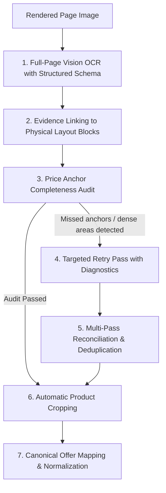

# Technical Brief: Promotional Leaflet OCR & Offer Extraction Mechanism

### 1. Objective
Extract all promotional product offers from high-density, multi-layout supermarket leaflet pages (PDF/images) and convert them into structured digital records. Extracted data includes:
- Bilingual product titles (Arabic & English) and brand names.
- Pricing intelligence (current promo price vs. crossed-out original price, multi-buy/bundle prices, currency).
- Package sizes, units (kg, L, pack, pcs), and promotional mechanics/conditions.
- Individual cropped product images corresponding to each offer.

---

### 2. Architecture & Pipeline Flow
The system operates on a **"Page-First"** vision pipeline with self-auditing completeness:

#### Step 1: Full-Page Vision OCR with Strict JSON Schema
- The rendered page image is optimized (scaled to a maximum of 2500px via Sharp) and uploaded to the AI vision endpoint.
- **Model:** Mistral Document OCR (`mistral-ocr-latest`) using structured document annotations.
- **Enforcement:** A strict JSON schema (via Zod) forces the model to return valid structured arrays of offers containing titles, price candidates, bounding-region hints, and exact visible evidence text.

#### Step 2: Physical Evidence Linking
- The raw OCR model returns two things:
  1. Semantic offer objects (what it understood).
  2. Physical layout blocks (exact text tokens with $(x, y, w, h)$ bounding boxes).
- An internal matching service uses tokenization, price extraction, and Levenshtein distance string matching to connect each semantic field (e.g., price `14.95`, title `Nadec Milk`) to physical pixel coordinates on the page.

#### Step 3: Completeness Audit (Self-Verification)
- Supermarket pages are audited by counting independent visible price anchors.
- The system checks if every visible price token on the page is accounted for by an extracted offer.
- If prices are unlinked or dense regions are flagged as suspicious, the system flags the page as incomplete.

#### Step 4: Targeted Semantic Retry (Pass 2)
- If the completeness check fails, a targeted second prompt is generated containing specific diagnostic hints (e.g., *"Pass 1 missed 3 price anchors in the bottom-right corner; re-examine those coordinates"*).
- The model re-evaluates the page focusing specifically on the missed regions.

#### Step 5: Multi-Pass Reconciliation & Deduplication
- Results from Pass 1 and Pass 2 are merged.
- Duplicates are resolved based on price anchor matches and spatial bounding box overlap (IoU).

#### Step 6: Automated Product Image Cropping
- Using the linked bounding boxes from the physical text and surrounding product boundaries, individual product images are automatically cropped and saved as WebP/JPEG assets.

#### Step 7: Canonical Offer Mapping
- Offers are normalized into a standardized schema (`CanonicalOffer`), validated against business rules, and enriched with trusted leaflet metadata (supermarket chain, validity dates, city).

---

### 3. Current Technology Stack
- **AI / Vision Provider:** Mistral AI (`mistral-ocr-latest` for document layout & annotation; `pixtral-large-latest` for fallback item extraction).
- **Backend Runtime:** Node.js / Electron (TypeScript).
- **Image Processing:** [Sharp](https://sharp.pixelplumbing.com/) (image downscaling, slicing, bounding-box cropping).
- **Validation:** Zod schemas enforcing strict output structure.
- **Infrastructure:** Central priority queue managing rate limits, 429 exponential backoffs, and concurrency tokens.

---

### 4. Key Questions & Areas for Evaluation / Improvement
When reviewing this system, we are looking for recommendations on:
1. **Model & Provider Evaluation:** Can we achieve higher accuracy, faster extraction, or lower cost by switching to or supporting alternatives (e.g., Google Gemini 2.0 Flash/Pro, OpenAI GPT-4o, Anthropic Claude 3.5 Sonnet, or specialized local OCR like PaddleOCR / Docling / Florence-2)?
2. **Native 2D Grounding vs. Heuristic Linking:** Can we replace our text-based Levenshtein evidence linker with models that return exact pixel bounding boxes directly for each product?
3. **Single-Pass vs. Multi-Pass Trade-offs:** Can prompt optimization or vision model fine-tuning eliminate the need for the two-pass retry mechanism while maintaining high recall on small side offers?
4. **Latency & Throughput:** How can we best parallelize and optimize leaflet processing for 40–80 page catalogs?