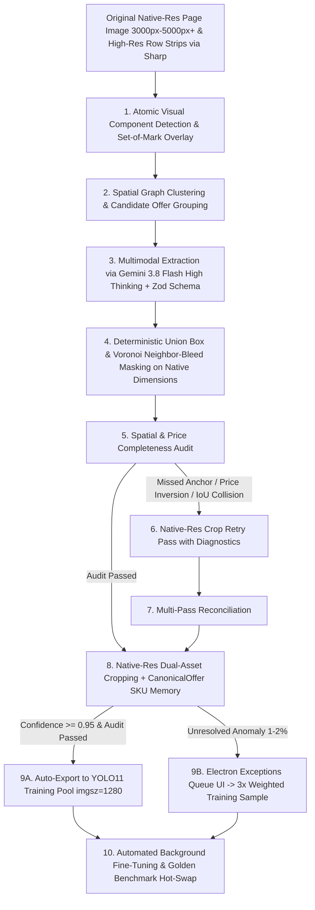

# Technical Specification: Promotional Leaflet Spatial & Vision Extraction Pipeline (rev1)

### 1. Objective & Design Priorities
Extract 100% of promotional grocery offers from multi-layout, borderless, high-density supermarket leaflet pages (PDF/images) into structured records and native-resolution cropped assets.

**Strict Engineering Priorities:**
1. **Priority #1 — Maximum Accuracy (Target: 99%+ Data & Crop Accuracy):** Zero coordinate hallucinations, zero inverted prices, exact Arabic/English transcription without translation, native-resolution badge legibility, and tight invisible-boundary reconstruction across variable column layouts.
2. **Priority #2 — Cost Efficiency (Target: ~$0.38–$1.65 / 1,000 pages):** Leverage local atomic component detection, native-resolution row/quadrant zooming, and asynchronous Flex/Batch inference on `gemini-3.8-flash` (High Thinking).
3. **Priority #3 — Continuous Self-Improvement (Active Learning):** Automatically improve spatial detection and SKU normalization with every leaflet processed via a Confidence-Gated Teacher-Student distillation loop and a Golden Benchmark validation gate.

---

### 2. Architecture & Pipeline Flow (rev1)
The `rev1` system replaces the `rev0` text-first heuristic Levenshtein linker with a **"Native-Resolution Component-First Spatial Graph + Active Learning"** pipeline:

#### Stage 1: Dual-Stream Native Resolution & High-Res Row/Quadrant Slicing (`Sharp`)

* **Removal of the `rev0` 2500px Cap:** Unlike `rev0` (which downscaled all pages to a maximum of 2500px), `rev1` preserves the **100% original native-resolution image buffer (`nativeWidth x nativeHeight`, even when `4000px–6000px+`)** in memory/disk.
* **Why Native Resolution Is Preserved:**
1. **Crisp Final Crops:** All Stage 8 product and offer crops (`offer_card_crop.webp` and `product_thumb_crop.webp`) are sliced directly from the untouched original high-resolution buffer using denormalized `[0–1000]` coordinates (`Math.round((coord / 1000) * nativeDimension)`).
2. **High-Res Row/Quadrant Strips for Small Badges:** When a leaflet switches between 2-column, 3-column, and 4-column rows on the same page, `Sharp` slices overlapping horizontal row bands (or 2x2 quadrants with 15% overlap) directly from the untouched native-resolution source so tiny badges (`400g`, `250g`, `8x135g`, `18-99`) are read at full optical clarity without downsampling blur.

#### Stage 2: Atomic Visual Component Detection & Set-of-Mark (SoM) Anchoring

Instead of attempting to detect invisible "whole offer boxes" directly, the pipeline detects **5 visible atomic component classes** that always possess hard visual edges:

1. `product_graphic`: The physical photo/cutout of the grocery item(s) (including multi-brand variants grouped with an `"Or / أو"` badge).
2. `promo_price`: The primary promotional price badge (e.g., giant red numbers `5`, `10`, `15` or gold loyalty boxes `35`, `18-99` anchored by the Saudi Riyal `ريال` symbol).
3. `original_price`: The smaller secondary/crossed-out price box (e.g., green rectangles `11.25`, `15.99`, `37.50`, `27.15`).
4. `unit_and_size_badge`: Circular unit badges (`Each / للحبة`, `Per Pack / للربطة`, `Per Plate / للطبق`, `Per Box / للكرتون`, `Kg / كيلو`) and rectangular weight/size tags (`270g`, `8x135g`, `30PCS`, `500 gram`) regardless of whether they sit at the top-left or bottom-right.
5. `title_block`: The localized bilingual Arabic and English product title text block.

* **Execution Modes:**
* **Mode A (Cold Start / Teacher Mode):** Uses `gemini-3.8-flash` (`thinkingLevel: "HIGH"`) native 2D spatial grounding (`box_2d` `[ymin, xmin, ymax, xmax]` normalized `0–1000`) to return component coordinates directly inside the structured schema.
* **Mode B (Trained Local Detector + Set-of-Mark):** Runs local `YOLOv11s` (`onnxruntime-node` at `imgsz=1280`) to detect atomic components in `<25ms`, overlays numbered Set-of-Mark (`#1..#N`) badges onto a working copy of the image, and constructs a directed spatial proximity graph from each `promo_price` anchor to candidate components.

#### Stage 3: Multimodal Semantic Extraction (`gemini-3.8-flash` High Thinking)

* **Model & Configuration:** Google GenAI SDK (`@google/genai`) calling `gemini-3.8-flash` with `thinkingConfig: { thinkingLevel: "HIGH" }`, `responseMimeType: "application/json"`, and a strict Zod `responseSchema`. Supports Batch/Flex execution for a 50% token discount.
* **GCC / Saudi Supermarket Domain Rules Enforced in Prompt & Schema:**
1. **Zero Translation Rule:** Extract exact printed Arabic and English text verbatim. Never translate English into standard Arabic (e.g., preserve printed `حبحب` on Watermelon rather than translating to `بطيخ`).
2. **Hyphenated & Superscript Price Normalization:** Convert hyphenated fractional prices (`18-99`, `16-99`, `10-99`, `6-99`) and superscript halalas (`14 95`) into standard floats (`18.99`, `16.99`, `10.99`, `6.99`, `14.95`).
3. **Strict Price Hierarchy:** `promo_price` is always the largest primary number with the currency symbol (`5`, `10`, `15` or gold box `30`, `50`); `original_price` is the smaller box (`11.25`, `15.99`, `59.99`). If no secondary price badge exists (e.g., fresh Watermelon or Red Onion, or Almond Salts), `original_price` MUST be `null`.
4. **Hero & Promotional Banner Rejection:** Ignore standalone decorative numbers or marketing banners that lack an associated product graphic and unit badge (e.g., the giant 3D `5 10 15` football stadium header on Page 1 or the vertical gold `اكتساب / Iktissab` QR code banner on Page 4).
5. **Page-Level Loyalty & Validity Extraction:** Detect loyalty headers (`اكتساب / Iktissab`) and set `loyalty_program: "Iktissab"` and `promo_condition: "LOYALTY_CARD_REQUIRED"` on affected offers. Extract page validity dates (`2026-06-10` to `2026-06-16`).

#### Stage 4: Deterministic Union Bounding Box & Voronoi Masking (Replaces `rev0` Step 2 Linker)

* The fragile Levenshtein text-evidence linker from `rev0` is completely removed.
* For each offer, the exact outer crop boundary (`union_box_px`) is computed deterministically from its linked atomic component boxes mapped to the **native image width and height**:

$$\text{UnionBox} = [\min(x_{\text{comp}}), \min(y_{\text{comp}}), \max(x_{\text{comp}}), \max(y_{\text{comp}})]$$

* **Dynamic Layout Resilience:** Whether the size badge is at the top-left (Page 1) or moved to the bottom-right above the price (Page 4), the union formula automatically adapts—using `product_graphic_box` as `ymin` when top badges are absent.
* **Neighbor-Bleed Clamping:** If two adjacent union boxes overlap by `>2%` on densely packed borderless layouts, the shared boundary is clamped along the Voronoi midpoint between their respective component edges so neither crop slices into a neighbor's price tag or product graphic.

#### Stage 5: Spatial & Price Completeness Audit (Self-Verification)

Every extracted page undergoes a deterministic TypeScript audit before completion:

1. **Anchor Coverage Check:** Every non-banner `promo_price` component detected on the page must be assigned to exactly one extracted offer.
2. **Price Sanity Check:** If `original_price !== null`, assert `promo_price < original_price`. (Flags any price inversion immediately).
3. **Spatial Integrity Check:** Assert `width > 40px`, `height > 40px`, and Intersection-over-Union (`IoU`) between any two distinct offer union boxes is `< 0.15`.
4. **Completeness Check:** Assert `arabic_title` or `english_title` is non-empty, `promo_price > 0`, and `size_value` / `unit_type` is populated.

#### Stage 6 & 7: Native-Resolution Diagnostic Retry & Reconciliation

* If Stage 5 flags a missed price anchor, an inverted price, or a bounding-box collision, `Sharp` crops the specific suspect region directly from the **full native-resolution source image** with `+15%` context padding.
* A targeted retry pass is executed with `gemini-3.8-flash` (`thinkingLevel: "HIGH"`) (or escalated to `gemini-4-argon` if configured) containing the exact diagnostic failure reason.
* Reconciled offers replace the failed region and re-run Stage 5 verification.

#### Stage 8: Native-Resolution Dual-Asset Cropping & `CanonicalOffer` SKU Memory

* **Dual Image Crops via `Sharp` (Sliced from Untouched Native Resolution):**
1. `offer_card_crop.webp`: The full `union_box_px` (plus `1.5%` clamped safety padding) showing the product, price tags, and unit badges for user proof-of-offer.
2. `product_thumb_crop.webp`: Cropped strictly to `components.product_graphic_box` at full native resolution for crisp e-commerce product thumbnails.

* **Canonical SKU Memory Auto-Correction:** When mapping to `CanonicalOffer`, the system queries existing high-trust historical SKUs by normalized `brand + arabic_title + english_title`. If a known SKU has a verified package size (e.g., `KDD Tomato Paste 8x135g`) and a noisy scan outputs a 1-character OCR typo (`3x135g`), the SKU memory flags and auto-corrects the unit/size against the canonical catalog.

#### Stage 9 & 10: Confidence-Gated Active Learning & Electron Exceptions Queue

* **Automated Training Pool (95%–98% of offers):** Any page where all offers pass Stage 5 Audit with `confidence >= 0.95` and zero unresolved retries is marked `"gold_verified"`. The pipeline automatically exports the normalized YOLO label file (`training_data/dataset/labels/train/<page_id>.txt`) across the 5 atomic classes (`product_graphic`, `promo_price`, `original_price`, `unit_and_size_badge`, `title_block`).
* **Human-in-the-Loop Exceptions Queue (1%–2% of offers):** Offers that still fail audit after Stage 6 retry are routed to an `ExceptionsQueue` store for a 10-second review in the Electron UI. Human-corrected boxes/fields are exported to the training pool with a **`3x` oversampling weight**.
* **Automated Fine-Tuning & Golden Benchmark Gate:** Whenever `verified_new_pages >= 200`, a background training job fine-tunes `YOLOv11s` at `imgsz=1280` (to preserve tiny 4-column badges), exports the updated `.onnx` model, and evaluates it against the **Golden Benchmark Set** (including `page1_small.jpg` and `page4_small.jpg`). The new `.onnx` weights are hot-swapped into production if and only if benchmark mAP and offer recall meet or exceed the active model.

---

### 3. Technology Stack (rev1)

* **Primary Vision & Grounding Model:** Google Gemini (`@google/genai` SDK) — `gemini-3.8-flash` with `thinkingConfig: { thinkingLevel: "HIGH" }` (Standard & Flex/Batch modes). Optional escalation to `gemini-4-argon`.
* **Local Component Detector & Active Learning:** `onnxruntime-node` for fast local `YOLOv11s` (`imgsz=1280`) inference + Python/CLI `ultralytics` background fine-tuning worker.
* **Backend Runtime:** Node.js / Electron (TypeScript).
* **Image Processing:** `Sharp` (Untouched native-resolution master buffer preservation, high-res row/quadrant strip slicing, Set-of-Mark SVG overlay compositing, native-res dual bounding-box cropping).
* **Validation & Contracts:** `Zod` schemas converted to JSON Schema for Gemini `responseSchema` enforcement plus runtime semantic/spatial validation.